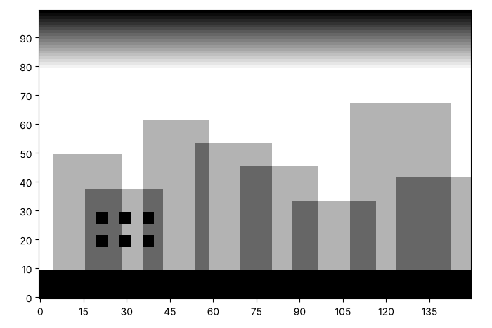
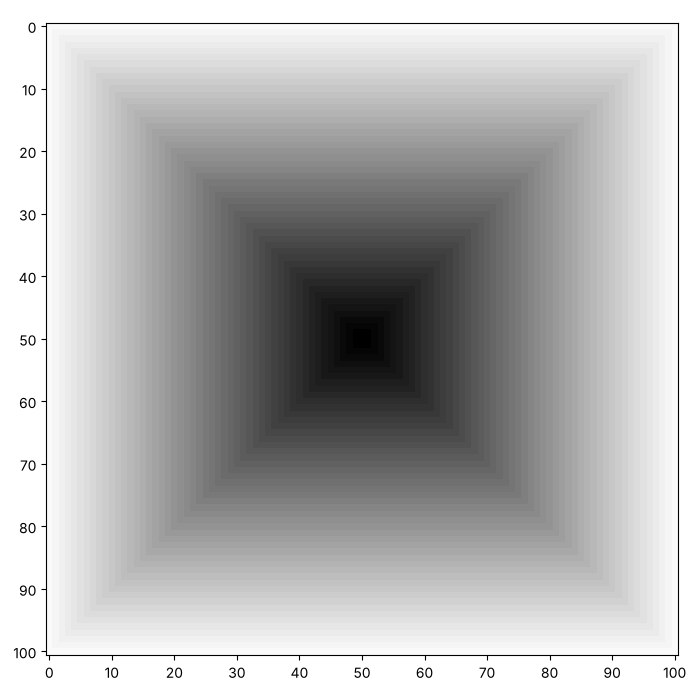
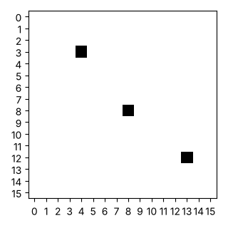
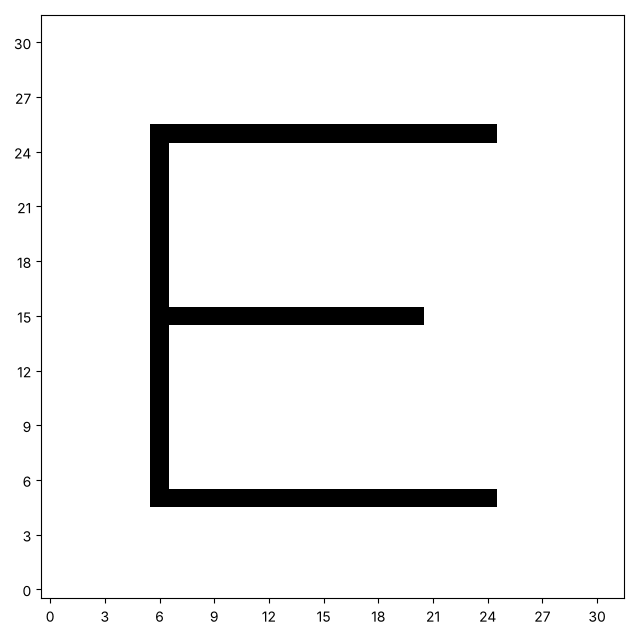

# A canvas of numbers: painting points and lines

Every picture on a screen is a grid of numbers. In this series we build
a small library of functions that paint pictures onto such a grid, one
idea at a time. Here are three pictures made with a library like the one
you will write. Yours will look different, and that is the point.






This page makes the first four functions of your toolkit: a blank
canvas, a point, and two kinds of line. Every later function is built
from them.

## A letter in numbers

Here is a small grid of numbers. Run the cell. Can you see a letter in
it?

```python exec
id: a-letter-in-numbers-1
letter = [
    [1, 1, 1, 1, 1],
    [1, 0, 0, 0, 0],
    [1, 1, 1, 1, 0],
    [1, 0, 0, 0, 0],
    [1, 0, 0, 0, 0],
    [1, 0, 0, 0, 0],
    [1, 0, 0, 0, 0],
]
for row in letter:
    print(row)
```

Each number is the amount of *ink* on one square of the paper. A 0 means
no ink, so the square stays white. A 1 means one layer of ink. The whole
grid is a *canvas*: a list of rows, where each row is a list of numbers.
`canvas[row][column]` is the square in that row and that column. Column 0
is the left column. Where row 0 sits is a choice, and we make it in a
moment.

The next cell teaches Python to draw a canvas. Run it once. It defines a
function called `show_picture`, and the comments say what each part does.

```python exec
id: a-letter-in-numbers-2
toolkit: yes
def show_picture(canvas, darkest=1, origin="bottom"):
    """Draw a canvas. A square with 0 ink is white. A square with `darkest` ink or more is black.
    origin="bottom" puts row 0 at the bottom of the picture. origin="top" puts it at the top."""
    import matplotlib.pyplot as plt

    rows = len(canvas)
    columns = len(canvas[0])
    longest = max(rows, columns)
    size = min(7, max(3, longest / 5))
    # Scale the figure to the canvas so that every square stays square.
    plt.figure(figsize=(size * columns / longest, size * rows / longest))
    # "gray_r" draws 0 as white. vmin and vmax set which numbers are white and black.
    plt.imshow(canvas, cmap="gray_r", vmin=0, vmax=darkest, interpolation="nearest",
               origin="lower" if origin == "bottom" else "upper")
    # About ten labels along each edge, so a big canvas stays readable.
    plt.xticks(range(0, columns, max(1, columns // 10)))
    plt.yticks(range(0, rows, max(1, rows // 10)))
```

Here is what the cell does. `matplotlib` is a library that draws
pictures. Its `imshow` function takes a list of rows and colours one
square for each number. The colour scale `gray_r` is a scale of greys that
starts at white. The numbers `vmin` and `vmax` say which number is drawn
white and which is drawn black, and `show_picture` sets them to 0 and
`darkest`. A number between the two is a grey. A real picture file keeps
each square as a whole number from 0 to 255, so `darkest` can be as high
as 255. The input `origin` says which end of the picture row 0 sits
at. Run the cell below. It draws the same letter twice.

```python exec
id: a-letter-in-numbers-3
show_picture(letter, origin="top")
show_picture(letter, origin="bottom")
```

```predict
type: choice

Both pictures show the same list. How will the second picture look?

- The letter F, the right way up
  - The list is the same, so the picture is the same.
- The letter F, upside down
  - With origin="bottom", the first row of the list is at the bottom.
```

## Where is row 0?

A page counts its rows from the top, so a list written line by line is
the right way up with `origin="top"`. A graph counts from the bottom, so
a row number becomes a height, and `origin="bottom"` is the way to read
it. Either choice works, and you can choose. In this series we count from
the bottom, because the lines on the last page use $x$ and $y$ the way a
graph does. Every picture in the series is drawn that way.

To change your choice for good, edit `origin="bottom"` in the `def` line
of the cell above to `origin="top"`, and run the cell again. To change it
for one picture, give `origin` in the call. If you choose the top, your
pictures will come out upside down next to ours, and `paint_xy` on the
last page is the one function that needs to know.

Now change one of the 0s in the second row of `letter` to a 3, and run
the cells again. What do you think the 3 will look like? Then try
`show_picture(letter, darkest=3)`. The `darkest` number says how much ink
counts as black. With the default of 1, a square with 3 ink looks the
same as a square with 1.

## Lists that share, and lists that copy

A canvas is a list of rows, and each row is a list of numbers. Before we
write the function that makes one, we need to find out something about
lists that surprises almost everyone: what happens when you copy one, and
what happens when you multiply one. The next few cells are small
experiments. Predict what each one prints before you run it.

### Two names, one list

```python exec
id: lists-share-1
a = [0, 0, 0]
b = a
b[0] = 1
print(a)
print(a is b)
```

```predict
type: choice

What will `print(a)` show?

- [0, 0, 0]
  - A change to `b` leaves `a` alone, as if `b = a` made a copy. There
    is [a closer look at this](tutorial:two-names-one-list).
- [1, 0, 0]
  - There is one list with two names, so a change through `b` shows
    through `a`.
```

The line `b = a` does not make a second list. It gives the same list a
second name, so a change made through `b` shows up through `a`. We say
that `a` and `b` are *references* to one list. The word `is` asks
whether two names point at the very same list.

```
a ──┐
    ├──▶ [1, 0, 0]
b ──┘
```

### A real copy

Python has several ways to make a new list with the same numbers. Here
are three. Which of them would you remember most easily?

```python exec
id: lists-copy-1
a = [0, 0, 0]
c = a[:]            # a slice of the whole list is a new list
d = list(a)         # list() builds a new list from the old one
e = a.copy()        # a list knows how to copy itself
c[0] = 1
print(a, c)
print(a is c, a is d, a is e)
```

```predict
type: choice

What do the three `is` tests print?

- True True True
  - Each line would then give the same list a second name. There is
    [a closer look at this](tutorial:two-names-one-list).
- False False False
  - Each of the three builds a new list, so none of them is `a`.
```

### Multiplying a list

A quick way to make a row of zeros is `[0] * 3`. What about a grid with
two rows? Predict first.

```python exec
id: lists-multiply-1
row = [0, 0, 0]
grid = [row] * 2
grid[0][0] = 1
print(grid)
print(grid[0] is grid[1])
```

```predict
type: number

Only one square got a 1. How many 1s will the cell print in total?
```

Multiplying a list repeats the *reference*, not the list. The grid has
two places for a row, and both point at one row.

```
grid ──▶ [ ●, ● ]        every row is the same list
           └──┴──▶ [1, 0, 0]
```

Why is `[0] * 3` safe, then? A number cannot be changed in place, only
replaced by another number, so sharing a `0` does no harm. A list can be
changed in place, so sharing a list does. The page
[Two names, one list](tutorial:two-names-one-list) looks at this idea
more slowly.

### Your turn: two separate rows

Can you build a grid of 2 rows and 3 columns in which every row is its
own list? Start from an empty list, go round a loop, and put a *new* row
on the end each time. When it works, a 1 appears in the first row only,
and the last line prints `False`.

```python exec
id: separate-rows-1
grid = []
for row_number in range(2):
    # what goes here, so that every row is a new list?
    pass
grid[0][0] = 1
print(grid)                  # a 1 in the first row only
print(grid[0] is grid[1])    # False
```

```solution
grid = []
for row_number in range(2):
    grid.append([0] * 3)       # a new list every time round the loop
grid[0][0] = 1
print(grid)
print(grid[0] is grid[1])
---
Here is one answer. Yours may be different and work too. `[0] * 3` runs
again on every trip round the loop, so every row is a new list. A
shorter way to write the same loop is
`grid = [[0] * 3 for row_number in range(2)]`, where the part before
`for` runs again for every row. Could `row[:]` or `list(row)` help in a
loop that starts from a row you already have?
```

### Functions get the same list

When you give a list to a function, the function does not get a copy. It
gets the same list, under a new name.

```python exec
id: functions-share-1
def add_one(numbers):
    numbers[0] = numbers[0] + 1

scores = [5, 5, 5]
add_one(scores)
print(scores)
```

```predict
type: choice

What will the cell print?

- [5, 5, 5]
  - The function returned nothing, so nothing changed. There is
    [a closer look at this](tutorial:two-names-one-list).
- [6, 5, 5]
  - `numbers` is another name for the list `scores`.
```

The function returned nothing, and `scores` still changed. That is why
`paint_point`, which you write below, does not need to return anything:
it changes the canvas it is given.

Sometimes you want the old list to stay as it was. Then the function
makes a copy, changes the copy and returns it. Can you finish this one?
What does the caller see in `scores` afterwards?

```python exec
id: add-one-safely
expect: (lambda s: add_one_safely(s) == [6, 5, 5] and s == [5, 5, 5])([5, 5, 5])
def add_one_safely(numbers):
    """A new list like numbers, with 1 added to the first item. The list that was passed in stays as it was."""
    # Make a copy first, change the copy, and give the copy back.
    ...
```

```solution
def add_one_safely(numbers):
    """A new list like numbers, with 1 added to the first item. The list that was passed in stays as it was."""
    result = numbers[:]
    result[0] = result[0] + 1
    return result
---
Here is one answer. Yours may be different and work too. `numbers[:]`
is a new list, so the change to its first item cannot reach the list the
caller holds.
```

## A blank canvas

Here is the function. It has a name, two inputs and an empty body. The
comments are questions for you. Answer them in your own words first, and
then in code.

```python exec
id: make-canvas
toolkit: yes
expect: make_canvas(2, 3) == [[0, 0, 0], [0, 0, 0]] and (lambda c: c[0] is not c[1])(make_canvas(2, 2))
def make_canvas(rows, columns):
    """A canvas of this size with no ink on any square."""
    # Inputs: what type is rows? What type is columns?
    # Returns: what type should come back? What does it look like when it is empty?
    # A canvas is a list of rows, and every row is a list of numbers.
    # Each row must be its own list. What did the experiments show about [row] * 2?
    # Hint: start with an empty list, loop once for every row, and append a new row each time.
    ...
```

```python toolkit-reference
for: make-canvas
def make_canvas(rows, columns):
    """A canvas of this size with no ink on any square."""
    canvas = []
    for row in range(rows):
        canvas.append([0] * columns)
    return canvas
```

```hint
after: 3 errors
Which line of the error is yours? What did you expect
`make_canvas(2, 3)` to return, and what did it return?
```

```hint
after: 6 errors
title: some steps
1. Start with an empty list called `canvas`.
2. Go round a loop once for each row. Inside it, add a new list of
   `columns` zeros to `canvas`.
3. Return `canvas` after the loop.

**Think about:** which part of `[row] * 2` made every row the same
list, and why a loop does not.
```

```solution
def make_canvas(rows, columns):
    """A canvas of this size with no ink on any square."""
    canvas = []
    for row in range(rows):
        canvas.append([0] * columns)
    return canvas
---
Here is one answer. Yours may be different and work too. `[0] * columns`
runs again on every trip round the loop, so every row is a new list.
```

Let's make a small canvas and draw it. The picture is all white.

```python exec
id: a-blank-canvas-1
canvas = make_canvas(5, 8)
show_picture(canvas)
print(len(canvas), "rows of", len(canvas[0]))
```

## A point

How would you put ink on one square?

```python exec
id: paint-point
toolkit: yes
expect: (lambda c: (paint_point(c, 1, 2), c[1][2] == 1 and sum(map(sum, c)) == 1)[1])(make_canvas(3, 4))
def paint_point(canvas, row, column):
    """Add 1 ink to the square at this row and column."""
    # Inputs: what type is each of the three inputs?
    # Returns: does this function need to return anything? Think about `add_one`.
    ...
```

```python toolkit-reference
for: paint-point
def paint_point(canvas, row, column):
    """Add 1 ink to the square at this row and column."""
    canvas[row][column] = canvas[row][column] + 1
```

```solution
def paint_point(canvas, row, column):
    """Add 1 ink to the square at this row and column."""
    canvas[row][column] = canvas[row][column] + 1
---
Here is one answer. Yours may be different and work too. It changes the
list the canvas holds, so the caller's canvas changes and nothing needs
to be returned.
```

Can you make this picture? Read the numbers along its edges to find the
rows and columns.



```python exec
id: paint-a-point-1
# Your picture of three points
```

```solution
{{include: setup/painting/toolkit.py}}

canvas = make_canvas(16, 16)
paint_point(canvas, 3, 4)
paint_point(canvas, 8, 8)
paint_point(canvas, 12, 13)
show_picture(canvas)
---
Here is one answer. Yours may be different and work too.
```

What happens when we paint one square twice?

```python exec
id: paint-a-point-2
canvas = make_canvas(5, 5)
paint_point(canvas, 2, 3)
paint_point(canvas, 2, 3)
print(canvas[2][3])
show_picture(canvas)
```

```predict
type: number

What will the cell print?
```

The square holds 2 ink, and the picture looks the same as with 1 ink,
because the default `darkest` is 1. Run `show_picture(canvas, darkest=2)`
in a new cell. Which square is the darkest now?

Try your own canvas. Paint some squares on a size you choose. What
happens when you paint a square that is not on the canvas?

## Lines

How would you draw a horizontal line? A vertical line? You already have
a function that paints one square.

```python exec
id: lines-1
toolkit: yes
expect: (lambda c: (paint_horizontal(c, 1, 1, 3), c[1] == [0, 1, 1, 1, 0])[1])(make_canvas(3, 5))
def paint_horizontal(canvas, row, start_column, end_column):
    """Paint a run of squares along one row, from start_column to end_column."""
    # Decide: does the run include the end column? Keep your choice in every function.
    # Which earlier function paints one square? What needs to repeat?
    ...
```

```python exec
id: lines-2
toolkit: yes
expect: (lambda c: (paint_vertical(c, 2, 0, 2), [r[2] for r in c] == [1, 1, 1])[1])(make_canvas(3, 4))
def paint_vertical(canvas, column, start_row, end_row):
    """Paint a run of squares down one column, from start_row to end_row."""
    # How is this like paint_horizontal? What is different?
    ...
```

```python toolkit-reference
for: lines-1
def paint_horizontal(canvas, row, start_column, end_column):
    """Paint a run of squares along one row, from start_column to end_column."""
    for column in range(start_column, end_column + 1):
        paint_point(canvas, row, column)
```

```python toolkit-reference
for: lines-2
def paint_vertical(canvas, column, start_row, end_row):
    """Paint a run of squares down one column, from start_row to end_row."""
    for row in range(start_row, end_row + 1):
        paint_point(canvas, row, column)
```

```hint
for: lines-1
after: 3 errors
`range(2, 5)` gives 2, 3 and 4. Which squares does your loop paint when
`start_column` is 1 and `end_column` is 3? Does the last square get its
ink?
```

```solution
for: lines-1
def paint_horizontal(canvas, row, start_column, end_column):
    """Paint a run of squares along one row, from start_column to end_column."""
    for column in range(start_column, end_column + 1):
        paint_point(canvas, row, column)
---
Here is one answer. Yours may be different and work too. A `range` stops
one before its end value, so `end_column + 1` includes the last square.
```

```solution
for: lines-2
def paint_vertical(canvas, column, start_row, end_row):
    """Paint a run of squares down one column, from start_row to end_row."""
    for row in range(start_row, end_row + 1):
        paint_point(canvas, row, column)
---
Here is one answer. Yours may be different and work too. It is the same
loop as `paint_horizontal`, with the row changing instead of the column.
```

## Your turn: a letter

Can you make this picture? It is a canvas of 32 by 32. Where do two of
its lines share a square? Try `darkest=2` to find out.



```python exec
id: your-turn-1
# Your letter E
```

```hint
Four lines make the whole E. Which of them are horizontal and which are
vertical? What do the numbers along the edge tell you about where each
one starts and ends?
```

```solution
{{include: setup/painting/toolkit.py}}

canvas = make_canvas(32, 32)
paint_vertical(canvas, 6, 5, 25)
paint_horizontal(canvas, 5, 6, 24)
paint_horizontal(canvas, 15, 6, 20)
paint_horizontal(canvas, 25, 6, 24)
show_picture(canvas)
---
Here is one answer. Yours may be different and work too. The corners of
the E are painted twice, so `darkest=2` shows them as black.
```

Now try your own. Make a canvas that is wider than it is tall. Paint the
whole bottom row and the whole last column. What happens when the start
of a line is bigger than its end?

## Looking back

Painting the same square twice made no visible difference until we
changed `darkest`. What does that tell you about where the ink is
stored, and what the picture shows?

A challenge: paint the first letter of your name on a canvas, using only
points and lines. Which letters are easy, and which are hard?

```python challenge
# Paint the first letter of your name.
# Your toolkit has make_canvas, paint_point, paint_horizontal,
# paint_vertical and show_picture.
```

The next page, [Rectangles and grids](tutorial:rectangles-and-grids),
fills whole regions with ink, using the functions you wrote here.

## Where to read more

Wikipedia. *Raster graphics.*
<https://en.wikipedia.org/wiki/Raster_graphics>. The name for pictures
made of a grid of squares, and how screens and printers use them.

Downey, A. B. (2015). *Think Python: How to Think Like a Computer
Scientist* (2nd ed.). Green Tea Press.
<https://greenteapress.com/wp/think-python-2e/>. Chapter 10 covers the
lists that every canvas on this page is made of.
