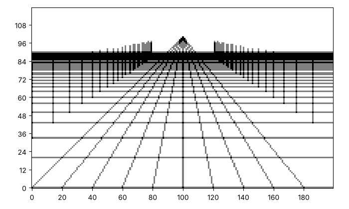
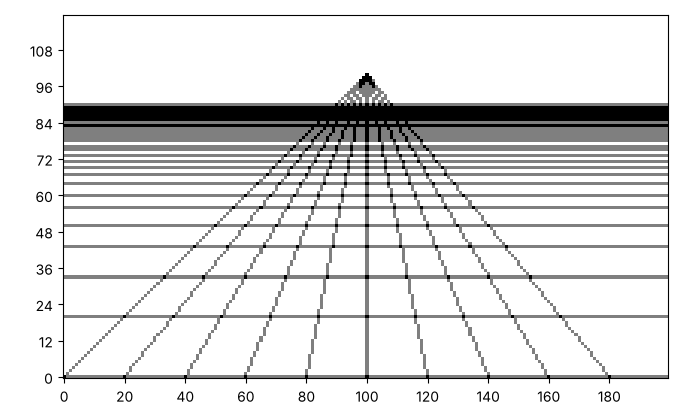

# A floor in perspective: tiles that run away

Picture a floor of square tiles that runs away from you. The lines that
run away all meet at one point on the horizon, the *vanishing point*.
The lines across the floor seem to bunch together as they get further
away. Here is a floor, with a row of posts on each side. Yours will look
different, and that is the point.



This page makes one function, `paint_floor`, and then adds posts that
use the same idea.

## Bunching towards the horizon

A point on the floor that is `distance` steps away lands `400 /
distance` rows below the horizon. Before you paint, run the cell. It
prints `round(400 / distance)` for distances 4 to 12. What do you notice
about the gaps?

```python exec
id: a-floor-probe
for distance in range(4, 13):
    print(distance, round(400 / distance))
```

```predict
type: number

What is the last number the cell prints, for a distance of 12?
```

Equal steps in the world give rows that bunch towards the horizon. A
distance of 8 is twice as far as a distance of 4, so it lands half as
far below the horizon.

## A floor

The lines along the floor run from the bottom edge to the vanishing
point. The rows across the floor are at distances 4, 5, 6 and so on.
Which function paints a line between two points? Where does a row at
this distance land?

```python exec
id: a-floor-1
toolkit: yes
expect: (lambda c: (paint_floor(c, 100, 100, 20), all(v > 0 for v in c[0]) and all(v > 0 for v in c[50]) and c[99][0] == 0)[1])(make_canvas(120, 200))
def paint_floor(canvas, horizon, vanishing_x, spacing):
    """Paint a floor in perspective: lines from the bottom edge to the vanishing point (vanishing_x, horizon), and a row of tiles at each distance 4, 5, 6 and so on."""
    # Which function paints a line between two points?
    # Where does a row at this distance land? What happens to the gaps as the distance grows?
    ...
```

```python toolkit-reference
for: a-floor-1
def paint_floor(canvas, horizon, vanishing_x, spacing):
    columns = len(canvas[0])
    for x in range(0, columns, spacing):
        # Lines that run away from us all point at the vanishing point.
        paint_segment(canvas, x, 0, vanishing_x, horizon)
    for distance in range(4, 40):
        # Equal steps in distance land closer and closer together on the picture.
        y = horizon - round(400 / distance)
        paint_horizontal(canvas, y, 0, columns - 1)
```

```hint
after: 3 errors
Try a canvas of 120 by 200 with the horizon at row 100 and the vanishing
point at column 100. The row for distance 4 is `100 - round(400 / 4)`,
which is row 0. Is that row painted all the way across?
```

```solution
def paint_floor(canvas, horizon, vanishing_x, spacing):
    columns = len(canvas[0])
    for x in range(0, columns, spacing):
        # Lines that run away from us all point at the vanishing point.
        paint_segment(canvas, x, 0, vanishing_x, horizon)
    for distance in range(4, 40):
        # Equal steps in distance land closer and closer together on the picture.
        y = horizon - round(400 / distance)
        paint_horizontal(canvas, y, 0, columns - 1)
---
Here is one answer. Yours may be different and work too. The lines to
the vanishing point stay straight because they are segments. The rows
come from `horizon - round(400 / distance)`, so they bunch up towards
the horizon.
```

Can you make a floor of tiles that runs away to a point on the horizon, like this one? Put the horizon high on the canvas and the vanishing point in the middle.



```python exec
id: a-floor-2
# Your floor
```

```solution
# From earlier on this page, repeated so that this answer runs on its own
def paint_floor(canvas, horizon, vanishing_x, spacing):
    columns = len(canvas[0])
    for x in range(0, columns, spacing):
        # Lines that run away from us all point at the vanishing point.
        paint_segment(canvas, x, 0, vanishing_x, horizon)
    for distance in range(4, 40):
        # Equal steps in distance land closer and closer together on the picture.
        y = horizon - round(400 / distance)
        paint_horizontal(canvas, y, 0, columns - 1)

canvas = make_canvas(120, 200)
paint_floor(canvas, 100, 100, 20)
show_picture(canvas, darkest=2)
---
Here is one answer. Yours may be different and work too. The canvas is
120 by 200, the horizon is at row 100, the vanishing point is at column
100 and the lines along the floor start 20 squares apart.
```

## Posts along the floor

Everything on the floor shrinks the same way. A post at `distance`
stands on the floor at row `horizon - 400 / distance`, rises `300 /
distance` rows, and stands `600 / distance` squares to the left or right
of the vanishing point. Can you add posts to your floor?


```python exec
id: a-floor-3
# Your floor with posts
```

```solution
# From earlier on this page, repeated so that this answer runs on its own
def paint_floor(canvas, horizon, vanishing_x, spacing):
    columns = len(canvas[0])
    for x in range(0, columns, spacing):
        # Lines that run away from us all point at the vanishing point.
        paint_segment(canvas, x, 0, vanishing_x, horizon)
    for distance in range(4, 40):
        # Equal steps in distance land closer and closer together on the picture.
        y = horizon - round(400 / distance)
        paint_horizontal(canvas, y, 0, columns - 1)

canvas = make_canvas(120, 200)
paint_floor(canvas, 100, 100, 20)
for distance in range(4, 30):
    base_y = 100 - round(400 / distance)
    top_y = base_y + round(300 / distance)           # a post that is twice as far looks half as tall
    left_x = 100 - round(600 / distance)
    right_x = 100 + round(600 / distance)
    paint_segment(canvas, left_x, base_y, left_x, top_y)
    paint_segment(canvas, right_x, base_y, right_x, top_y)
show_picture(canvas, darkest=2)
---
Here is one answer. Yours may be different and work too. A post twice as
far away looks half as tall and half as far from the vanishing point, so
the same $1 / \text{distance}$ rule gives its height and its sideways
position. The vanishing point is the only place where the rows and the
posts meet.
```

What changes if the horizon sits lower, or the vanishing point moves to
the left? Which parts of the floor change?

## Looking back

A distance of 8 lands half as far from the horizon as a distance of 4.
What does that tell you about how a post looks when it is twice as far
away?

A challenge: paint a road that narrows towards the horizon, with a post
on each side at every distance.

```python challenge
# A road to the horizon. Your toolkit has paint_floor, paint_segment and paint_rectangle.
canvas = make_canvas(120, 200)
```

## Where to read more

Wikipedia. *Vanishing point.*
<https://en.wikipedia.org/wiki/Vanishing_point>. How artists since the
Renaissance have drawn lines that meet at the horizon.
