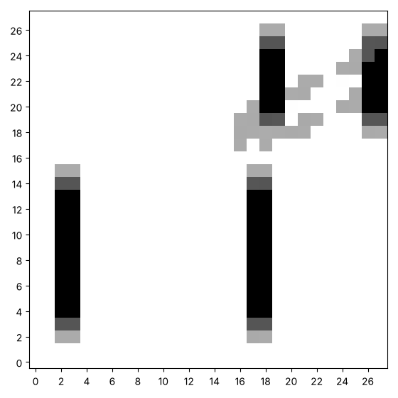
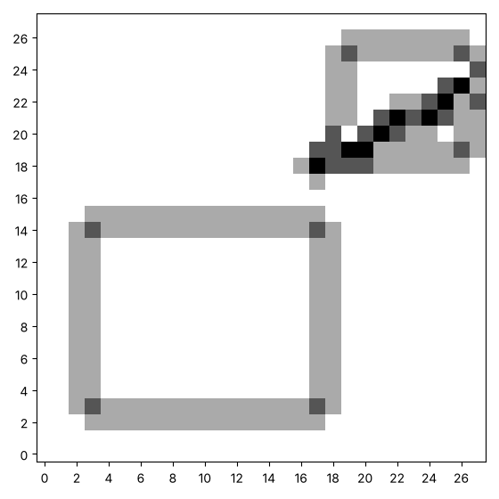

# A kernel that learns: nudging and following the gradient

Random guessing ignores what it learns. A better idea is to start with a
kernel and improve it a little at a time. Here is the up and down edge
picture again, made by a kernel that the computer found by itself. Yours
will look different, and that is the point.



This page has two ways to improve a kernel. The first nudges one weight
at a time. The second works out in one pass which way every weight
should move. That is the first step of how machines **learn**, and we do
it with nothing more than the lists, loops and functions you already
have.

## Nudging

For one weight, try making it a bit bigger and a bit smaller. Keep
whichever of the three, as it was, bigger or smaller, gives the lowest
score. Do that for every weight in turn, and you have one **round** of
learning.

How would you write a function that does one round? Careful with the
copy: if you change the kernel that was passed in, the old kernel is
lost.

```python exec
id: nudge-1
toolkit: yes
expect: (lambda p, k: (lambda t: (lambda new: new is not k and score(convolve(p, new), t) <= score(convolve(p, k), t) and k == [[0, 0, 0], [0, 0, 0], [0, 0, 0]])(nudge_kernel(p, t, k, 0.5)))(convolve(p, [[-1, 0, 1], [-1, 0, 1], [-1, 0, 1]])))([[0, 0, 1, 1], [0, 0, 1, 1], [0, 0, 1, 1], [0, 0, 1, 1]], [[0, 0, 0], [0, 0, 0], [0, 0, 0]])
def nudge_kernel(canvas, target, kernel, amount):
    """A new kernel. For every weight in turn, keep whichever of the weight as it is, with amount added, and with amount taken away gives the lowest score against target. The kernel that was passed in stays as it was."""
    # Returns: a new kernel. Why must it be a copy, with the old one left as it was?
    # In words: for every weight in turn, find the score with the weight as it is, with amount added,
    # and with amount taken away. Keep whichever gave the lowest score.
    # Which of your functions measures a kernel against a target?
    ...
```

```python toolkit-reference
for: nudge-1
def nudge_kernel(canvas, target, kernel, amount):
    new_kernel = [row[:] for row in kernel]              # a copy, so the old kernel stays as it was
    for row in range(len(kernel)):
        for column in range(len(kernel)):
            original = new_kernel[row][column]
            best_value = original
            best_score = score(convolve(canvas, new_kernel), target)
            for candidate in [original + amount, original - amount]:
                new_kernel[row][column] = candidate
                candidate_score = score(convolve(canvas, new_kernel), target)
                if candidate_score < best_score:
                    best_value = candidate
                    best_score = candidate_score
            new_kernel[row][column] = best_value          # keep whichever of the three was best
    return new_kernel
```

```hint
after: 3 errors
Make a copy of the kernel first, and change the copy. After the call, is
the kernel you passed in still all zeros? Which line changes the copy,
and which changes the original?
```

```solution
def nudge_kernel(canvas, target, kernel, amount):
    new_kernel = [row[:] for row in kernel]              # a copy, so the old kernel stays as it was
    for row in range(len(kernel)):
        for column in range(len(kernel)):
            original = new_kernel[row][column]
            best_value = original
            best_score = score(convolve(canvas, new_kernel), target)
            for candidate in [original + amount, original - amount]:
                new_kernel[row][column] = candidate
                candidate_score = score(convolve(canvas, new_kernel), target)
                if candidate_score < best_score:
                    best_value = candidate
                    best_score = candidate_score
            new_kernel[row][column] = best_value          # keep whichever of the three was best
    return new_kernel
---
Here is one answer. Yours may be different and work too. `[row[:] for
row in kernel]` is a new list for every row, so the old kernel stays as
it was. Each weight is tried three ways, and the best of the three is
kept.
```

Can you start from a kernel of zeros, and repeat the round 30 times with
an amount of 0.5, halving the amount every 10 rounds? Print the score
every 10 rounds, and then the kernel. Is the answer close to the one the
hidden kernel had?

```python exec
id: nudge-2
# PROVIDED. A small picture to practise on: a block, a smaller block and a slanted line.
practice = make_canvas(30, 30)
paint_rectangle(practice, 4, 4, 15, 18)
paint_rectangle(practice, 20, 20, 26, 27)
paint_line(practice, 0.5, 10, 18, 29)
show_picture(practice)

target = convolve(practice, [[-1, 0, 1], [-1, 0, 1], [-1, 0, 1]])   # the hidden kernel
# Your rounds of nudging
```

```solution
{{include: setup/painting/toolkit.py}}

# PROVIDED. A small picture to practise on: a block, a smaller block and a slanted line.
practice = make_canvas(30, 30)
paint_rectangle(practice, 4, 4, 15, 18)
paint_rectangle(practice, 20, 20, 26, 27)
paint_line(practice, 0.5, 10, 18, 29)
show_picture(practice)
target = convolve(practice, [[-1, 0, 1], [-1, 0, 1], [-1, 0, 1]])

kernel = [[0, 0, 0],
          [0, 0, 0],
          [0, 0, 0]]
amount = 0.5
for round_number in range(1, 31):
    kernel = nudge_kernel(practice, target, kernel, amount)
    if round_number % 10 == 0:
        amount = amount / 2                               # smaller nudges once we are close
        print(round_number, round(score(convolve(practice, kernel), target), 4))
for row in kernel:
    print([round(weight, 2) for weight in row])
---
Here is one answer. Yours may be different and work too. Nudging gets
close and then stalls, because the weights depend on one another, and a
nudge to a single weight cannot move along a diagonal valley. It also
costs two extra convolutions for every weight in every round.
```

Could the nudging learner find a blur? Make a target with a blur kernel,
start from zeros, and see what it finds. Why can it only get close?

```python exec
id: nudge-3
blurred_target = convolve(practice, [[1 / 9] * 3] * 3)       # the output of a blur
kernel = [[0, 0, 0], [0, 0, 0], [0, 0, 0]]
amount = 0.5
for round_number in range(1, 41):
    kernel = nudge_kernel(practice, blurred_target, kernel, amount)
    if round_number % 10 == 0:
        amount = amount / 2
for row in kernel:
    print([round(weight, 2) for weight in row])
```

## Which way is downhill?

Nudging runs the whole convolution twice for every weight in every
round. There is a faster way. For each weight, we can work out in one
pass how the score changes when that weight goes up. That number is the
**gradient** of the weight. If it is positive, the weight should come
down. If it is negative, the weight should go up. The size of the change
we make is the gradient times a number we choose, called the **learning
rate**.

The cell below holds `kernel_gradient`, which we give you. Read it
before you run it. At every output square, `error` is how far the output
is from the target. The weight at `(i, j)` met the square `canvas[row +
i][column + j]` there, so the bigger that square, the more this weight
is to blame.

```python exec
id: gradient-1
toolkit: yes
expect: callable(kernel_gradient)
# PROVIDED. Read this function before you run it.
def kernel_gradient(canvas, target, kernel):
    size = len(kernel)
    output = convolve(canvas, kernel)
    count = len(output) * len(output[0])
    gradient = [[0] * size for row in range(size)]
    for row in range(len(output)):
        for column in range(len(output[0])):
            error = output[row][column] - target[row][column]     # how far this square is from where it should be
            for i in range(size):
                for j in range(size):
                    # the weight at (i, j) met this square of the picture, so it shares the blame in proportion
                    gradient[i][j] = gradient[i][j] + 2 * error * canvas[row + i][column + j] / count
    return gradient
```

How would you write `train_kernel`? Start from a kernel of zeros, and
repeat many times: find the gradient, move every weight a little the
opposite way, and note the score.

```python exec
id: train-kernel-1
toolkit: yes
expect: (lambda p: (lambda t: (lambda k, s: len(s) == 50 and s[-1] < s[0] / 10 and abs(k[1][2] - 1) < 0.2)(*train_kernel(p, t, 3, 50, 0.1)))(convolve(p, [[-1, 0, 1], [-1, 0, 1], [-1, 0, 1]])))([[1 if 2 <= c < 5 and 2 <= r < 6 else 0 for c in range(8)] for r in range(8)])
def train_kernel(canvas, target, size, rounds, rate):
    """Start with a kernel of zeros. For every round, move every weight by rate times its gradient, in the opposite direction. Return the kernel and a list with the score after every round."""
    # Returns: the kernel it learned, and a list with the score after every round.
    # In words: start with a kernel of zeros. For every round, find the gradient, then move every weight
    # by rate times its gradient, in the opposite direction, and save the score.
    # What happens to the learning if rate is very small? If it is very big?
    ...
```

```python toolkit-reference
for: train-kernel-1
def train_kernel(canvas, target, size, rounds, rate):
    kernel = [[0] * size for row in range(size)]
    scores = []
    for round_number in range(rounds):
        gradient = kernel_gradient(canvas, target, kernel)
        for i in range(size):
            for j in range(size):
                kernel[i][j] = kernel[i][j] - rate * gradient[i][j]
        scores.append(score(convolve(canvas, kernel), target))
    return kernel, scores
```

```hint
after: 3 errors
The score should fall as the rounds go on. Print the first and the last.
If it rises, which way are you moving the weights, with the gradient or
against it?
```

```solution
def train_kernel(canvas, target, size, rounds, rate):
    kernel = [[0] * size for row in range(size)]
    scores = []
    for round_number in range(rounds):
        gradient = kernel_gradient(canvas, target, kernel)
        for i in range(size):
            for j in range(size):
                kernel[i][j] = kernel[i][j] - rate * gradient[i][j]
        scores.append(score(convolve(canvas, kernel), target))
    return kernel, scores
---
Here is one answer. Yours may be different and work too. Each round
finds the gradient, moves every weight by `rate` times its gradient in
the opposite direction, and saves the score. This is gradient descent,
which trains every neural network.
```

Can you train a kernel for 200 rounds with a learning rate of 0.1, print
its weights, and show the picture it makes? Does it look like the
mystery result?


```python exec
id: train-kernel-2
# Your trained kernel
```

```solution
{{include: setup/painting/toolkit.py}}

# PROVIDED. A small picture to practise on: a block, a smaller block and a slanted line.
practice = make_canvas(30, 30)
paint_rectangle(practice, 4, 4, 15, 18)
paint_rectangle(practice, 20, 20, 26, 27)
paint_line(practice, 0.5, 10, 18, 29)
show_picture(practice)
target = convolve(practice, [[-1, 0, 1], [-1, 0, 1], [-1, 0, 1]])

kernel, scores = train_kernel(practice, target, 3, 200, 0.1)
print("score after 1, 10, 100, 200 rounds:", [round(scores[n - 1], 4) for n in [1, 10, 100, 200]])
for row in kernel:
    print([round(weight, 2) for weight in row])
show_picture(absolute(convolve(practice, kernel)), darkest=3)
---
Here is one answer. Yours may be different and work too. The kernel the
learner finds has weights near -1 on the left and 1 on the right, which
is the hidden kernel.
```

What happens to the final score with a learning rate of 0.001, 0.1 and
0.5? What does a rate that is too big do, and why?

```python exec
id: train-kernel-3
for rate in [0.001, 0.1, 0.5]:
    kernel, scores = train_kernel(practice, target, 3, 100, rate)
    print("rate", rate, "gives score", scores[-1])
```

```predict
type: choice

What will a learning rate of 0.5 give?

- The best score of the three, because it moves furthest
  - A big step can jump past the best weights, and then the next step is
    bigger still.
- A score that blows up
- The same score as 0.1
```

What happens to the final score with 10, 50, 200 and 500 rounds? When
would you stop?

```python exec
id: train-kernel-4
for rounds in [10, 50, 200, 500]:
    kernel, scores = train_kernel(practice, target, 3, rounds, 0.1)
    print(rounds, "rounds: score", round(scores[-1], 6))
```

## A mystery kernel

The cell below hides a kernel. It runs the hidden kernel on the practice
picture and keeps only the result, `seen`. We do not look inside. Can a
learner find the kernel from the practice picture and `seen` alone? What
would you expect a kernel that does this to look like? What does it do
to a flat area, and to an edge?



```python exec
id: hidden-1
# PROVIDED. A small picture to practise on: a block, a smaller block and a slanted line.
practice = make_canvas(30, 30)
paint_rectangle(practice, 4, 4, 15, 18)
paint_rectangle(practice, 20, 20, 26, 27)
paint_line(practice, 0.5, 10, 18, 29)
show_picture(practice)

# PROVIDED. Please do not look inside. A hidden kernel changes the picture, and we keep only the result.
def hidden(canvas):
    secret = [[0, 1, 0], [1, -4, 1], [0, 1, 0]]
    return convolve(canvas, secret)

seen = hidden(practice)
show_picture(absolute(seen), darkest=3)
```

Can you let a learner find the hidden kernel, with 600 rounds and a rate
of 0.25? What does the kernel it finds do to a flat area? What does it
do at an edge?

```python exec
id: hidden-2
# Your learner
```

```solution
{{include: setup/painting/toolkit.py}}

# PROVIDED. A small picture to practise on: a block, a smaller block and a slanted line.
practice = make_canvas(30, 30)
paint_rectangle(practice, 4, 4, 15, 18)
paint_rectangle(practice, 20, 20, 26, 27)
paint_line(practice, 0.5, 10, 18, 29)
show_picture(practice)
# PROVIDED. Please do not look inside. A hidden kernel changes the picture, and we keep only the result.
def hidden(canvas):
    secret = [[0, 1, 0], [1, -4, 1], [0, 1, 0]]
    return convolve(canvas, secret)

seen = hidden(practice)
show_picture(absolute(seen), darkest=3)

kernel, scores = train_kernel(practice, seen, 3, 600, 0.25)
for row in kernel:
    print([round(weight, 2) for weight in row])
print("score:", round(scores[-1], 6))
---
Here is one answer. Yours may be different and work too. The hidden
kernel is the Laplacian, with a centre of -4 and 1 on the four
neighbours. It adds up to 0, so a flat area gives 0, and it finds edges
and corners in every direction. The learner recovers the weights to
within a small error.
```

What if the result had been recorded with a few errors in it? The cell
below adds a little noise to `seen`. Does the learner still find the
kernel? Does the score reach 0?

```python exec
id: hidden-3
# PROVIDED. A small picture to practise on: a block, a smaller block and a slanted line.
practice = make_canvas(30, 30)
paint_rectangle(practice, 4, 4, 15, 18)
paint_rectangle(practice, 20, 20, 26, 27)
paint_line(practice, 0.5, 10, 18, 29)
show_picture(practice)

# PROVIDED. Please do not look inside. A hidden kernel changes the picture, and we keep only the result.
def hidden(canvas):
    secret = [[0, 1, 0], [1, -4, 1], [0, 1, 0]]
    return convolve(canvas, secret)

seen = hidden(practice)
show_picture(absolute(seen), darkest=3)

noisy_seen = [row[:] for row in seen]
add_noise(noisy_seen, 0.05, 2)                              # the output was recorded with some error
kernel, scores = train_kernel(practice, noisy_seen, 3, 600, 0.25)
for row in kernel:
    print([round(weight, 2) for weight in row])
print("score:", round(scores[-1], 4))
```

What if the hidden kernel shifts the picture one square to the right?
Make a target with it and let the learner find it.

```python exec
id: hidden-4
# Your shift, and your learner
```

```solution
{{include: setup/painting/toolkit.py}}

# PROVIDED. A small picture to practise on: a block, a smaller block and a slanted line.
practice = make_canvas(30, 30)
paint_rectangle(practice, 4, 4, 15, 18)
paint_rectangle(practice, 20, 20, 26, 27)
paint_line(practice, 0.5, 10, 18, 29)
show_picture(practice)

# a different mystery: a picture moved one square to the left, with a hidden shift
shifted = convolve(practice, [[0, 0, 0], [0, 0, 1], [0, 0, 0]])
kernel, scores = train_kernel(practice, shifted, 3, 300, 0.25)
for row in kernel:
    print([round(weight, 2) for weight in row])
---
Here is one answer. Yours may be different and work too. The kernel the
learner finds is almost all zeros, with a weight near 1 beside the
centre, which is the shift.
```

## Looking back

In the last series a person chose the kernel. Here the computer chose it
by comparing its output with a target. What did we have to provide for
that to work? What if there was no target at all?

A neural network that recognises pictures has layers with many kernels,
and it learns all of their weights in the same way, by following the
gradient of a score. What would the target be if the job was to tell
cats from dogs?

A challenge: choose a picture of your own and a kernel that you like.
Make the target by convolving, and let `train_kernel` find the kernel
again. Does it find it exactly?

```python challenge
# Learn a kernel of your own. Your toolkit has convolve, score and train_kernel.
picture = cube_picture()
```

## Where to read more

Grant Sanderson (3Blue1Brown) (2017). *Gradient descent, how neural
networks learn.* <https://www.youtube.com/watch?v=IHZwWFHWa-w>. The same
idea of following the slope of a score downhill, in a network with
thousands of weights.
