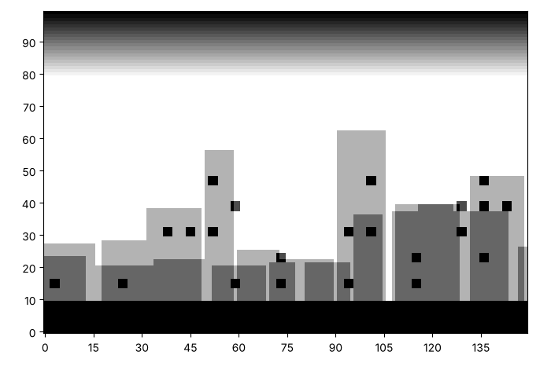

# A random city: buildings, sky and windows

A city is rows of buildings with random widths and heights, a sky behind
them and a road in front. Here is one. Yours will be a different city,
and that is the point.



This page makes one function, `paint_city`, from the functions you
already have and a few random choices.

## Ink that builds up

A while loop is useful here, because we do not know how many buildings
fit until we run out of canvas. The sky is a gradient, the road is a
strip of ink that builds up, and the windows are tiny squares that light
up at random, but only on buildings.

How would you tell a building from the sky? A square on a building has
had ink added several times, so its number is larger. Which of your
functions paints a rectangle, a square and a gradient? Think about the
order: what must be painted first?

```python exec
id: random-city-1
toolkit: yes
expect: (lambda a, b: (paint_city(a, 7), paint_city(b, 7), a == b and a[0][0] >= 20 and a[99][0] == 20)[2])(make_canvas(100, 150), make_canvas(100, 150))
import random
def paint_city(canvas, seed):
    """Paint a sky, two rows of random buildings, a road and some lit windows. The same seed gives the same city."""
    # In words: a sky gradient, two rows of random buildings, a road, and some lit windows.
    # Which of your functions paints a gradient? A rectangle? A square?
    # Which loop lets you keep adding buildings until you run out of canvas?
    # How do you tell a building from the sky, so that windows only appear on buildings?
    ...
```

```python toolkit-reference
for: random-city-1
import random
def paint_city(canvas, seed):
    random.seed(seed)       # the same seed gives the same city every time
    columns = len(canvas[0])
    paint_gradient(canvas, 80, 0, 99, columns - 1)
    for tallest in [45, 65]:                    # far buildings first, then near ones on top
        left = 0
        while left < columns:
            width = random.randint(8, 20)
            height = random.randint(20, tallest)
            right = min(left + width - 1, columns - 1)
            for layer in range(6):
                paint_rectangle(canvas, 0, left, height - 1, right)
            left = left + width + random.randint(0, 3)
    for layer in range(20):
        paint_rectangle(canvas, 0, 0, 9, columns - 1)       # the road
    for row in range(14, 60, 8):
        for column in range(2, columns - 4, 7):
            on_a_building = canvas[row][column] >= 6      # the sky has less than 6 ink here
            if on_a_building and random.random() < 0.3:    # about 3 windows in 10 are lit
                for layer in range(14):
                    paint_square(canvas, row, column, 3)
```

```hint
after: 3 errors
Make a city on a canvas of 100 rows by 150 columns. The bottom rows are
the road, and the top row is the darkest of the sky. Which of the two is
missing or wrong?
```

```hint
after: 6 errors
title: some steps
1. Paint the sky first, with `paint_gradient` over rows 80 to 99.
2. Go round the two heights of building. For each, start at column 0 and
keep adding buildings of a random width and height until you run out of
canvas.
3. Paint the road with many layers, so it is black.
4. Visit a grid of window positions. Paint a window where the ink is 6
or more, and only some of the time.
```

```solution
import random
def paint_city(canvas, seed):
    random.seed(seed)       # the same seed gives the same city every time
    columns = len(canvas[0])
    paint_gradient(canvas, 80, 0, 99, columns - 1)
    for tallest in [45, 65]:                    # far buildings first, then near ones on top
        left = 0
        while left < columns:
            width = random.randint(8, 20)
            height = random.randint(20, tallest)
            right = min(left + width - 1, columns - 1)
            for layer in range(6):
                paint_rectangle(canvas, 0, left, height - 1, right)
            left = left + width + random.randint(0, 3)
    for layer in range(20):
        paint_rectangle(canvas, 0, 0, 9, columns - 1)       # the road
    for row in range(14, 60, 8):
        for column in range(2, columns - 4, 7):
            on_a_building = canvas[row][column] >= 6      # the sky has less than 6 ink here
            if on_a_building and random.random() < 0.3:    # about 3 windows in 10 are lit
                for layer in range(14):
                    paint_square(canvas, row, column, 3)
---
Here is one answer. Yours may be different and work too. The far
buildings are painted first and the near ones on top, so the ink builds
up and the near buildings are darker. A window is painted only where the
ink is 6 or more, which is how a building is told apart from the sky.
Changing the order of painting changes the picture, because ink is only
ever added.
```

Can you make a random city like this one? Yours will be a different city, and that is the point.


```python exec
id: random-city-2
# Your city
```

```solution
{{include: setup/painting/toolkit.py}}

canvas = make_canvas(100, 150)
paint_city(canvas, 7)
show_picture(canvas, darkest=20)
---
Here is one answer. Yours may be different and work too. The canvas is
100 rows by 150 columns, the seed is 7 and `darkest` is 20.
```

What happens if you make the same city twice with the same seed, and
once with another? What changes if you alter one number inside
`paint_city`, such as the chance that a window is lit, or the tallest
building?

```python exec
id: random-city-3
canvas = make_canvas(100, 150)
paint_city(canvas, 3)
show_picture(canvas, darkest=20)
canvas = make_canvas(100, 150)
paint_city(canvas, 3)
show_picture(canvas, darkest=20)     # the same seed gives the same city
```

## Looking back

The city is built from layers, and each layer only adds ink. Which of
the three things in the picture, the sky, the buildings and the windows,
would change if you painted the windows first?

A challenge: add a moon and some stars to the sky, but only where the
sky is dark.

```python challenge
# A night city. Your toolkit has paint_city, paint_random_points and paint_where.
canvas = make_canvas(100, 150)
paint_city(canvas, 7)
```

## Where to read more

Wikipedia. *Procedural generation.*
<https://en.wikipedia.org/wiki/Procedural_generation>. Making pictures,
maps and levels from rules and chance, which is how many games build
their worlds.
