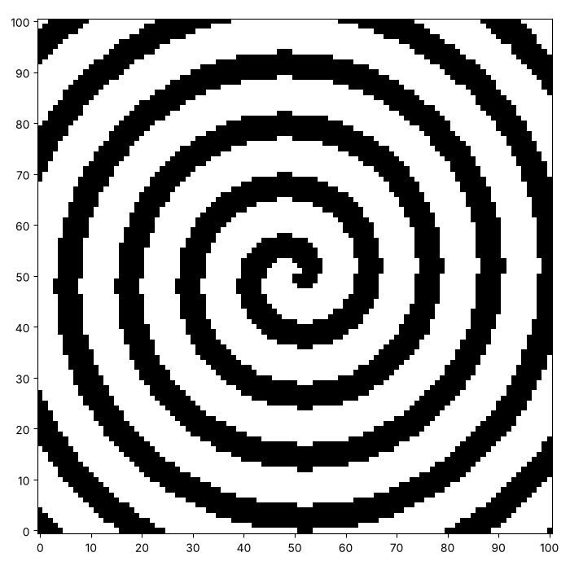
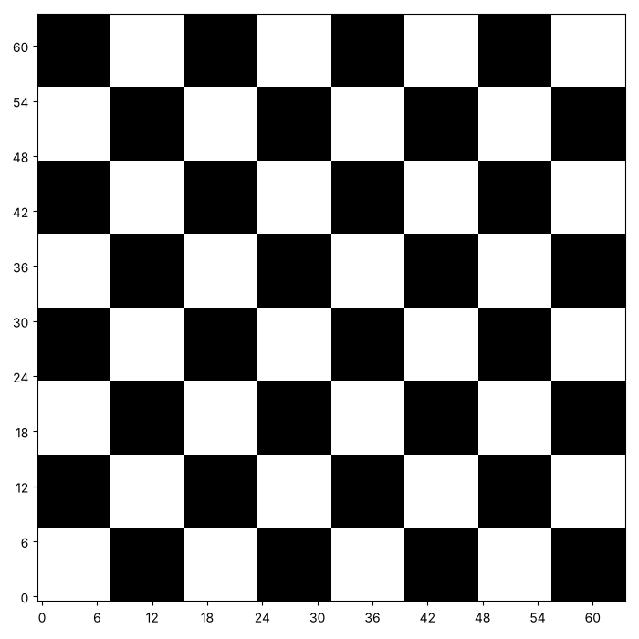
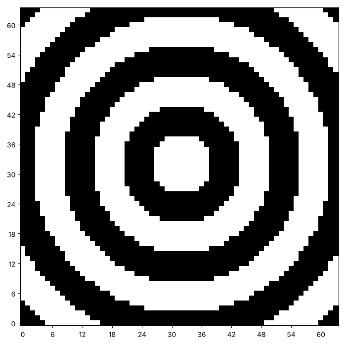
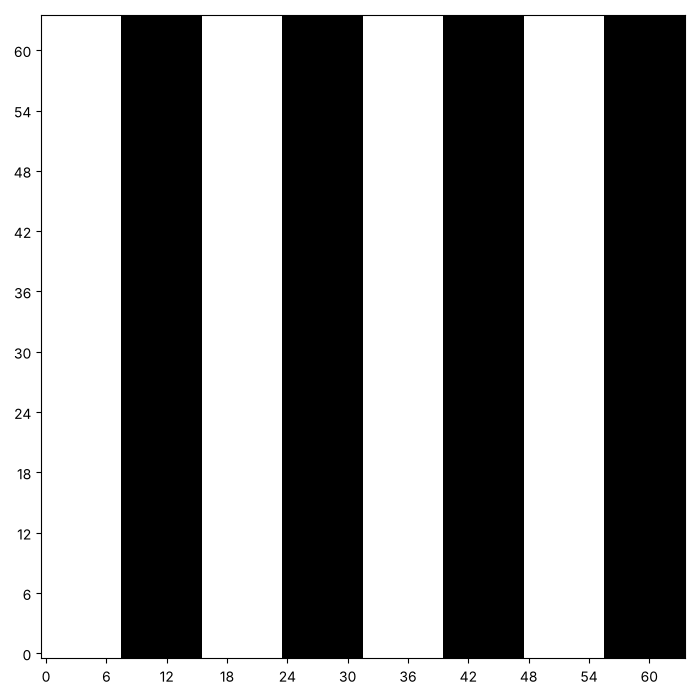
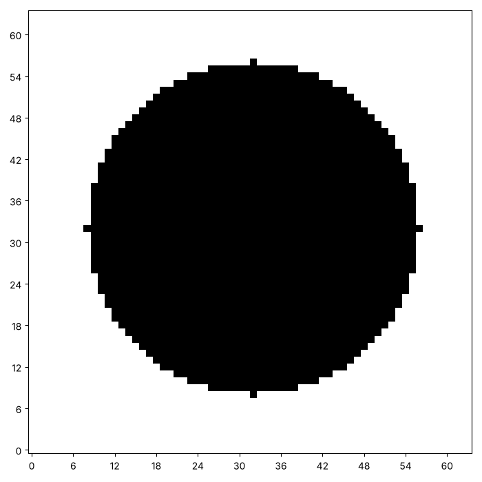

# A rule for every square: patterns and spirals

So far we chose which squares to paint. Another way is to ask every
square a question. Here are some pictures that come from one question
each. Yours will look different, and that is the point.







A **rule** is a function that takes $x$ and $y$ and gives back how much
ink the square at that point gets. In Python a function is a value like
any other, so you can give a rule to another function, the way you give
it a number or a list. This page makes one function that paints from any
rule, and then asks what rules make stripes, a checkerboard, rings, a
disc and a spiral.

## Two operators for patterns

The operators `//` (divide and drop the remainder) and `%` (the
remainder) are useful for patterns. Run the cell. It prints `x // 8` and
`x % 2` for some values of $x$.

```python exec
id: two-operators-1
for x in [0, 3, 7, 8, 15, 16, 24]:
    print(x, x // 8, x % 2, (x // 8) % 2)
```

```predict
type: number

What is the last number the cell prints? It is `(x // 8) % 2` for x =
24.
```

What does `x // 8` give for $x$ from 0 to 7, and then from 8 to 15? It
counts which block of 8 the number is in. The `% 2` turns that count
into 0, 1, 0, 1, and so on, which is a stripe.

## Painting from a rule

How would you paint a canvas from any rule? The rule needs $x$ and $y$.
Which of the two is the column, and which is the row?

```python exec
id: paint-where-1
toolkit: yes
expect: (lambda c: (paint_where(c, lambda x, y: x), c[0] == [0, 1, 2] and c[1] == [0, 1, 2])[1])(make_canvas(2, 3))
def paint_where(canvas, rule):
    """Add to every square the ink that rule(x, y) gives for it, where x is the column and y is the row."""
    # Inputs: what type is rule? What does it take, and what does it give back?
    # In words: ask the rule how much ink every square gets, and add that ink to the square.
    # Which of x and y is the column, and which is the row?
    ...
```

```python toolkit-reference
for: paint-where-1
def paint_where(canvas, rule):
    for row in range(len(canvas)):
        for column in range(len(canvas[0])):
            ink = rule(column, row)      # x is the column and y is the row
            canvas[row][column] = canvas[row][column] + ink
```

```hint
after: 3 errors
Try the rule `lambda x, y: x` on a canvas of 2 rows and 3 columns. Each
row should read 0, 1, 2. If your rows read 0, 0, 0 and 1, 1, 1, which of
the two names did you give the column?
```

```solution
def paint_where(canvas, rule):
    for row in range(len(canvas)):
        for column in range(len(canvas[0])):
            ink = rule(column, row)      # x is the column and y is the row
            canvas[row][column] = canvas[row][column] + ink
---
Here is one answer. Yours may be different and work too. Every square
asks the rule for its ink, and the ink is added, so rules can build on
pictures that are already there. The column is $x$ and the row is $y$,
the same convention as `paint_xy`.
```

## Rules for pictures

Each of these canvases is 64 by 64. Can you write the rule that paints
each of them? Yours does not need to match.



```python exec
id: rule-stripes
# Your rule for stripes
```

```solution
# From earlier on this page, repeated so that this answer runs on its own
def paint_where(canvas, rule):
    for row in range(len(canvas)):
        for column in range(len(canvas[0])):
            ink = rule(column, row)      # x is the column and y is the row
            canvas[row][column] = canvas[row][column] + ink

def stripes(x, y):
    return (x // 8) % 2


canvas = make_canvas(64, 64)
paint_where(canvas, stripes)
show_picture(canvas)
---
Here is one answer. Yours may be different and work too. `x // 8` is the
number of the block of 8 columns, and `% 2` turns it into 0 or 1.
```


```python exec
id: rule-checker
# Your rule for a checkerboard
```

```solution
# From earlier on this page, repeated so that this answer runs on its own
def paint_where(canvas, rule):
    for row in range(len(canvas)):
        for column in range(len(canvas[0])):
            ink = rule(column, row)      # x is the column and y is the row
            canvas[row][column] = canvas[row][column] + ink

def checkerboard(x, y):
    return (x // 8 + y // 8) % 2


canvas = make_canvas(64, 64)
paint_where(canvas, checkerboard)
show_picture(canvas)
---
Here is one answer. Yours may be different and work too. A square is
black when the block number across plus the block number up is odd.
```


```python exec
id: rule-rings
# Your rule for rings
```

```solution
import math

# From earlier on this page, repeated so that this answer runs on its own
def paint_where(canvas, rule):
    for row in range(len(canvas)):
        for column in range(len(canvas[0])):
            ink = rule(column, row)      # x is the column and y is the row
            canvas[row][column] = canvas[row][column] + ink

def rings(x, y):
    distance = math.sqrt((x - 32) ** 2 + (y - 32) ** 2)
    return int(distance) // 6 % 2


canvas = make_canvas(64, 64)
paint_where(canvas, rings)
show_picture(canvas)
---
Here is one answer. Yours may be different and work too. The distance
from the centre is `math.sqrt(dx * dx + dy * dy)`. Rings are stripes of
that distance.
```



```python exec
id: rule-disc
# Your rule for a disc
```

```solution
# From earlier on this page, repeated so that this answer runs on its own
def paint_where(canvas, rule):
    for row in range(len(canvas)):
        for column in range(len(canvas[0])):
            ink = rule(column, row)      # x is the column and y is the row
            canvas[row][column] = canvas[row][column] + ink

def disc(x, y):
    if (x - 32) ** 2 + (y - 32) ** 2 <= 24 ** 2:
        return 1
    return 0


canvas = make_canvas(64, 64)
paint_where(canvas, disc)
show_picture(canvas)
---
Here is one answer. Yours may be different and work too. A square is
inside the disc when its distance from the centre is at most the radius.
Comparing squares avoids the square root.
```

What happens when a rule returns a number bigger than 1? Try showing the
canvas with `darkest=2`. What rule would you invent?

## A spiral

A spiral is a rule too. A square at a distance `radius` from the centre,
at an angle `angle`, sits on an arm of the spiral when the radius, minus
a steady amount for every turn, is a multiple of the gap between the
arms. `math.atan2(dy, dx)` gives the angle of a point, from $-\pi$ to
$\pi$. Can you make this picture, with the centre at (50, 50) and a gap
of 12?


```python exec
id: rule-spiral
# Your spiral
```

```solution
import math

# From earlier on this page, repeated so that this answer runs on its own
def paint_where(canvas, rule):
    for row in range(len(canvas)):
        for column in range(len(canvas[0])):
            ink = rule(column, row)      # x is the column and y is the row
            canvas[row][column] = canvas[row][column] + ink

def spiral(x, y):
    dx = x - 50
    dy = y - 50
    radius = math.sqrt(dx * dx + dy * dy)
    turns = math.atan2(dy, dx) / (2 * math.pi)     # the angle, as a fraction of a full turn
    if (radius - 12 * turns) % 12 < 5:             # the radius grows by 12 every turn
        return 1
    return 0


canvas = make_canvas(101, 101)
paint_where(canvas, spiral)
show_picture(canvas)
---
Here is one answer. Yours may be different and work too. `turns` is the
angle as a fraction of a full turn. The radius minus 12 times that
fraction is a multiple of 12 along an arm, so `% 12 < 5` keeps a band 5
squares wide.
```

## Looking back

A rule paints every square, and `paint_where` adds. How would the
picture change if the rule returned 2 for a stripe instead of 1? What
does `darkest` do?

A challenge: make a plaid, with two kinds of stripe that cross, so that
where they cross there is more ink.

```python challenge
# A plaid from a rule. Your toolkit has paint_where and show_picture.
canvas = make_canvas(80, 80)
```

## Where to read more

Wikipedia. *Sierpinski triangle.*
<https://en.wikipedia.org/wiki/Sierpi%C5%84ski_triangle>. A famous
picture that a one-line rule can paint, using the operator `&` on $x$
and $y$.
