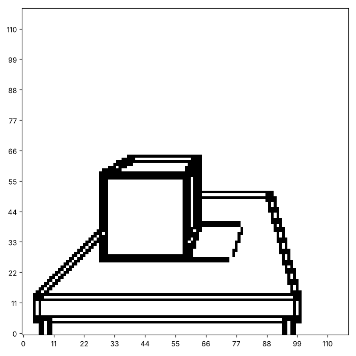
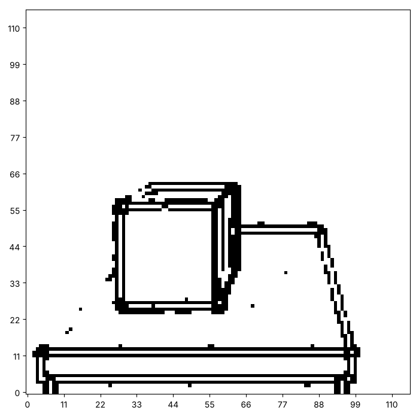
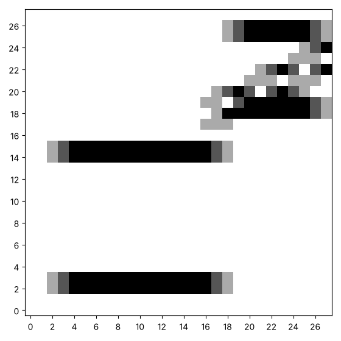
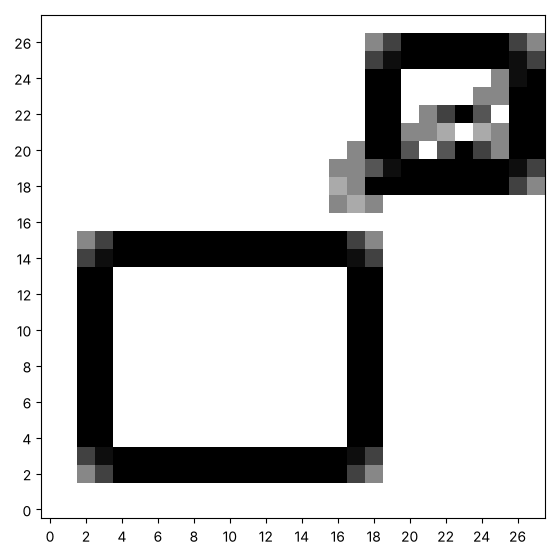
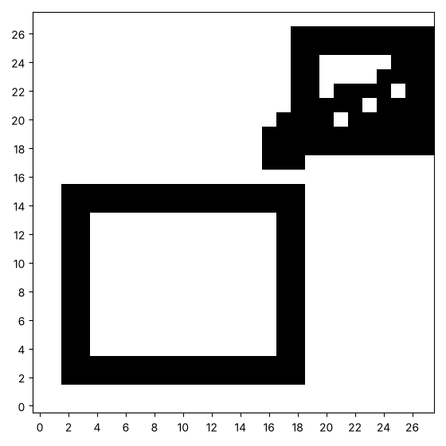
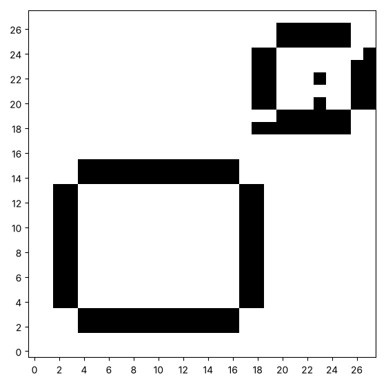
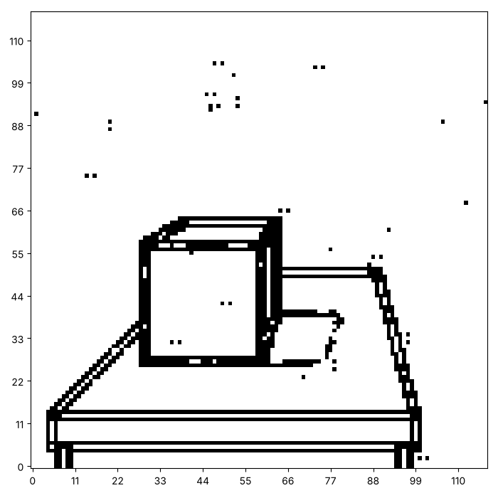

# Edges in every direction: finding where a picture changes

In the last series a kernel was a small grid of numbers that we chose.
We chose a blur, a sharpen and an edge finder, and they worked because
someone had worked out the right numbers. Here we look hard at edges:
which way they run, how strong they are, and what noise does to them.
Here are three pictures from this page. Yours will look different, and
that is the point.






This page adds two functions to your toolkit, `combine` and `threshold`,
and uses the kernels and `convolve` from the last series.

## Edges that run one way

An **edge** is a place where the picture changes quickly. Think of one
row of the picture that crosses a vertical edge: the squares are 0, 0, 0
and then 3, 3, 3. Moving from the left to the right, the number jumps.
How could a kernel notice that jump? Which weights would you give the
square on the left, and which the square on the right? What should the
weights add up to, so that a flat area gives 0?

Here is a small picture to practise on, a block, a smaller block and a
slanted line, and a kernel that finds the edges that run up and down,
and one for edges that run across.

```python exec
id: practice-1
# PROVIDED. A small picture to practise on: a block, a smaller block and a slanted line.
practice = make_canvas(30, 30)
paint_rectangle(practice, 4, 4, 15, 18)
paint_rectangle(practice, 20, 20, 26, 27)
paint_line(practice, 0.5, 10, 18, 29)
show_picture(practice)
```

```python exec
id: edge-kernels-1
vertical_edges = [[-1, 0, 1],
                  [-1, 0, 1],
                  [-1, 0, 1]]
horizontal_edges = [[-1, -1, -1],
                    [ 0,  0,  0],
                    [ 1,  1,  1]]
```

Can you find the edges that run up and down in the practice picture, and
then the edges that run across, like these? `show_picture` draws a
negative number as white, so some edges may seem to be missing. What can
you do about that?




```python exec
id: edge-kernels-2
# Your edges, up and down and across
```

```solution
{{include: setup/painting/toolkit.py}}

# PROVIDED. A small picture to practise on: a block, a smaller block and a slanted line.
practice = make_canvas(30, 30)
paint_rectangle(practice, 4, 4, 15, 18)
paint_rectangle(practice, 20, 20, 26, 27)
paint_line(practice, 0.5, 10, 18, 29)
show_picture(practice)

vertical_edges = [[-1, 0, 1],
                  [-1, 0, 1],
                  [-1, 0, 1]]
horizontal_edges = [[-1, -1, -1],
                    [ 0,  0,  0],
                    [ 1,  1,  1]]

show_picture(absolute(convolve(practice, vertical_edges)), darkest=3)
show_picture(absolute(convolve(practice, horizontal_edges)), darkest=3)
---
Here is one answer. Yours may be different and work too. `absolute`
keeps both signs of the response, so both sides of each edge show. The
kernels add up to 0, so a flat area gives 0.
```

What are the smallest and largest numbers in the response? Why does one
side of each edge disappear when you show it as it is?

```python exec
id: edge-kernels-3
response = convolve(practice, vertical_edges)
print("most negative:", min(min(row) for row in response))
print("most positive:", max(max(row) for row in response))
show_picture(response, darkest=3)                  # the negative numbers vanish
show_picture(absolute(response), darkest=3)
```

```predict
type: choice

What will the cell print for the most negative number?

- 0, because a kernel cannot give a negative number
  - A weight of -1 times a square with ink gives a negative number.
- A negative number, such as -4
- The same as the most positive number, with the sign changed
```

Could a kernel find edges that run diagonally, from the bottom left to
the top right? What should its weights be? Try it on the practice
picture, and add up its weights. What happens to a flat area?

```python exec
id: edge-kernels-4
diagonal = [[ 0,  1,  1],
            [-1,  0,  1],
            [-1, -1,  0]]
show_picture(absolute(convolve(practice, diagonal)), darkest=3)
print(sum(sum(row) for row in diagonal), "is the sum of the weights")
```

## How strong is the edge?

A vertical-edge kernel misses horizontal edges, and the other way round.
Run both, and at every square you have two numbers: how much the picture
changes across, and how much it changes up. Together they make an arrow,
and the **strength** of the edge is the length of that arrow, $\sqrt{a^2
+ b^2}$.

How would you combine two canvases of the same size into one, square by
square?

```python exec
id: combine-1
toolkit: yes
expect: combine([[3, 0]], [[4, 0]]) == [[5.0, 0.0]]
import math
def combine(first, second):
    """A new canvas where each square is the length of the pair (a, b), with a from the first canvas and b from the second."""
    # Inputs: two canvases of the same size. Returns: a new canvas of that size.
    # How is the length of a pair found? Which function in math helps?
    # Which of your functions makes a blank canvas?
    ...
```

```python toolkit-reference
for: combine-1
import math
def combine(first, second):
    result = make_canvas(len(first), len(first[0]))
    for row in range(len(first)):
        for column in range(len(first[0])):
            a = first[row][column]
            b = second[row][column]
            result[row][column] = math.sqrt(a * a + b * b)     # the length of the pair (a, b)
    return result
```

```hint
after: 3 errors
The pair (3, 4) has the length 5. What does your function give for the
squares of two canvases that hold 3 and 4?
```

```solution
import math
def combine(first, second):
    result = make_canvas(len(first), len(first[0]))
    for row in range(len(first)):
        for column in range(len(first[0])):
            a = first[row][column]
            b = second[row][column]
            result[row][column] = math.sqrt(a * a + b * b)     # the length of the pair (a, b)
    return result
---
Here is one answer. Yours may be different and work too. The two
responses form an arrow at every square, and `math.sqrt(a * a + b * b)`
is its length.
```

How would you keep only the squares whose strength reaches a level you
choose, and turn them into 1 while the rest become 0? A function that
does that is called a **threshold**.

```python exec
id: threshold-1
toolkit: yes
expect: threshold([[1, 2, 3]], 2) == [[0, 1, 1]] and threshold([[5]], 6) == [[0]]
def threshold(canvas, level):
    """A new canvas of 0 and 1. A square becomes 1 where the original number is at least level."""
    # Returns: a new canvas of 0 and 1.
    # In words: a square becomes 1 where the original number is at least level, and stays 0 elsewhere.
    ...
```

```python toolkit-reference
for: threshold-1
def threshold(canvas, level):
    result = make_canvas(len(canvas), len(canvas[0]))
    for row in range(len(canvas)):
        for column in range(len(canvas[0])):
            if canvas[row][column] >= level:
                result[row][column] = 1
    return result
```

```hint
after: 3 errors
A square that equals the level should become 1. Does yours, or does it
need to be bigger?
```

```solution
def threshold(canvas, level):
    result = make_canvas(len(canvas), len(canvas[0]))
    for row in range(len(canvas)):
        for column in range(len(canvas[0])):
            if canvas[row][column] >= level:
                result[row][column] = 1
    return result
---
Here is one answer. Yours may be different and work too. The comparison
`>= level` keeps a square that is exactly at the level.
```

Can you make an outline of the practice picture from both kinds of edge
at once, and then keep only the strong ones, like these? Try a low level
and a high one.







```python exec
id: strength-1
# Your strength picture, and your outlines
```

```solution
{{include: setup/painting/toolkit.py}}

# PROVIDED. A small picture to practise on: a block, a smaller block and a slanted line.
practice = make_canvas(30, 30)
paint_rectangle(practice, 4, 4, 15, 18)
paint_rectangle(practice, 20, 20, 26, 27)
paint_line(practice, 0.5, 10, 18, 29)
show_picture(practice)

vertical_edges = [[-1, 0, 1],
                  [-1, 0, 1],
                  [-1, 0, 1]]
horizontal_edges = [[-1, -1, -1],
                    [ 0,  0,  0],
                    [ 1,  1,  1]]

across = convolve(practice, vertical_edges)
up = convolve(practice, horizontal_edges)
strength = combine(across, up)
print("strongest edge:", round(max(max(row) for row in strength), 2))
show_picture(strength, darkest=3)
show_picture(threshold(strength, 1))
show_picture(threshold(strength, 3))
---
Here is one answer. Yours may be different and work too. A low level
keeps a thick outline, and a high level keeps only the strongest edges.
```

Here is the cube from the last series. Can you make an outline of the
cube? What happens to the outline as the level goes up? How many squares
stay at the levels 0.5, 2, 4 and 6?


```python exec
id: strength-2
picture = cube_picture()
# Your outline of the cube
```

```solution
{{include: setup/painting/toolkit.py}}

picture = cube_picture()
vertical_edges = [[-1, 0, 1],
                  [-1, 0, 1],
                  [-1, 0, 1]]
horizontal_edges = [[-1, -1, -1],
                    [ 0,  0,  0],
                    [ 1,  1,  1]]
across = convolve(picture, vertical_edges)
up = convolve(picture, horizontal_edges)
strength = combine(across, up)
show_picture(threshold(strength, 3))
for level in [0.5, 2, 4, 6]:
    outline = threshold(strength, level)
    print(level, "keeps", sum(sum(row) for row in outline), "squares")
---
Here is one answer. Yours may be different and work too. The cube has
strong edges, so most of the outline survives a low level.
```

## Edges in a noisy picture

Real pictures carry noise: tiny errors from a camera, or from a printer.
An edge finder reacts to every speck, because a speck is a sharp change.
What do you expect to happen if you find the edges of the noisy cube
from the series on chance? What would you do to the picture first?

A **smoothing** kernel is a blur with more weight in the middle. Its
weights add up to 1, so flat areas stay as they are.

Can you add noise to a copy of the cube, find its edges, and then find the edges again after smoothing, like these? Which outline would you rather give to a robot?




```python exec
id: noisy-edges-1
picture = cube_picture()
smooth = [[1 / 16, 2 / 16, 1 / 16],
          [2 / 16, 4 / 16, 2 / 16],
          [1 / 16, 2 / 16, 1 / 16]]
# Your noisy cube and its two outlines
```

```solution
{{include: setup/painting/toolkit.py}}

picture = cube_picture()
vertical_edges = [[-1, 0, 1],
                  [-1, 0, 1],
                  [-1, 0, 1]]
horizontal_edges = [[-1, -1, -1],
                    [ 0,  0,  0],
                    [ 1,  1,  1]]
smooth = [[1 / 16, 2 / 16, 1 / 16],
          [2 / 16, 4 / 16, 2 / 16],
          [1 / 16, 2 / 16, 1 / 16]]
noisy = [row[:] for row in picture]
add_noise(noisy, 0.1, 5)
across = convolve(noisy, vertical_edges)
up = convolve(noisy, horizontal_edges)
show_picture(threshold(combine(across, up), 3))          # edges of the noisy picture

cleaned = convolve(noisy, smooth)
across = convolve(cleaned, vertical_edges)
up = convolve(cleaned, horizontal_edges)
show_picture(threshold(combine(across, up), 3))          # blur first, then find the edges
---
Here is one answer. Yours may be different and work too. Differences
amplify noise, because a single speck is a sharp change. Smoothing first
averages the speck into its neighbours. The cost is that real edges
soften, so the outline is thinner and weaker.
```

What if the noise is heavier, a chance of 0.2, and you smooth twice?
Which level of threshold gives the cleanest outline?

## Looking back

Smoothing and then finding edges are two convolutions, one after the
other. Could one bigger kernel do both jobs? What would its size be?

A challenge: find the direction of the edge at every square, with
`math.atan2(up, across)`, and paint the squares whose edges run nearly
vertically.

```python challenge
# Edge directions. Your toolkit has convolve, combine and threshold.
picture = cube_picture()
```

## Where to read more

Wikipedia. *Sobel operator.*
<https://en.wikipedia.org/wiki/Sobel_operator>. The edge kernels used in
many programs, with the strength and direction of an edge.
