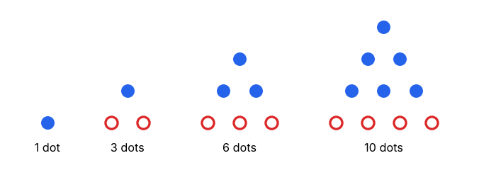
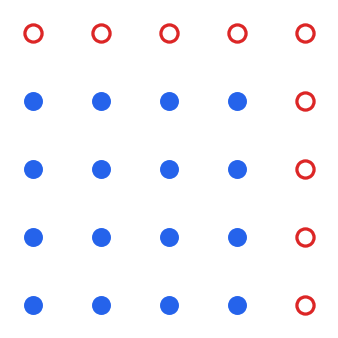
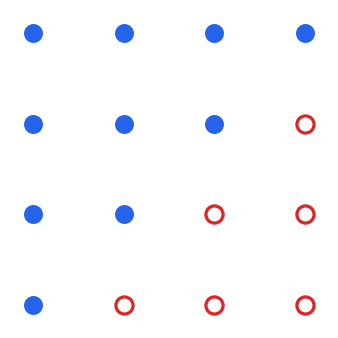
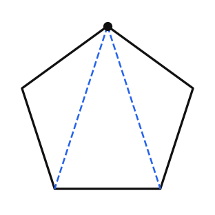

# Experiments with number patterns: dots in triangles, squares and pentagons

If we arrange dots in a triangle, the counts go 1, 3, 6, 10, 15 and so on. If we arrange them in a square, the counts go 1, 4, 9, 16, 25. A list of numbers that follows a rule like this is called a sequence. On this page we let Python build these sequences, and then we use the lists and some drawings to find the rules behind them.

Everything here is built from functions, so we start with what a function is.

There are questions on this page to answer in words as well as in code. The **+ Text** button between cells adds a text cell where you can write your answers.

## 1. What a function is

A function is a recipe with a name. We write the recipe once, and after that we can use it as often as we like. Here is a function called `double`.

```python exec
id: what-a-function-is-1
def double(n):
    return n * 2
```

The first line starts with `def`, short for define. It gives the function its name, `double`, and names its input, `n`. An input like `n` is called an argument. It is a placeholder: it stands for whatever value we hand in later. The second line, `return n * 2`, says what the function hands back.

**1.1** Run the cell above. Nothing appears below it. Why might that be?

<!-- answer -->

Using a function is called calling it. To call a function, we write its name and put a value in brackets, such as `double(4)`. Python puts 4 in place of `n`, follows the recipe, and hands back 8. A call can go anywhere a number can go, even inside another call.

**1.2** What do you expect each of these three lines to print? Write your guesses down, then run the cell.

```python exec
id: what-a-function-is-2
print(double(4))
print(double(10) + 1)
print(double(double(3)))
```

**1.3** This version of the function uses `print` where the first one used `return`. Run it. What appears, and where do you think `None` comes from?

```python exec
id: what-a-function-is-3
def double_and_show(n):
    print(n * 2)

answer = double_and_show(4)
print(answer)
```

<!-- answer -->

<details class="dl-hint"><summary>smaller steps</summary>

1. Which line printed the 8: the line inside the function, or the last line?
2. The function has no `return` line. What does `answer` hold after the call?
3. When a function has no `return`, Python hands back a special value meaning "nothing". What is it called?

</details>

**1.4** Write a function `triple(n)` that hands back three times `n`, and call it on a few numbers.

```python exec
id: what-a-function-is-4
# your function here
```

```solution
def triple(n):
    return n * 3

print(triple(5))
print(triple(0))
```

## 2. Growing triangles



Each triangle is the one before it with one new row along the bottom. The new row in the fourth triangle has 4 dots, so the fourth triangle is the third triangle plus 4.

The cell below uses that idea to build a list of triangles. It starts with a list holding one triangle, `[1]`. In a list, `triangles[-1]` means the last item. Each time round the loop, `.append()` adds a new item to the end of the list: the last triangle plus the new row.

```python exec
id: growing-triangles-1
triangles = [1]
for row in range(2, 8):
    triangles.append(triangles[-1] + row)
print(triangles)
```

**2.1** Run the cell. Which row is added to make 15? How many triangles are in the list, and which number in the cell decides that?

<!-- answer -->

**2.2** Try changing the 8 to 11, and then to 2. What happens to the list each time?

```python exec
id: growing-triangles-2
triangles = [1]
for row in range(2, 11):
    triangles.append(triangles[-1] + row)
print(triangles)
```

**2.3** We would like to ask for any number of triangles without editing the loop each time. Put the loop inside a function, `triangle_list(k)`, that hands back a list of the first `k` triangles. `triangle_list(6)` should give `[1, 3, 6, 10, 15, 21]`.

```python exec
id: growing-triangles-3
def triangle_list(k):
    triangles = [1]
    # your loop here
    return triangles

print(triangle_list(6))
```

<details class="dl-hint"><summary>smaller steps</summary>

1. Copy the two loop lines from the cell in 2.1 into the function, under the comment, and indent them to match.
2. The loop should stop after the `k`-th triangle. Which number in `range` controls where it stops, and how could you write it using `k`?
3. Check with a few values of `k`, including 1.

</details>

```solution
def triangle_list(k):
    triangles = [1]
    for row in range(2, k + 1):
        triangles.append(triangles[-1] + row)
    return triangles

print(triangle_list(6))
---
`range(2, k + 1)` stops one short of `k + 1`, so the last row it adds is row `k`.
```

## 3. Squares, two ways

We already know a rule for square numbers: a square with `n` dots along each side has `n * n` dots.

**3.1** Write a function `square(n)` that uses that rule, and print the first ten squares.

```python exec
id: squares-two-ways-1
def square(n):
    # your code here
    return 0

for n in range(1, 11):
    print(n, square(n))
```

```solution
def square(n):
    return n * n

for n in range(1, 11):
    print(n, square(n))
```

There is a second way to make the squares, which grows each one from the one before, just as we grew the triangles.



**3.2** In the picture, how many red rings turn the 4 by 4 square into a 5 by 5 square? How many new dots would turn a 5 by 5 square into a 6 by 6 square? What kind of numbers are these?

<!-- answer -->

**3.3** Write `square_list(k)`, which builds the first `k` squares by adding the new dots each time, the way `triangle_list` builds triangles. Then compare it with your `square` function.

```python exec
id: squares-two-ways-2
def square_list(k):
    squares = [1]
    # your loop here
    return squares

print(square_list(10))
```

<details class="dl-hint"><summary>smaller steps</summary>

1. Count the new dots for the first few steps: from 1 to 4, from 4 to 9, from 9 to 16. Put the counts in a list.
2. To make the `n`-th square, count the new dots along the top, then down the side. The corner dot is on both, so count it once. How many new dots is that, written with `n`?
3. In the loop, append the last square plus that many new dots.

</details>

```solution
def square_list(k):
    squares = [1]
    for n in range(2, k + 1):
        squares.append(squares[-1] + (2 * n - 1))
    return squares

print(square_list(10))
print(square_list(20) == [n * n for n in range(1, 21)])
---
The new dots make an L: n along the top and n down the side, with the corner shared, so 2n − 1. Those are the odd numbers.
```

## 4. A square from two triangles



**4.1** The picture cuts a square into two triangles. How many dots are in each? Which triangles from your list are they? Picture a 5 by 5 square cut the same way. Which two triangles make it?

<!-- answer -->

**4.2** Check your idea in code for the first ten squares. `triangle_list` and `square` from earlier are ready to use.

```python exec
id: a-square-from-two-triangles-1
triangles = triangle_list(10)
print(triangles)
# your code here
```

<details class="dl-hint"><summary>smaller steps</summary>

1. In the list, `triangles[0]` is the first triangle, `triangles[1]` is the second, and so on. Which item is the fourth triangle?
2. Add two neighbouring triangles, such as `triangles[3] + triangles[2]`, and compare with `square(4)`.
3. Put that comparison inside a loop for the squares from 2 to 10.

</details>

```solution
def triangle_list(k):
    triangles = [1]
    for row in range(2, k + 1):
        triangles.append(triangles[-1] + row)
    return triangles

triangles = triangle_list(10)
for n in range(2, 11):
    print(n, triangles[n - 1] + triangles[n - 2], square(n))
```

**4.3** So far we can only find a triangle by growing the whole list. Find a rule that gives the `n`-th triangle straight away, and write it as a function `triangular(n)`. `triangular(100)` should match the last item of `triangle_list(100)`.

```python exec
id: a-square-from-two-triangles-2
def triangular(n):
    # your rule here
    return 0

print(triangular(100), triangle_list(100)[-1])
```

<details class="dl-hint"><summary>smaller steps</summary>

1. You have two facts about the `n`-th triangle. From the picture in section 2, it is the triangle before it plus `n`. From the square, the two of them together make `n * n`.
2. Write the second fact out: triangle `n` plus triangle `n - 1` makes `n * n`.
3. The triangle before is the `n`-th triangle with its bottom row of `n` dots taken away. Put that in place of triangle `n - 1`.
4. You now have two copies of the `n`-th triangle, take away `n`, making `n * n`. What is one copy?

</details>

```solution
def triangular(n):
    return (n * n + n) // 2

print(triangular(100), triangle_list(100)[-1])
---
Two copies of the triangle, less one bottom row of n dots, make the n by n square. So two triangles make n × n + n, and one triangle is half of that. `//` divides and keeps a whole number.
```

## 5. Pentagons

The pentagonal numbers begin 1, 5, 12, 22, 35. Their dots sit in pentagons that share one corner, and each pentagon has sides one dot longer than the one before.



**5.1** Copy the pentagon onto paper, with the two lines, and fill it with dots for the third pentagonal number, 12 dots, with 3 dots along each side. Then draw the fourth, 22 dots, with 4 along each side. How many dots are in each triangle? Which dots lie on a dashed line?

<!-- answer -->

**5.2** Use your drawings and your `triangular` function to write `pentagonal(n)`. `pentagonal(4)` should give 22.

```python exec
id: pentagons-1
def pentagonal(n):
    # your code here
    return 0

for n in range(1, 6):
    print(n, pentagonal(n))
```

<details class="dl-hint"><summary>smaller steps</summary>

1. In your drawing of 22 dots, count each of the three triangles on its own. How many rows does each have?
2. Add the three counts. Is the total more than 22? By how much?
3. The dots on the dashed lines belong to two triangles, so they were counted twice. The corner dot belongs to all three. How many extra counts is that for 22 dots, and for `n` dots along each side?

</details>

```solution
def triangular(n):
    return (n * n + n) // 2

def pentagonal(n):
    return 3 * triangular(n) - 2 * n

for n in range(1, 6):
    print(n, pentagonal(n))
---
Each triangle has n rows. The two dashed lines hold n dots each, and those were counted twice, so they are taken away once. There are other ways to cut the dots: the shared dots could go to one triangle only, giving triangular(n) + 2 * triangular(n - 1).
```

## 6. Hexagons: questions to think about

The hexagonal numbers begin 1, 6, 15, 28, 45. This section has no answers to check. The questions are for drawing, talking over with someone, and testing in code.

**6.1** Draw a regular hexagon and fill it with dots for the third hexagonal number, 15 dots. How many triangles can you cut it into? Is there more than one way?

<!-- answer -->

**6.2** When two triangles share an edge, the dots along that edge are counted twice. Where does that happen in your drawing? How would you correct for it?

<!-- answer -->

<details class="dl-hint"><summary>ways in</summary>

1. Start from one corner, as with the pentagon, and draw lines to the other corners. How many triangles do you get?
2. Count each triangle on its own and add them up. How far over 15 is the total?
3. Which dots did you count more than once, and how many times?

</details>

**6.3** Turn your idea into a function `hexagonal(n)` and test it against the list.

```python exec
id: hexagons-1
def hexagonal(n):
    # your idea here
    return 0

print([hexagonal(n) for n in range(1, 6)])
print([1, 6, 15, 28, 45])
```

## 7. Any number of sides: questions to think about

**7.1** Look back at the triangle, the square, the pentagon and the hexagon. From one corner, how many triangles does each shape split into? How does that number change as the shape gains a side?

<!-- answer -->

**7.2** Write `polygonal(sides, n)`. What should it give when `sides` is 3, and when it is 4? Does it agree with your other functions for 5 and 6?

```python exec
id: any-number-of-sides-1
def polygonal(sides, n):
    # your idea here
    return 0

for sides in [3, 4, 5, 6]:
    print(sides, [polygonal(sides, n) for n in range(1, 7)])
```

**7.3** What does your function give for 2 sides, or 1 side? Does the answer mean anything?

<!-- answer -->

<details class="dl-hint"><summary>ways in</summary>

1. Make a small table: the number of sides, the number of triangles from one corner, and the number of dashed lines.
2. Each triangle has `n` rows. Each dashed line holds `n` dots that were counted twice.
3. Does your pentagon rule still hold if you change the number of triangles and the number of lines?

</details>
