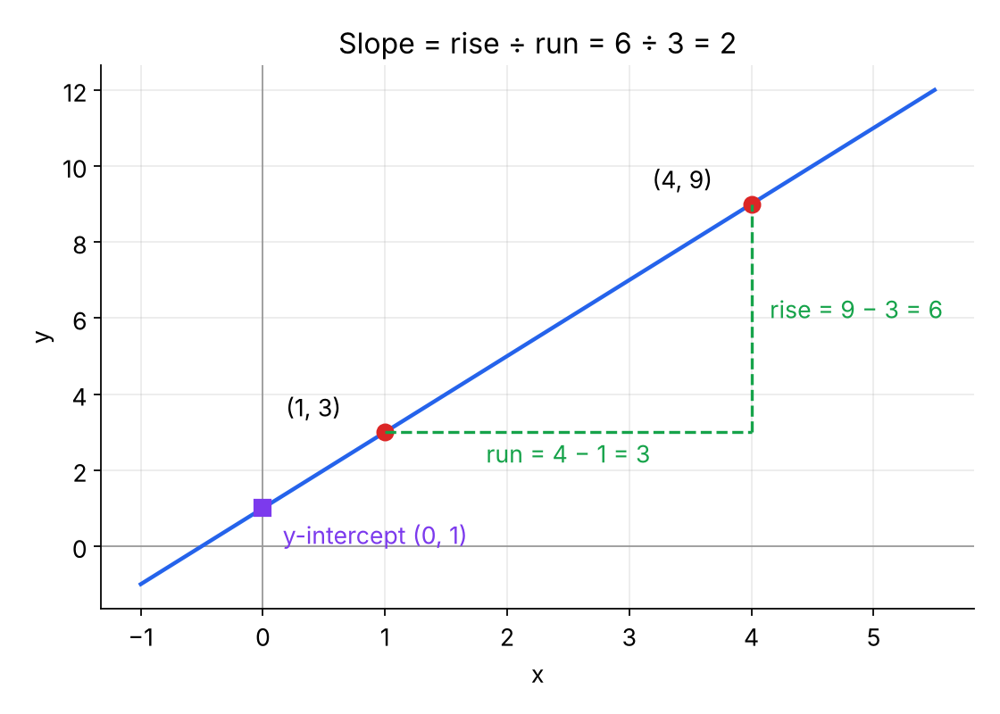

# Experiments with slopes: how steep is a curve?

The slope of a line says how steep it is. For every step to the right, the slope says how far the line goes up, or down when the slope is negative. On this page you write a function for the slope between two points, then pass other functions into it to measure how steep a curve is at a single point.

We measure slope with two points. The change in y is the rise, the change in x is the run, and the slope is the rise divided by the run.

$$\text{slope} = \frac{y_2 - y_1}{x_2 - x_1}$$



## 1. Slope between two points

**1.1** Write `slope(x1, y1, x2, y2)`. The points in the picture should give 2.0.

```python exec
id: slope-between-two-points-1
def slope(x1, y1, x2, y2):
    # your code here
    return 0

print(slope(1, 3, 4, 9))
```

```solution
def slope(x1, y1, x2, y2):
    rise = y2 - y1
    run = x2 - x1
    return rise / run

print(slope(1, 3, 4, 9))
```

```inputs
slope(1, 3, 4, 9)
slope(0, 0, 2, -4)    # a line going down
slope(1, 5, 3, 5)     # a flat line
```

**1.2** Swap the two points: `slope(4, 9, 1, 3)`. Does the order matter?

**1.3** Try `slope(2, 5, 2, 8)`. Read the error. What does the line through those two points look like, and why has it no slope?

```python exec
id: slope-between-two-points-2
def slope(x1, y1, x2, y2):
    return (y2 - y1) / (x2 - x1)

print(slope(2, 5, 2, 8))
```

**1.4** Add an `if` so that `slope` returns `None` instead of crashing when the run is zero.

```python exec
id: slope-between-two-points-3
def slope(x1, y1, x2, y2):
    # your code here
    return (y2 - y1) / (x2 - x1)

print(slope(2, 5, 2, 8))
print(slope(1, 3, 4, 9))
```

```solution
def slope(x1, y1, x2, y2):
    if x2 == x1:
        return None
    return (y2 - y1) / (x2 - x1)

print(slope(2, 5, 2, 8))
print(slope(1, 3, 4, 9))
```

## 2. Where the line crosses the y-axis

A straight line that is not upright can be written as $y = m x + b$. Here $m$ is the slope and $b$ is the y-intercept, the height where the line crosses the y-axis. With the slope and one point we can find $b$:

$$b = y_1 - m x_1$$

**2.1** Write `y_intercept(x1, y1, x2, y2)`. It can call `slope` to find $m$ first. The points in the picture should give 1.0.

```python exec
id: where-the-line-crosses-1
def slope(x1, y1, x2, y2):
    return (y2 - y1) / (x2 - x1)

def y_intercept(x1, y1, x2, y2):
    # your code here
    return 0

print(y_intercept(1, 3, 4, 9))
```

```solution
def slope(x1, y1, x2, y2):
    return (y2 - y1) / (x2 - x1)

def y_intercept(x1, y1, x2, y2):
    m = slope(x1, y1, x2, y2)
    return y1 - m * x1

print(y_intercept(1, 3, 4, 9))
```

```inputs
y_intercept(1, 3, 4, 9)
y_intercept(0, 7, 1, 9)     # the first point is on the y-axis
y_intercept(2, 1, 4, -3)
```

**2.2** Write `describe_line(x1, y1, x2, y2)`, which returns a string such as `"y = 2.0x + 1.0"`. What does yours show when $b$ is negative? Can you make it show `- 3.0` instead of `+ -3.0`?

```python exec
id: where-the-line-crosses-2
# your code here
```

```solution
def slope(x1, y1, x2, y2):
    return (y2 - y1) / (x2 - x1)

def describe_line(x1, y1, x2, y2):
    m = slope(x1, y1, x2, y2)
    b = y1 - m * x1
    if b < 0:
        return f"y = {m}x - {-b}"
    return f"y = {m}x + {b}"

print(describe_line(1, 3, 4, 9))
print(describe_line(2, 1, 4, -3))
```

## 3. A function inside a function

So far every argument has been a number. In Python a function is a value too, so one function can be passed into another.

**3.1** Predict what this prints, then run it.

```python exec
id: a-function-inside-a-function-1
def f(x):
    return x ** 2

def apply_twice(func, value):
    return func(func(value))

print(apply_twice(f, 3))
```

**3.2** Change the last line to `print(apply_twice(f(3), 3))` and read the error. What is the difference between `f` and `f(3)`?

**3.3** Write your own function `add_one(x)` and pass it to `apply_twice` instead of `f`. Predict the answer first.

```python exec
id: a-function-inside-a-function-2
def apply_twice(func, value):
    return func(func(value))

# your code here
```

```solution
def apply_twice(func, value):
    return func(func(value))

def add_one(x):
    return x + 1

print(apply_twice(add_one, 3))
```

## 4. Slope between two points on a curve

The curve $y = x^2$ has no single slope, because its steepness changes as we move along it. We can still pick two points on the curve and measure the line that joins them.


**4.1** Write `slope_between(func, a, b)`. It finds the points $(a, \text{func}(a))$ and $(b, \text{func}(b))$ and returns the slope between them. `slope_between(f, 1, 3)` should give 4.0.

```python exec
id: slope-on-a-curve-1
def f(x):
    return x ** 2

def slope_between(func, a, b):
    # your code here
    return 0

print(slope_between(f, 1, 3))
```

```solution
def f(x):
    return x ** 2

def slope_between(func, a, b):
    return (func(b) - func(a)) / (b - a)

print(slope_between(f, 1, 3))
```

```inputs
slope_between(f, 1, 3)
slope_between(f, 1, 2)
slope_between(f, 1, 1.25)
slope_between(f, -2, 0)    # left of the bottom of the curve
```

**4.2** Keep `a = 1` and move `b` closer: 2, 1.5, 1.1, 1.01, 1.001. Print one line for each value of `b`. Which number are the slopes heading towards?

```python exec
id: slope-on-a-curve-2
def f(x):
    return x ** 2

def slope_between(func, a, b):
    return (func(b) - func(a)) / (b - a)

# your loop here
```

```solution
def f(x):
    return x ** 2

def slope_between(func, a, b):
    return (func(b) - func(a)) / (b - a)

for b in [2, 1.5, 1.1, 1.01, 1.001]:
    print(b, slope_between(f, 1, b))
```

When the second point is very close to the first, the line between them barely cuts the curve. Its slope tells us how steep the curve is at that one point. We will call it the slope at a point.

## 5. The slope at a point

**5.1** Write `slope_at(func, a, h=0.0001)`. It returns the slope between `a` and `a + h`. The `h=0.0001` is a default: when you leave `h` out, Python uses 0.0001.

```python exec
id: the-slope-at-a-point-1
def f(x):
    return x ** 2

def slope_at(func, a, h=0.0001):
    # your code here
    return 0

print(slope_at(f, 1))
```

```solution
def f(x):
    return x ** 2

def slope_at(func, a, h=0.0001):
    return (func(a + h) - func(a)) / h

print(slope_at(f, 1))
```

**5.2** Find the slope of $y = x^2$ at x = 0, 1, 2, 3 and 4. Round each answer with `round(value, 2)`. What pattern do you see? Predict the slope at x = 10 before you check it.

```python exec
id: the-slope-at-a-point-2
def f(x):
    return x ** 2

def slope_at(func, a, h=0.0001):
    return (func(a + h) - func(a)) / h

# your loop here
```

```solution
def f(x):
    return x ** 2

def slope_at(func, a, h=0.0001):
    return (func(a + h) - func(a)) / h

for x in [0, 1, 2, 3, 4, 10]:
    print(x, round(slope_at(f, x), 2))
```

## 6. A curve that goes up and down


**6.1** Write `g(x)`, which returns `x ** 3 - 3 * x`, and pass it to `slope_at` for each whole number from −3 to 3. Where is the slope close to zero? Where is it negative? Compare your numbers with the picture.

```python exec
id: a-curve-that-goes-up-and-down-1
def slope_at(func, a, h=0.0001):
    return (func(a + h) - func(a)) / h

# your code here
```

```solution
def slope_at(func, a, h=0.0001):
    return (func(a + h) - func(a)) / h

def g(x):
    return x ** 3 - 3 * x

for x in range(-3, 4):
    print(x, round(slope_at(g, x), 2))
```

**6.2** Pass a function of your own to `slope_at`. Choose one you can picture, such as `3 * x + 1`. What slope do you expect everywhere?

```python exec
id: a-curve-that-goes-up-and-down-2
def slope_at(func, a, h=0.0001):
    return (func(a + h) - func(a)) / h

# your code here
```

## 7. When h gets too small

**7.1** Run `slope_at(f, 1, h)` for `h` equal to `1e-4`, `1e-8`, `1e-12` and `1e-15`. The answer should stay close to 2. Where does it start to go wrong?

```python exec
id: when-h-gets-too-small-1
def f(x):
    return x ** 2

def slope_at(func, a, h=0.0001):
    return (func(a + h) - func(a)) / h

for h in [1e-4, 1e-8, 1e-12, 1e-15]:
    print(h, slope_at(f, 1, h))
```

A computer stores a decimal with only about 16 significant digits. Subtracting two numbers that are almost equal throws most of those digits away, and dividing by a tiny `h` makes the leftover error large.

**7.2** Try `h = 2 ** -20` and `h = 2 ** -40`. Do powers of two behave better than powers of ten? Why might that be?
