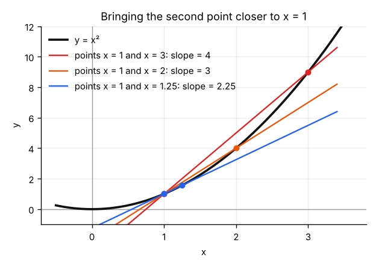
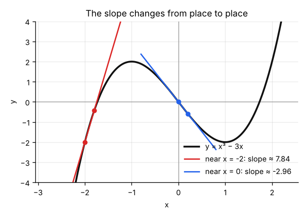

# Experiments with slopes: how steep is a curve?

The slope of a line says how steep it is. For every step to the right, the slope says how far the line goes up, or down when the slope is negative. On this page you write a function for the slope between two points, then pass other functions into it to measure how steep a curve is at a single point. The rules come from what you measure.

We measure slope with two points. The change in y is the rise, the change in x is the run, and the slope is the rise divided by the run.

$$\text{slope} = \frac{y_2 - y_1}{x_2 - x_1}$$


## 1. Slope between two points

**1.1** Write `slope(x1, y1, x2, y2)`. The points in the picture should give 2.0.

```python exec
id: slope-between-two-points-1
def slope(x1, y1, x2, y2):
    # your code here
    return 0

print(slope(1, 3, 4, 9))
```

<details class="dl-hint"><summary>smaller steps</summary>

1. In the picture, the rise is 9 − 3. Which arguments hold those two numbers?
2. The run is 4 − 1. Which arguments hold those?
3. Store the rise and the run in two variables, then return one divided by the other.

</details>

```solution
def slope(x1, y1, x2, y2):
    rise = y2 - y1
    run = x2 - x1
    return rise / run

print(slope(1, 3, 4, 9))
```

```inputs
slope(1, 3, 4, 9)
slope(0, 0, 2, -4)    # a line going down
slope(1, 5, 3, 5)     # a flat line
```

**1.2** Swap the two points: `slope(4, 9, 1, 3)`. Does the order matter? Why not?

**1.3** Try `slope(2, 5, 2, 8)`. Read the error. What does the line through those two points look like, and why has it no slope?

```python exec
id: slope-between-two-points-2
def slope(x1, y1, x2, y2):
    return (y2 - y1) / (x2 - x1)

print(slope(2, 5, 2, 8))
```

**1.4** Add an `if` so that `slope` returns `None` instead of crashing when the run is zero.

```python exec
id: slope-between-two-points-3
def slope(x1, y1, x2, y2):
    # your code here
    return (y2 - y1) / (x2 - x1)

print(slope(2, 5, 2, 8))
print(slope(1, 3, 4, 9))
```

```solution
def slope(x1, y1, x2, y2):
    if x2 == x1:
        return None
    return (y2 - y1) / (x2 - x1)

print(slope(2, 5, 2, 8))
print(slope(1, 3, 4, 9))
```

## 2. Where the line crosses the y-axis

The height where a line crosses the y-axis is called the y-intercept. In the picture it is 1.

**2.1** Write `y_intercept(x1, y1, x2, y2)`, which finds where the line through two points crosses the y-axis. It can call `slope`. The points in the picture should give 1.0.

```python exec
id: where-the-line-crosses-1
def slope(x1, y1, x2, y2):
    return (y2 - y1) / (x2 - x1)

def y_intercept(x1, y1, x2, y2):
    # your code here
    return 0

print(y_intercept(1, 3, 4, 9))
```

<details class="dl-hint"><summary>smaller steps</summary>

1. Start at the point (1, 3) in the picture. How many steps left do you walk to reach x = 0?
2. The slope is 2. For each step left, does the line go up or down, and by how much?
3. So what height is the line at when you reach x = 0?
4. Now start at (4, 9) instead. How many steps left, and how far down? Do you reach the same height?
5. Starting from any point (x1, y1) with slope m, how far down do you go on the walk back to x = 0?

</details>

```solution
def slope(x1, y1, x2, y2):
    return (y2 - y1) / (x2 - x1)

def y_intercept(x1, y1, x2, y2):
    m = slope(x1, y1, x2, y2)
    return y1 - m * x1

print(y_intercept(1, 3, 4, 9))
---
Walking back x1 steps to the y-axis, the line drops m for every step, so it drops m × x1 in all.
```

```inputs
y_intercept(1, 3, 4, 9)
y_intercept(0, 7, 1, 9)     # the first point is on the y-axis
y_intercept(2, 1, 4, -3)
```

**2.2** Write `describe_line(x1, y1, x2, y2)`, which returns a string such as `"y = 2.0x + 1.0"`. What does yours show for the points (2, 1) and (4, −3)? Can you make it show `- 3.0` rather than `+ -3.0`?

```python exec
id: where-the-line-crosses-2
# your code here
```

<details class="dl-hint"><summary>smaller steps</summary>

1. Find the slope and the intercept with the functions you already have, and store them.
2. Build the string with an f-string, such as `f"y = {m}x + {b}"`.
3. Add an `if` for a negative intercept. In that case, which sign do you write, and which number?

</details>

```solution
def slope(x1, y1, x2, y2):
    return (y2 - y1) / (x2 - x1)

def describe_line(x1, y1, x2, y2):
    m = slope(x1, y1, x2, y2)
    b = y1 - m * x1
    if b < 0:
        return f"y = {m}x - {-b}"
    return f"y = {m}x + {b}"

print(describe_line(1, 3, 4, 9))
print(describe_line(2, 1, 4, -3))
```

## 3. A function inside a function

So far every argument has been a number. In Python a function is a value too, so one function can be passed into another.

**3.1** Predict what this prints, then run it.

```python exec
id: a-function-inside-a-function-1
def f(x):
    return x ** 2

def apply_twice(func, value):
    return func(func(value))

print(apply_twice(f, 3))
```

**3.2** Change the last line to `print(apply_twice(f(3), 3))` and read the error. What is the difference between `f` and `f(3)`?

**3.3** Write your own function `add_one(x)` and pass it to `apply_twice` instead of `f`. Predict the answer first.

```python exec
id: a-function-inside-a-function-2
def apply_twice(func, value):
    return func(func(value))

# your code here
```

```solution
def apply_twice(func, value):
    return func(func(value))

def add_one(x):
    return x + 1

print(apply_twice(add_one, 3))
```

## 4. Slope between two points on a curve

The curve $y = x^2$ has no single slope, because its steepness changes as we move along it. We can still pick two points on the curve and measure the line that joins them.



**4.1** Write `slope_between(func, a, b)`, which returns the slope of the line joining the points of the curve at x = a and x = b. `slope_between(f, 1, 3)` should give 4.0.

```python exec
id: slope-on-a-curve-1
def f(x):
    return x ** 2

def slope_between(func, a, b):
    # your code here
    return 0

print(slope_between(f, 1, 3))
```

<details class="dl-hint"><summary>smaller steps</summary>

1. The first point has x = a. What is its height? Write it with `func`.
2. Do the same for the second point.
3. The rise is the difference in heights and the run is the difference in x. Divide one by the other.

</details>

```solution
def f(x):
    return x ** 2

def slope_between(func, a, b):
    return (func(b) - func(a)) / (b - a)

print(slope_between(f, 1, 3))
```

```inputs
slope_between(f, 1, 3)
slope_between(f, 1, 2)
slope_between(f, 1, 1.25)
slope_between(f, -2, 0)    # left of the bottom of the curve
```

**4.2** Keep `a = 1` and move `b` closer: 2, 1.5, 1.1, 1.01, 1.001. Print one line for each value of `b`. Which number are the slopes heading towards? Try the same from the other side, with `b` at 0, 0.5, 0.9, 0.99 and 0.999.

```python exec
id: slope-on-a-curve-2
def f(x):
    return x ** 2

def slope_between(func, a, b):
    return (func(b) - func(a)) / (b - a)

# your loop here
```

```solution
def f(x):
    return x ** 2

def slope_between(func, a, b):
    return (func(b) - func(a)) / (b - a)

for b in [2, 1.5, 1.1, 1.01, 1.001]:
    print(b, slope_between(f, 1, b))
for b in [0, 0.5, 0.9, 0.99, 0.999]:
    print(b, slope_between(f, 1, b))
```

When the second point is very close to the first, the line between them barely cuts the curve. Its slope tells us how steep the curve is at that one point. We will call it the slope at a point.

## 5. The slope at a point

**5.1** Write `slope_at(func, a, h=0.0001)`, which returns the slope between `a` and `a + h`. The `h=0.0001` is a default: when you leave `h` out, Python uses 0.0001.

```python exec
id: the-slope-at-a-point-1
def f(x):
    return x ** 2

def slope_at(func, a, h=0.0001):
    # your code here
    return 0

print(slope_at(f, 1))
```

```solution
def f(x):
    return x ** 2

def slope_at(func, a, h=0.0001):
    return (func(a + h) - func(a)) / h

print(slope_at(f, 1))
```

**5.2** Print the slope of $y = x^2$ at every whole number from −3 to 5, rounded with `round(value, 2)`. Look at the list. Find a rule that gives the slope at any x, write it as a function `slope_rule(x)`, and check it against `slope_at` at x = 10 and x = −7.

```python exec
id: the-slope-at-a-point-2
def f(x):
    return x ** 2

def slope_at(func, a, h=0.0001):
    return (func(a + h) - func(a)) / h

for x in range(-3, 6):
    print(x, round(slope_at(f, x), 2))

def slope_rule(x):
    # your rule here
    return 0
```

<details class="dl-hint"><summary>smaller steps</summary>

1. Look only at x = 0, 1, 2 and 3. How does the slope change each time x goes up by 1?
2. What is the slope when x is 0? What does that tell you about the bottom of the curve?
3. Compare each slope with its x. Is it bigger by the same amount, or bigger by the same multiple?
4. Do the negative values of x follow the same rule?

</details>

```solution
def f(x):
    return x ** 2

def slope_at(func, a, h=0.0001):
    return (func(a + h) - func(a)) / h

def slope_rule(x):
    return 2 * x

for x in [10, -7]:
    print(x, round(slope_at(f, x), 2), slope_rule(x))
```

## 6. Other curves: questions to think about

This section has no answers to check. The questions are for testing in code and talking over with someone.

**6.1** Make a list of slopes in the same way for $y = 3x^2$, $y = x^2 + x$ and $y = x^3$. Can you find a rule for each one?

**6.2** Is there a rule that links a curve to its slopes? What happens to the slopes when you multiply a curve by 3? What happens when you add $x$ to it?

**6.3** What is the slope of a straight line such as $y = 3x + 1$ everywhere? Why?

```python exec
id: other-curves-1
def slope_at(func, a, h=0.0001):
    return (func(a + h) - func(a)) / h

def g(x):
    return 3 * x ** 2

for x in range(-3, 6):
    print(x, round(slope_at(g, x), 2))
```

<details class="dl-hint"><summary>ways in</summary>

1. Change only the `return` line of `g` each time, and keep the loop the same.
2. Put the slopes of $x^2$ and $3x^2$ side by side. How are the two lists related?
3. For $x^3$, compare each slope with the square of its x.

</details>

## 7. A curve that goes up and down



**7.1** Before you compute anything, look at the picture. At which values of x should the slope be zero? Where should it be negative? Then check your answers with `slope_at`.

```python exec
id: a-curve-that-goes-up-and-down-1
def slope_at(func, a, h=0.0001):
    return (func(a + h) - func(a)) / h

def g(x):
    return x ** 3 - 3 * x

# your code here
```

**7.2** Can a curve have the same slope at two different points? Look for an example on this curve, or on $x^2$. Is there a curve where the slope is the same everywhere?

<details class="dl-hint"><summary>ways in</summary>

1. Print the slope of this curve at every whole number from −3 to 3 and look for repeats.
2. Is the curve symmetrical in any way? What does that do to its slopes?

</details>

## 8. A detour: when h gets too small

**8.1** Run `slope_at(f, 1, h)` for `h` equal to `1e-4`, `1e-8`, `1e-12` and `1e-15`. The answer should stay close to 2. Where does it start to go wrong?

```python exec
id: when-h-gets-too-small-1
def f(x):
    return x ** 2

def slope_at(func, a, h=0.0001):
    return (func(a + h) - func(a)) / h

for h in [1e-4, 1e-8, 1e-12, 1e-15]:
    print(h, slope_at(f, 1, h))
```

A computer stores a decimal with only about 16 significant digits. Subtracting two numbers that are almost equal throws most of those digits away, and dividing by a tiny `h` makes the leftover error large.
