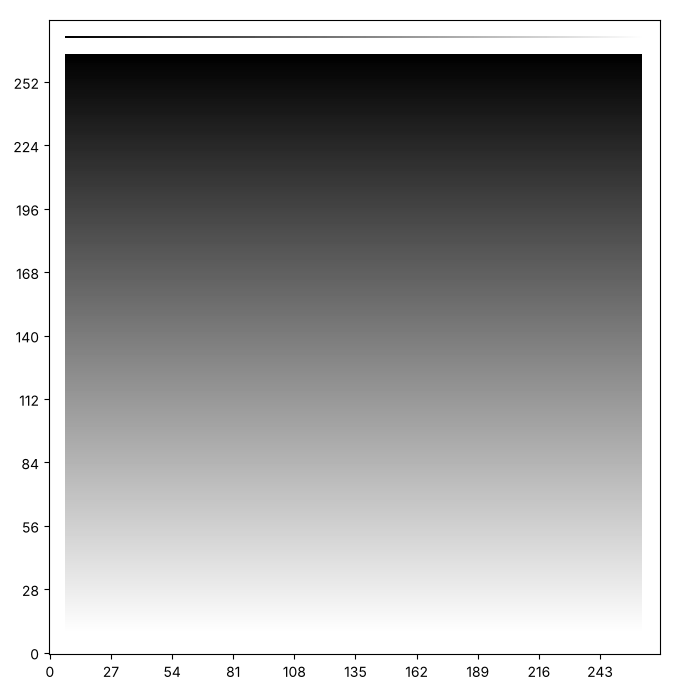

# Fading ink and gradients: painting with different amounts

So far every paint added 1 ink. A square can hold more, and the more ink
it holds, the darker it looks. Run this cell. Each square in the middle
row gets one more layer of ink than the square on its left.

```python exec
id: layers-of-ink-1
canvas = make_canvas(3, 8)
for column in range(8):
    for layer in range(column + 1):
        paint_point(canvas, 1, column)
print(canvas[1])
show_picture(canvas, darkest=8)
```

The numbers climb from 1 to 8, and the squares climb from pale grey to
black. Now change `darkest=8` to `darkest=4` and run the cell again.
Which squares look the same now? The picture changes, and the numbers
do not. `darkest` is only the number that the picture treats as black. It can
be as large as 255, the biggest number that a square of a real picture
holds.

A smooth change from light to dark is a *gradient*. This page makes two
functions that paint with a changing amount of ink: one for a line that
fades, and one for a block that fades.

## A line that fades

How would you paint a line that starts dark and fades as it goes? A fade
of length 4 puts 4, 3, 2 and 1 ink on four squares in a row.

```python exec
id: a-line-that-fades-1
toolkit: yes
expect: (lambda c: (paint_fade(c, 0, 1, 3), c[0] == [0, 3, 2, 1, 0])[1])(make_canvas(1, 5))
def paint_fade(canvas, row, column, length):
    """Paint a horizontal line of length squares, starting at this column. The first square gets length ink, each square after it gets 1 less, and the last gets 1."""
    # How much ink does the square at step 0 get? At step 1?
    # Is there one rule that gives both numbers?
    ...
```

```python toolkit-reference
for: a-line-that-fades-1
def paint_fade(canvas, row, column, length):
    """Paint a horizontal line of length squares, starting at this column. The first square gets length ink, each square after it gets 1 less, and the last gets 1."""
    for step in range(length):
        canvas[row][column + step] = canvas[row][column + step] + (length - step)
```

```hint
after: 3 errors
For the square at step 0 of the line, how much ink do you add? And for
the square at step 1? What formula gives both numbers?
```

```solution
title: add the number to the square
def paint_fade(canvas, row, column, length):
    """Paint a horizontal line of length squares, starting at this column. The first square gets length ink, each square after it gets 1 less, and the last gets 1."""
    for step in range(length):
        canvas[row][column + step] = canvas[row][column + step] + (length - step)
---
Here is one answer. Yours may be different and work too. `step` counts
from 0, so `length - step` gives length, then length - 1, down to 1.
```

```solution
title: paint a square several times
def paint_fade(canvas, row, column, length):
    """Paint a horizontal line of length squares, starting at this column. The first square gets length ink, each square after it gets 1 less, and the last gets 1."""
    for step in range(length):
        for layer in range(length - step):
            paint_point(canvas, row, column + step)
---
A second way. It calls `paint_point` once for every layer of ink, so it
reuses a function you already have. The first answer does the same
thing in fewer steps.
```

Here is a fade of length 64 on a wide canvas. The cell prints the largest
number of ink on the row.

```python exec
id: a-line-that-fades-2
canvas = make_canvas(20, 80)
paint_fade(canvas, 10, 8, 64)
print(max(canvas[10]))
show_picture(canvas, darkest=64)
```

```predict
type: number

What is the largest number of ink on the row? The cell prints it.
```

## A block that fades

A block that fades is a stack of rows, where every row has a little more
ink than the one before it. How would you paint one?

```python exec
id: a-block-that-fades-1
toolkit: yes
expect: (lambda c: (paint_gradient(c, 0, 0, 2, 1), c == [[1, 1], [2, 2], [3, 3], [0, 0]])[1])(make_canvas(4, 2))
def paint_gradient(canvas, first_row, first_column, last_row, last_column):
    """Paint a block whose first row gets 1 ink. Each row after it gets 1 more, so the last row gets as much ink as the block has rows."""
    # How much ink does the first row get? The second? Is there one rule for both?
    # How many rows does the block have?
    ...
```

```python toolkit-reference
for: a-block-that-fades-1
def paint_gradient(canvas, first_row, first_column, last_row, last_column):
    """Paint a block whose first row gets 1 ink. Each row after it gets 1 more, so the last row gets as much ink as the block has rows."""
    for step in range(last_row - first_row + 1):
        for column in range(first_column, last_column + 1):
            canvas[first_row + step][column] = canvas[first_row + step][column] + (step + 1)
```

```hint
after: 3 errors
How much ink does the first row get, and the second? What number goes up
by 1 for every row, and where does your loop count it?
```

```solution
def paint_gradient(canvas, first_row, first_column, last_row, last_column):
    """Paint a block whose first row gets 1 ink. Each row after it gets 1 more, so the last row gets as much ink as the block has rows."""
    for step in range(last_row - first_row + 1):
        for column in range(first_column, last_column + 1):
            canvas[first_row + step][column] = canvas[first_row + step][column] + (step + 1)
---
Here is one answer. Yours may be different and work too. `step` counts
from 0, so `step + 1` gives 1 for the first row. The block has
`last_row - first_row + 1` rows, because the last row is also part of it.
```

Can you make this picture? Why does it need a `darkest` of 255?



```python exec
id: a-block-that-fades-2
# Your fade and your gradient
```

```solution
# From earlier on this page, repeated so that this answer runs on its own
def paint_fade(canvas, row, column, length):
    for step in range(length):
        canvas[row][column + step] = canvas[row][column + step] + (length - step)

def paint_gradient(canvas, first_row, first_column, last_row, last_column):
    height = last_row - first_row + 1
    for step in range(height):
        for column in range(first_column, last_column + 1):
            canvas[first_row + step][column] = canvas[first_row + step][column] + (step + 1)

canvas = make_canvas(280, 270)
paint_gradient(canvas, 10, 7, 264, 261)
paint_fade(canvas, 272, 7, 255)
show_picture(canvas, darkest=255)
---
Here is one answer. Yours may be different and work too. The gradient
block has 255 rows, and the fade is 255 squares long, so the darkest square
holds 255 ink. A `darkest` of 255 shows every step between white and
black, as a real greyscale picture does.
```

Now try your own. Can you make the ink fade from left to right inside a
block? What stays the same as `paint_gradient`, and what changes?

## Your turn: a sky

Can you paint a sky that is dark at the top and pale near the ground?
Put a building in front of it, with its own ink. Which end of the canvas
is the top? Before you run the
cell, write a guess in a comment: where will the building look darker
than the sky, and where lighter?

```python exec
id: your-turn-1
# Your sky and building
```

```hint
The sky is a gradient across the whole width. The building is a
rectangle painted on top, so its squares hold the sky's ink plus its
own. How much `darkest` do you need to see both?
```

```solution
# From earlier on this page, repeated so that this answer runs on its own
def paint_gradient(canvas, first_row, first_column, last_row, last_column):
    height = last_row - first_row + 1
    for step in range(height):
        for column in range(first_column, last_column + 1):
            canvas[first_row + step][column] = canvas[first_row + step][column] + (step + 1)

canvas = make_canvas(100, 120)
paint_gradient(canvas, 60, 0, 99, 119)
for layer in range(20):
    paint_rectangle(canvas, 0, 30, 74, 70)
show_picture(canvas, darkest=40)
---
Here is one answer. Yours may be different and work too. The building
holds 20 ink, which is half of `darkest`, so it is mid grey. In rows 60
to 74 it stands in front of the sky and adds its ink to the sky's, so it
is darker there.
```

## Looking back

A gradient needs a number to say what counts as black. If you changed
only `darkest`, could the same canvas show a dark sky or a pale sky?
What would change in the numbers, and what in the picture?

A challenge: add a sun that is a bright disc against the dark sky. What
does "bright" mean when more ink is darker?

```python challenge
# A sun against a dark sky.
canvas = make_canvas(100, 120)
```

The next page, [Lines from equations](tutorial:lines-from-equations),
draws straight lines of any slope, using the rule $y = ax + b$.

## Where to read more

Wikipedia. *Color gradient.*
<https://en.wikipedia.org/wiki/Color_gradient>. Gradients in graphics,
and where they appear in design.

Downey, A. B. (2015). *Think Python: How to Think Like a Computer
Scientist* (2nd ed.). Green Tea Press.
<https://greenteapress.com/wp/think-python-2e/>. Chapter 7 on iteration
has the loops that this page counts with.
