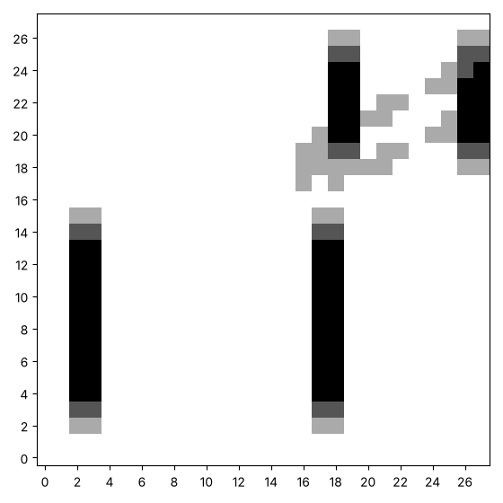
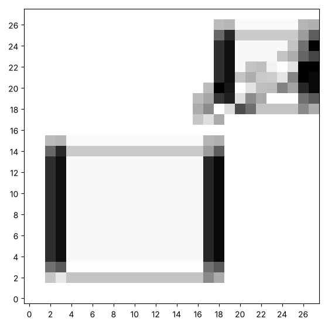

# How wrong is a kernel? Scoring a guess

Now we turn the question around. Somewhere a kernel has made a picture
from our practice picture, and we can see the result but not the kernel.
If we guess a kernel, how do we know how close it is? This page gives a
guess a **score**, and then tries guessing at random. Here is the result
we want to match, and the best of a thousand random guesses. Yours will
look different, and that is the point.





This page adds three functions to your toolkit: `score`, `random_kernel`
and `best_of_random`.

## A score for a guess

We can guess a kernel, convolve it with the practice picture, and
compare what we get with the result. How would you measure how far apart
two canvases are, as a single number? Which number should mean that they
match exactly?

One way is to take the difference at every square, square it so that the
signs cannot cancel, and average. That number is the score of a guess,
and a lower score is a better guess. Before you run anything, guess:
what will the score be for the kernel that leaves the picture alone?

```python exec
id: score-1
toolkit: yes
expect: score([[1, 2]], [[1, 4]]) == 2 and score([[1]], [[1]]) == 0
def score(first, second):
    """The average of the squared difference at every square of two canvases of the same size. 0 means they match exactly."""
    # Inputs: two canvases of the same size. Returns: one number. What type is it?
    # In words: the average of the squared difference at every square.
    # Why do we square the difference? What is the score of two canvases that match exactly?
    ...
```

```python toolkit-reference
for: score-1
def score(first, second):
    total = 0
    for row in range(len(first)):
        for column in range(len(first[0])):
            difference = first[row][column] - second[row][column]
            total = total + difference * difference
    return total / (len(first) * len(first[0]))        # the average squared difference
```

```hint
after: 3 errors
For `[[1, 2]]` and `[[1, 4]]` the differences are 0 and -2, the squares
are 0 and 4, and the average is 2. What does your function give?
```

```solution
def score(first, second):
    total = 0
    for row in range(len(first)):
        for column in range(len(first[0])):
            difference = first[row][column] - second[row][column]
            total = total + difference * difference
    return total / (len(first) * len(first[0]))        # the average squared difference
---
Here is one answer. Yours may be different and work too. Squaring makes
every term positive and punishes large errors more than small ones. A
score of 0 means a perfect match. In machine learning this is called the
loss.
```

The cell below makes `target`, the result of a hidden kernel on the
practice picture. It is shown as the size of each number.


```python exec
id: mystery-1
# PROVIDED. A small picture to practise on: a block, a smaller block and a slanted line.
practice = make_canvas(30, 30)
paint_rectangle(practice, 4, 4, 15, 18)
paint_rectangle(practice, 20, 20, 26, 27)
paint_line(practice, 0.5, 10, 18, 29)
show_picture(practice)

# PROVIDED. A hidden kernel has been used on the practice picture. We keep only what it made.
target = convolve(practice, [[-1, 0, 1], [-1, 0, 1], [-1, 0, 1]])   # the hidden kernel
show_picture(absolute(target), darkest=3)
```

What does the score say about a kernel that leaves the picture alone?
What does it say about the up and down edge kernel from the last page?
Guess a kernel of your own, and see how low you can get the score.

```python exec
id: guess-1
guess = [[0, 0, 0],
         [0, 1, 0],
         [0, 0, 0]]
print(score(convolve(practice, guess), target))
guess = [[-1, 0, 1],
         [-1, 0, 1],
         [-1, 0, 1]]
print(score(convolve(practice, guess), target))
```

```predict
type: number

What is the last number the cell prints? It is the score of the kernel
that finds up and down edges.
```

What score does a kernel get if one row of the right answer is missing?
What about if every weight of the right answer is a little too big?

```python exec
id: guess-2
guess = [[-1, 0, 1],
         [-1, 0, 1],
         [ 0, 0, 0]]                              # one row of the right answer is missing
print(score(convolve(practice, guess), target))
```

## Guessing at random

The simplest way to find a kernel is to try some. `random.uniform(-1,
1)` gives a decimal between -1 and 1. How would you make a random
kernel? How would you try many of them, and keep the one with the lowest
score? Predict how the best score changes when we try 10 kernels, 100
and 1000.

```python exec
id: random-kernel-1
toolkit: yes
expect: len(random_kernel(3, 1)) == 3 and all(len(r) == 3 for r in random_kernel(3, 1)) and all(-1 <= w <= 1 for r in random_kernel(3, 1) for w in r) and random_kernel(3, 1) == random_kernel(3, 1) and random_kernel(3, 1) != random_kernel(3, 2)
import random
def random_kernel(size, seed):
    """A size-by-size kernel whose weights are random decimals between -1 and 1. The same seed gives the same kernel."""
    # Returns: a kernel, which is a list of lists. How many rows and columns does it have?
    # Every weight is a random decimal between -1 and 1 (random.uniform gives one).
    # Where does random.seed belong, so that a seed gives the same kernel every time?
    ...
```

```python toolkit-reference
for: random-kernel-1
import random
def random_kernel(size, seed):
    random.seed(seed)
    kernel = []
    for row in range(size):
        kernel.append([random.uniform(-1, 1) for column in range(size)])    # uniform gives a decimal in a range
    return kernel
```

```hint
after: 3 errors
A 3 by 3 kernel is a list of 3 lists with 3 numbers each. Print
`random_kernel(3, 1)` twice. Are the two the same? Print it with the
seed 2. Is that different?
```

```solution
import random
def random_kernel(size, seed):
    random.seed(seed)
    kernel = []
    for row in range(size):
        kernel.append([random.uniform(-1, 1) for column in range(size)])    # uniform gives a decimal in a range
    return kernel
---
Here is one answer. Yours may be different and work too. The seed is set
once, then a new row is built for each of the `size` rows, with its own
list of random weights.
```

```python exec
id: best-of-random-1
toolkit: yes
expect: (lambda p, t: best_of_random(p, t, 20, 1)[1] <= best_of_random(p, t, 1, 1)[1] and len(best_of_random(p, t, 5, 1)[0]) == 3)([[1, 2, 3, 4], [5, 6, 7, 8], [9, 1, 2, 3], [4, 5, 6, 7]], [[1, 1], [1, 1]])
import random
def best_of_random(canvas, target, tries, seed):
    """Try `tries` random kernels. Return the best kernel and its score against target."""
    # Returns: two things, the best kernel found and its score. A function can return a pair.
    # In words: make a random kernel, convolve it with the canvas, and score the result against target.
    # Do it tries times, and keep the best. Which seed should each try use, so that the kernels differ?
    ...
```

```python toolkit-reference
for: best-of-random-1
import random
def best_of_random(canvas, target, tries, seed):
    best_kernel = random_kernel(3, seed)
    best_score = score(convolve(canvas, best_kernel), target)
    for attempt in range(1, tries):
        kernel = random_kernel(3, seed + attempt)
        kernel_score = score(convolve(canvas, kernel), target)
        if kernel_score < best_score:
            best_kernel = kernel
            best_score = kernel_score
    return best_kernel, best_score
```

```hint
after: 3 errors
More tries can only keep or improve the best score, because you keep the
best so far. Does yours get worse with more tries? Where do you update
the best?
```

```solution
import random
def best_of_random(canvas, target, tries, seed):
    best_kernel = random_kernel(3, seed)
    best_score = score(convolve(canvas, best_kernel), target)
    for attempt in range(1, tries):
        kernel = random_kernel(3, seed + attempt)
        kernel_score = score(convolve(canvas, kernel), target)
        if kernel_score < best_score:
            best_kernel = kernel
            best_score = kernel_score
    return best_kernel, best_score
---
Here is one answer. Yours may be different and work too. Keeping the
best so far means the score can only go down. The seed `seed + attempt`
gives each try a different kernel.
```

Can you try 10, 100 and 1000 random kernels, and show the picture that
the best one makes? It should look a bit like the mystery result.


```python exec
id: best-guess-1
# Your best random kernel, and its picture
```

```solution
{{include: setup/painting/toolkit.py}}

# PROVIDED. A small picture to practise on: a block, a smaller block and a slanted line.
practice = make_canvas(30, 30)
paint_rectangle(practice, 4, 4, 15, 18)
paint_rectangle(practice, 20, 20, 26, 27)
paint_line(practice, 0.5, 10, 18, 29)
show_picture(practice)
# PROVIDED. A hidden kernel has been used on the practice picture. We keep only what it made.
target = convolve(practice, [[-1, 0, 1], [-1, 0, 1], [-1, 0, 1]])

for tries in [10, 100, 1000]:
    kernel, kernel_score = best_of_random(practice, target, tries, 1)
    print(tries, "tries: best score", round(kernel_score, 3))
show_picture(absolute(convolve(practice, kernel)), darkest=3)
---
Here is one answer. Yours may be different and work too. With nine
weights the space of kernels is large, so random guessing improves only
slowly. The best random kernel can look nothing like the right answer
and still score reasonably, because many kernels give similar outputs on
this picture.
```

How close did the best random kernel come to the numbers of the right
answer? Print its weights and compare.

## Looking back

Random guessing ignores everything it learns. After a good guess, why
not try kernels near it? What would you need to decide?

A challenge: make the guess better by trying random kernels near the
best one so far, and see how the score falls.

```python challenge
# Guessing near the best guess. Your toolkit has score, random_kernel and convolve.
import random
```

## Where to read more

Wikipedia. *Random search.*
<https://en.wikipedia.org/wiki/Random_search>. The idea of trying random
candidates, and why it is a useful baseline for smarter methods.
