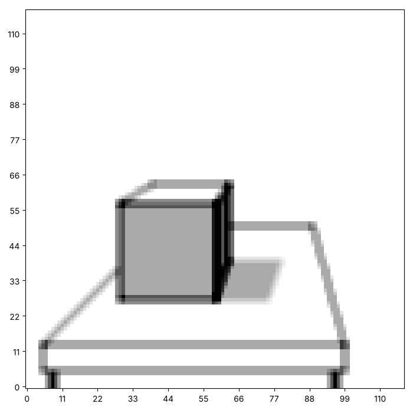
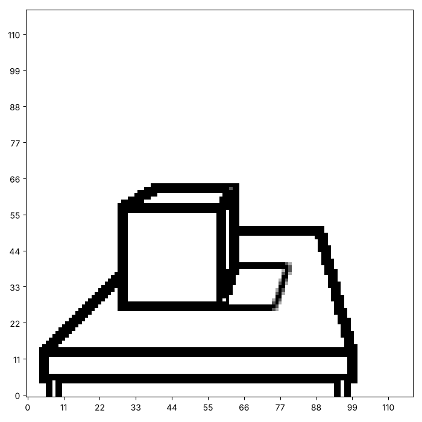
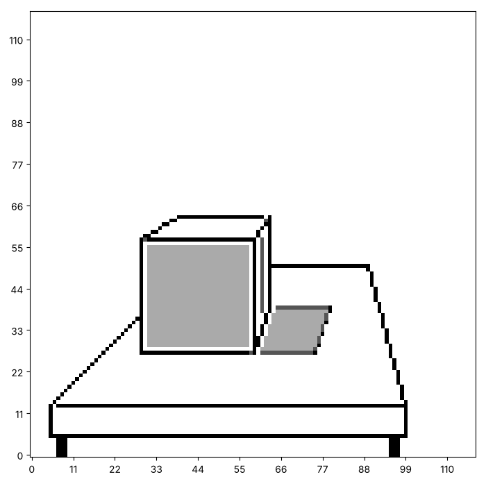
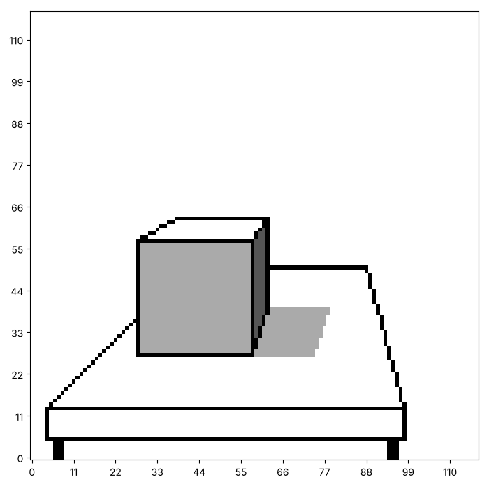
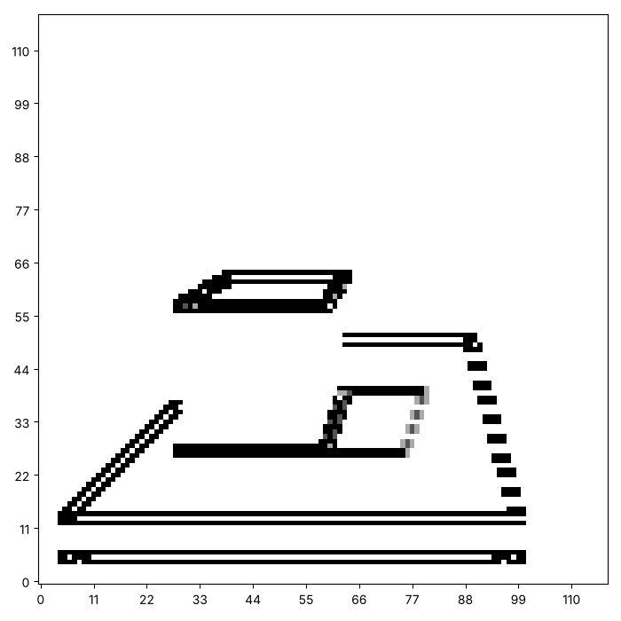

# Kernels at work: blur, edges and sharpen

A convolution with the right kernel can blur a picture, sharpen it or
find its edges. Here are a cube on a table, and what three kernels do to
it. Yours will look different, and that is the point.






This page adds one function to your toolkit, `absolute`, and tries four
kernels. We start from a picture to work on.

## A picture to work on

The cell below is the cube from the page on lines, packed into a
function so that we can ask for it by name. It is provided, so you do
not need to write it. Run it, and then ask for the cube.

```python exec
id: the-cube-1
toolkit: yes
expect: len(cube_picture()) == 120
# PROVIDED. The cube on a table, from the page on lines.
def cube_picture():
    """A cube on a table in perspective. Edges hold 3 ink, so show it with darkest=3."""
    canvas = make_canvas(120, 120)

    for row in range(28, 41):                    # the shadow on the table, to the right of the cube
        left = round(60 + (row - 28) / 3)
        paint_horizontal(canvas, row, left, left + 16)
    paint_rectangle(canvas, 28, 30, 58, 60)      # the front face
    for x in range(60, 65):                      # the shaded side, one column at a time
        for layer in range(2):
            paint_vertical(canvas, x, round(3 * x - 152), round(1.5 * x - 32))

    for layer in range(3):
        paint_horizontal(canvas, 14, 6, 100)     # the table: front edge and back edge
        paint_horizontal(canvas, 51, 65, 90)     # the cube hides the rest of the back edge
        paint_line(canvas, 1, 8, 6, 29)          # its two sides run towards the vanishing point
        paint_line(canvas, -3.7, 384, 90, 100)   # the cube hides the left side from x = 30
        paint_horizontal(canvas, 6, 6, 100)      # the table's edge, and its legs
        paint_vertical(canvas, 6, 6, 14)
        paint_vertical(canvas, 100, 6, 14)
        paint_rectangle(canvas, 0, 8, 5, 10)
        paint_rectangle(canvas, 0, 96, 5, 98)
        paint_horizontal(canvas, 28, 30, 60)     # the front face of the cube
        paint_horizontal(canvas, 58, 30, 60)
        paint_vertical(canvas, 30, 28, 58)
        paint_vertical(canvas, 60, 28, 58)
        paint_horizontal(canvas, 64, 40, 64)     # the back edges, seen above and beside it
        paint_vertical(canvas, 64, 40, 64)
        paint_line(canvas, 0.6, 40, 30, 40)      # three edges that run back to the vanishing point
        paint_line(canvas, 1.5, -32, 60, 64)
        paint_line(canvas, 3, -152, 60, 64)
    return canvas
```

```python exec
id: the-cube-2
picture = cube_picture()
show_picture(picture, darkest=3)
```

## Blur

Every weight is $1/9$, so each new square is the average of nine
squares. What do you expect the blurred cube to look like? Try a 5 by 5
kernel of $1/25$ as well. How could you make it with a loop, so that you
do not type 25 numbers? What does a bigger kernel do?

```python exec
id: blur-1
blur = [[1 / 9, 1 / 9, 1 / 9],
        [1 / 9, 1 / 9, 1 / 9],
        [1 / 9, 1 / 9, 1 / 9]]
show_picture(picture, darkest=3)
show_picture(convolve(picture, blur), darkest=3)
```

```predict
type: choice

How will the blurred cube look next to the original?

- Sharper, with darker edges
  - Averaging does the opposite: it spreads each square into its
    neighbours.
- Softer, with fuzzy edges
- The same
  - The kernel is not the identity, so something changes.
```

## Edges

An edge is a place where neighbours differ. The weights of this kernel
add up to 0, so a flat area gives 0. `show_picture` draws any number
below 0 as white, so some edges will be missing. Why? How would you keep
both signs?

```python exec
id: edges-1
edges = [[-1, -1, -1],
         [-1,  8, -1],
         [-1, -1, -1]]
show_picture(convolve(picture, edges), darkest=3)
```

Write `absolute(canvas)`, a function that returns a new canvas with the
size of each number, and show the result again.

```python exec
id: absolute-1
toolkit: yes
expect: absolute([[1, -2], [-3, 4]]) == [[1, 2], [3, 4]]
def absolute(canvas):
    """A new canvas whose squares are the size of the squares of the old one, with the sign removed."""
    # Which Python function gives the size of a number? Which of your functions makes a blank canvas?
    ...
```

```python toolkit-reference
for: absolute-1
def absolute(canvas):
    result = make_canvas(len(canvas), len(canvas[0]))
    for row in range(len(canvas)):
        for column in range(len(canvas[0])):
            result[row][column] = abs(canvas[row][column])
    return result
```

```hint
after: 3 errors
Test `absolute` on a small canvas with a few negative numbers. Does your
function change the canvas it was given, or return a new one?
```

```solution
def absolute(canvas):
    result = make_canvas(len(canvas), len(canvas[0]))
    for row in range(len(canvas)):
        for column in range(len(canvas[0])):
            result[row][column] = abs(canvas[row][column])
    return result
---
Here is one answer. Yours may be different and work too. `abs` gives the
size of a number. The function returns a new canvas, so the one you gave
it stays as it was.
```

```python exec
id: edges-2
show_picture(absolute(convolve(picture, edges)), darkest=3)    # both sides of each edge show
```


Without `absolute`, only one side of each edge shows. With it, both
sides show.

## Sharpen

These weights add up to 1, so a flat area stays the same. What happens
at an edge?

```python exec
id: sharpen-1
sharpen = [[ 0, -1,  0],
           [-1,  5, -1],
           [ 0, -1,  0]]
show_picture(convolve(picture, sharpen), darkest=3)
```

```predict
type: choice

What will sharpen do to the flat grey face of the cube?

- Nothing, because the weights add up to 1
- Make it darker
  - Only the sum of the weights decides what a flat area does.
- Make it white
```



## Kernels of your own

Can you design a kernel that moves the picture one square to the left or
the right? Can you design one that finds only the edges that run across
the picture, and not the ones that run up it? How do you know it works?
Compare your kernel with the one for `edges`.



```python exec
id: kernels-own-1
# A kernel that shifts the picture
```

```solution
picture = cube_picture()
shift_right = [[0, 0, 0], [0, 0, 1], [0, 0, 0]]       # each square copies its neighbour
show_picture(convolve(picture, shift_right), darkest=3)
---
Here is one answer. Yours may be different and work too. A single 1
beside the centre copies a neighbour into each square. The picture moves
one square.
```



```python exec
id: kernels-own-2
# A kernel for edges that run across
```

```solution
# From earlier on this page, repeated so that this answer runs on its own
def absolute(canvas):
    result = make_canvas(len(canvas), len(canvas[0]))
    for row in range(len(canvas)):
        for column in range(len(canvas[0])):
            result[row][column] = abs(canvas[row][column])
    return result

picture = cube_picture()
vertical_only = [[-1, -2, -1], [0, 0, 0], [1, 2, 1]]  # finds edges that run across the picture
show_picture(absolute(convolve(picture, vertical_only)), darkest=3)
---
Here is one answer. Yours may be different and work too. The weights
subtract the row below from the row above, so only changes up and down
give a number. Changes along a row cancel.
```

## Looking back

The blur averages, so its weights sum to 1. Edge detection has weights
that sum to 0, so a flat area becomes 0. Sharpen adds the difference
from the neighbours back onto the square. A convolutional neural network
learns the numbers in its kernels. Where would the numbers come from, if
nobody chose them?

A challenge: blur the picture twice, or use a 5 by 5 kernel, and
compare. How much of the cube is left?

```python challenge
# Blur it twice. Your toolkit has convolve, absolute and cube_picture.
picture = cube_picture()
```

## Where to read more

Grant Sanderson (3Blue1Brown) (2022). *But what is a convolution?*
<https://www.youtube.com/watch?v=KuXjwB4LzSA>. Convolution from several
sides, including the one we use here.
