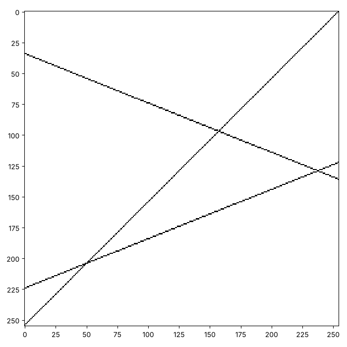
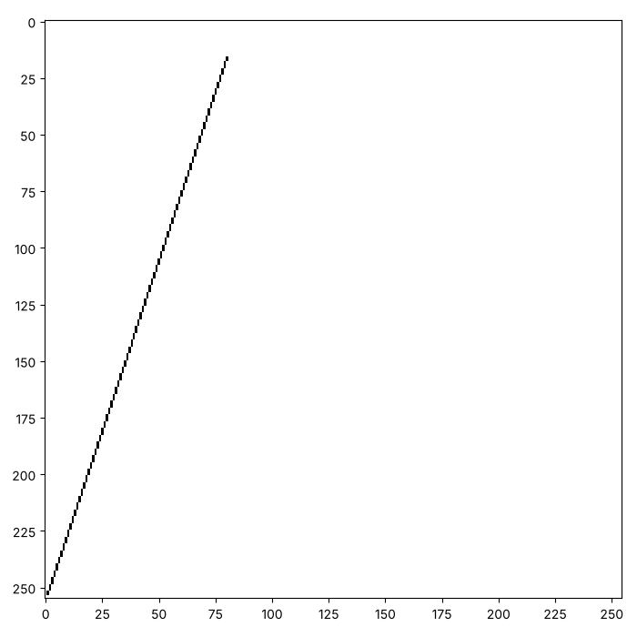

# Lines from equations: painting y = ax + b

The lines we have painted so far run along a row or down a column. A
line can also slope. Run the cell. It lists some points on the line
$y = 0.4x + 1$, and rounds each $y$ to the nearest whole number.

```python exec
id: points-on-a-line-1
for x in range(0, 8):
    y = 0.4 * x + 1
    print(x, y, round(y))
```

```predict
type: number

What will the last number on the last line be?
```

A straight line follows the rule $y = ax + b$. The number $a$ is the
*slope*, how much $y$ rises for each step of $x$. The number $b$ is the
value of $y$ when $x$ is 0. A canvas has only whole squares, so we find
$y$ for every whole $x$, round it, and paint that square. The pictures
on this page use a canvas of 255 by 255, so that a line has room to run.

## Where is (0, 0)?

A canvas counts its rows downwards from the top. A line on graph paper
has $y$ growing upwards. Many conventions are possible, and you choose
one. The target pictures put the point $(0, 0)$ in the bottom-left
square, so that $x$ is the column and $y$ counts up from the bottom row.
How would you turn $y$ into a row number?

Some squares of a line fall outside the canvas, and we skip them. A
check is needed here, because Python does not stop at a row of -1. Run
the cell.

```python exec
id: where-is-the-origin-1
letters = ["a", "b", "c"]
print(letters[-1])
```

```predict
type: text

What will the cell print?
```

A negative index counts from the end of the list. A row of -1 is the
last row, so a line that leaves the canvas at the bottom would quietly
paint along the top of the picture.

```python exec
id: paint-xy
toolkit: yes
expect: (lambda c: (paint_xy(c, 0, 0), paint_xy(c, 9, 9), paint_xy(c, -1, 1), c[2][0] == 1 and sum(map(sum, c)) == 1)[3])(make_canvas(3, 3))
def paint_xy(canvas, x, y):
    """Paint the square at the point (x, y), with (0, 0) in the bottom-left square. Do nothing when the point is off the canvas."""
    # How do you turn y into a row number?
    # Which two conditions must be true before the square is painted?
    # What does Python do with a row of -1?
    ...
```

```python toolkit-reference
for: paint-xy
def paint_xy(canvas, x, y):
    """Paint the square at the point (x, y), with (0, 0) in the bottom-left square. Do nothing when the point is off the canvas."""
    row = len(canvas) - 1 - y
    if 0 <= row < len(canvas) and 0 <= x < len(canvas[0]):
        paint_point(canvas, row, x)
```

```hint
after: 3 errors
On a canvas of 3 rows, which row holds the point where $y$ is 0? Which
two conditions must be true before `paint_point` is called?
```

```solution
def paint_xy(canvas, x, y):
    """Paint the square at the point (x, y), with (0, 0) in the bottom-left square. Do nothing when the point is off the canvas."""
    row = len(canvas) - 1 - y
    if 0 <= row < len(canvas) and 0 <= x < len(canvas[0]):
        paint_point(canvas, row, x)
---
Here is one answer. Yours may be different and work too. `0 <= row <
len(canvas)` rejects both a negative row and a row below the bottom. The
same test for `x` keeps the column inside the canvas.
```

## A line from a and b

How would you paint the line $y = ax + b$ between two values of $x$?

```python exec
id: a-line-from-a-and-b-1
toolkit: yes
expect: (lambda c: (paint_line(c, 1, 0, 0, 11), sum(map(sum, c)) == 12 and c[11][0] == 1 and c[0][11] == 1)[1])(make_canvas(12, 12))
def paint_line(canvas, a, b, start_x, end_x):
    """Paint the line y = a * x + b for every whole x from start_x to end_x."""
    # What is y for one x? How do you turn it into a whole number?
    # Which earlier function paints a point at (x, y)?
    # Does your function work for a steep line, such as a = 3? What do you see?
    ...
```

```python toolkit-reference
for: a-line-from-a-and-b-1
def paint_line(canvas, a, b, start_x, end_x):
    """Paint the line y = a * x + b for every whole x from start_x to end_x."""
    if abs(a) <= 1:
        for x in range(start_x, end_x + 1):
            paint_xy(canvas, x, round(a * x + b))
    else:
        first_y = round(a * start_x + b)
        last_y = round(a * end_x + b)
        for y in range(min(first_y, last_y), max(first_y, last_y) + 1):
            paint_xy(canvas, round((y - b) / a), y)
```

```hint
after: 3 errors
For $x = 0$ on the line $y = 0.4x + 1$, what is $y$? What does the
cell at the top of the page print for it? Which function paints that
square?
```

```solution
def paint_line(canvas, a, b, start_x, end_x):
    """Paint the line y = a * x + b for every whole x from start_x to end_x."""
    for x in range(start_x, end_x + 1):
        paint_xy(canvas, x, round(a * x + b))
---
Here is one answer. Yours may be different and work too. It steps
through $x$ and finds a $y$ for each. The next section shows where that
stops working.
```

Can you make this picture? It has three lines on a canvas of 255 by 255.
Before you run it, write a guess in a comment: which two lines meet
nearest the bottom-left corner?



```python exec
id: a-line-from-a-and-b-2
# Your three lines
```

```hint
Read three points off each line, using the numbers along the edge. How
much does $y$ rise when $x$ goes up by 100? That is $100a$, and it gives
you $a$.
```

```solution
{{include: setup/painting/toolkit.py}}

canvas = make_canvas(255, 255)
paint_line(canvas, 1, 0, 0, 254)
paint_line(canvas, 0.4, 30, 0, 254)
paint_line(canvas, -0.4, 220, 0, 254)
show_picture(canvas)
---
Here is one answer. Yours may be different and work too. The lines
$y = x$ and $y = 0.4x + 30$ meet where $x = 0.4x + 30$, which is at
$x = 50$.
```

A half-way value can round either way. Python's `round(2.5)` gives 2 and
`round(3.5)` gives 4, so a half-way value goes to the even number. The
lines above never land on a half, so the two ways agree. Try
$y = 0.5x + 20$ on your own and look at the steps it makes.

## A steep line

A line with a slope of 3 climbs three rows for each column. Can you make
this picture, a line with no gaps?



```python exec
id: a-steep-line-1
# Your steep line
```

```predict
type: choice

If your `paint_line` steps through $x$ only, how will its squares look?

- Joined, with no gaps
  - A line is made of squares that touch.
- In separate dots
  - Each whole $x$ gives one square, and the line climbs three rows for each.
```

When you try it, what do you see? Why do the squares not touch? What
would you change in `paint_line`, in its own cell above, so that a steep
line has no gaps? Run the cell above again afterwards.

```hint
for: a-steep-line-1
after: 2 unchanged runs
title: a way to start
There are only as many squares as there are whole values of $x$. For a
steep line, can you step through $y$ instead? The rule rearranged is
$x = (y - b) / a$. Which of the first and last $y$ is smaller when $a$
is negative?
```

```solution
for: a-steep-line-1
{{include: setup/painting/toolkit.py}}

canvas = make_canvas(255, 255)
paint_line(canvas, 3, -2, 1, 80)
show_picture(canvas)
---
Here is one answer. Yours may be different and work too. It needs a
`paint_line` that steps through $y$ for a steep line, like the toolkit
version. `min` and `max` make that work when $a$ is negative.
```

Now try your own. Paint a line that leaves the canvas at the bottom, and
a line with a negative slope. What does your `paint_xy` do with the
squares that are off the canvas?

## Your turn: a cube on a table

A cube on a table is a square for its front, a smaller set of edges
behind it, and slanted lines that join the two. Here is a picture to
try. Its canvas is 120 by 120. Which edges need `paint_line`, and which
can use the functions from the first page?


```python exec
id: your-turn-1
# Your cube on a table
```

```hint
Paint the front face as four lines. Paint the back top edge and back
right edge as two more. Then three slanted lines join the corners. Which
$a$ and $b$ fit a slanted line that goes up one row for every column?
```

```solution
{{include: setup/painting/toolkit.py}}

canvas = make_canvas(120, 120)
paint_rectangle(canvas, 41, 36, 74, 69)
for layer in range(2):
    paint_horizontal(canvas, 40, 35, 70)
    paint_horizontal(canvas, 75, 35, 70)
    paint_vertical(canvas, 35, 40, 75)
    paint_vertical(canvas, 70, 40, 75)
    paint_horizontal(canvas, 25, 50, 85)
    paint_vertical(canvas, 85, 25, 60)
    paint_line(canvas, 1, 44, 35, 50)
    paint_line(canvas, 1, 9, 70, 85)
    paint_line(canvas, 1, -26, 70, 85)
    paint_rectangle(canvas, 76, 10, 83, 100)
    paint_rectangle(canvas, 84, 18, 119, 21)
    paint_rectangle(canvas, 84, 88, 119, 91)
show_picture(canvas, darkest=2)
---
Here is one answer. Yours may be different and work too. The edges are
painted twice so that they look darker than the grey front face, and
`darkest=2` makes two ink black.
```

## Looking back

Your toolkit now holds every function behind the three pictures on the
first page of the series. What did you change in `paint_line` to make
steep lines join, and why did the change matter only for lines steeper
than 1?

A challenge: paint the diagonals of a square canvas, and then a star
shape made of lines through its centre.

```python challenge
# The two diagonals of a 255 by 255 canvas, and then more lines through its centre.
canvas = make_canvas(255, 255)
```

## Where to read more

Wikipedia. *Bresenham's line algorithm.*
<https://en.wikipedia.org/wiki/Bresenham%27s_line_algorithm>. The
method that computers use to draw a line quickly, using only whole
numbers. It solves the same problem as the steep line on this page.

Grant Sanderson (3Blue1Brown) (2016). *Essence of Linear Algebra,
Chapter 1: Vectors, What Even Are They?*
<https://www.youtube.com/watch?v=fNk_zzaMoSs>. The picture behind the
grids of numbers in the next series, and the start of a series worth
the whole hour.
