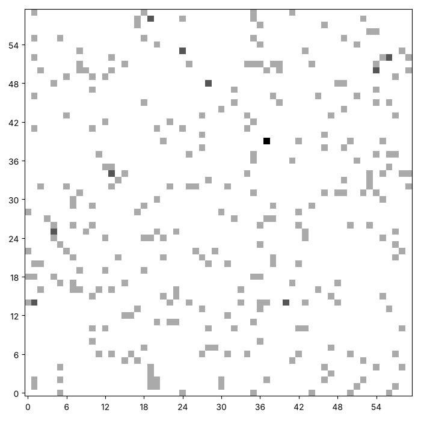
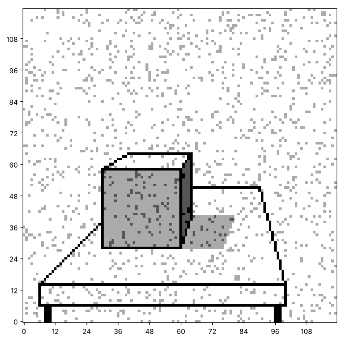
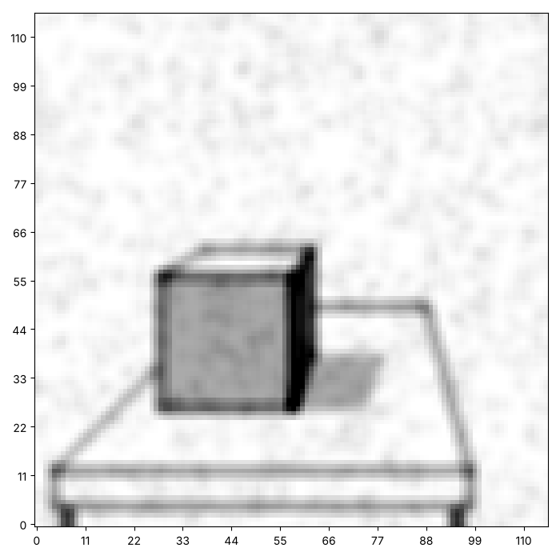
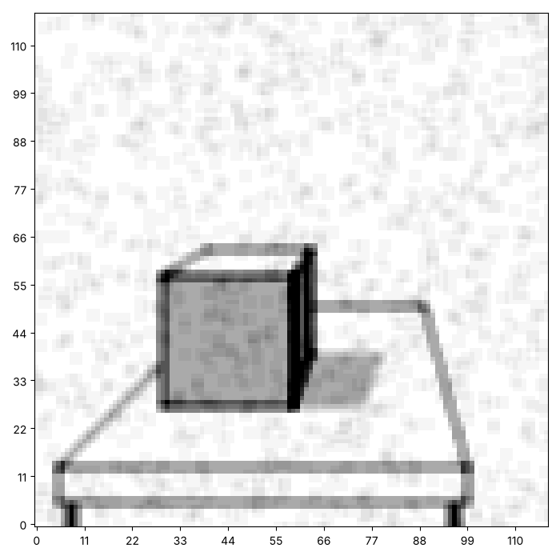

# Random points and noise: letting chance in

Everything we have painted so far came out the same every time. Now we
let chance into the picture. Python's `random` module gives us numbers
that we cannot predict, and a surprising amount can be built from them.
Here are three pictures from this page. Yours will look different, and
that is the point.







This page adds two functions: one that scatters points and one that adds
noise. We then use the blur from the last series to clear the noise away
again.

## Seeds

A computer cannot be truly random. It follows a recipe that produces
numbers that look random. The recipe starts from a number called the
**seed**. If you start from the same seed, you get the same numbers. Run
the cell twice, and then change the seed.

```python exec
id: seeds-1
import random

random.seed(1)
print(random.randint(0, 9), random.randint(0, 9), random.randint(0, 9))
random.seed(1)
print(random.randint(0, 9), random.randint(0, 9), random.randint(0, 9))
```

```predict
type: choice

How do the two lines of output compare?

- They are different, because the numbers are random
  - The seed is the same in both lines, and a seed fixes the whole
    sequence.
- They are the same
- They are different only some of the time
```

`random.randint(a, b)` gives a whole number from `a` to `b`, and unlike
`range`, it includes `b`.

## Random points

How would you write a function that paints a number of points in random
places? Think about which numbers are the largest row and the largest
column. Run your function twice with the same seed, and then with a
different one. What do you notice?

```python exec
id: random-points-1
toolkit: yes
expect: (lambda c: (paint_random_points(c, 50, 1), sum(map(sum, c)) == 50)[1])(make_canvas(10, 10)) and (lambda a, b: (paint_random_points(a, 20, 3), paint_random_points(b, 20, 3), a == b)[2])(make_canvas(8, 8), make_canvas(8, 8))
import random
def paint_random_points(canvas, count, seed):
    """Paint count points on the canvas, in random places. The same seed gives the same points."""
    # Inputs: what type is each input? What is the largest row number, and the largest column number?
    # In words: choose a random row and a random column, count times, and paint that point.
    # Which of your functions paints one square? Where does random.seed belong?
    ...
```

```python toolkit-reference
for: random-points-1
import random
def paint_random_points(canvas, count, seed):
    random.seed(seed)       # the same seed gives the same points every time
    for dot in range(count):
        row = random.randint(0, len(canvas) - 1)          # randint includes both ends
        column = random.randint(0, len(canvas[0]) - 1)
        paint_point(canvas, row, column)
```

```hint
after: 3 errors
Count the ink in your canvas after painting 50 points on a canvas of 10
by 10. It should add up to 50, even if some points land on the same
square. What is the largest row `randint` can give you, and is it on the
canvas?
```

```solution
import random
def paint_random_points(canvas, count, seed):
    random.seed(seed)       # the same seed gives the same points every time
    for dot in range(count):
        row = random.randint(0, len(canvas) - 1)          # randint includes both ends
        column = random.randint(0, len(canvas[0]) - 1)
        paint_point(canvas, row, column)
---
Here is one answer. Yours may be different and work too.
`random.seed(seed)` comes first, so the sequence that follows is fixed.
The largest row is `len(canvas) - 1`, because `randint` includes both
ends.
```

Can you scatter random points over a canvas, like this one? Two points can land on the same square, so a few squares come out darker than the rest.


```python exec
id: random-points-2
# Your scatter
```

```solution
{{include: setup/painting/toolkit.py}}

canvas = make_canvas(60, 60)
paint_random_points(canvas, 300, 1)
print(sum(row.count(2) for row in canvas), "squares hold 2 ink")
show_picture(canvas, darkest=3)
---
Here is one answer. Yours may be different and work too. The canvas is
60 by 60 with 300 points, shown with `darkest=3`. A square that was hit
twice holds 2 ink.
```

What if there are as many points as squares? Is every square painted,
and how many stay empty? You could try a canvas of 60 by 60 with 3600
points, then with 10 000.

```python exec
id: random-points-3
canvas = make_canvas(60, 60)
paint_random_points(canvas, 3600, 1)             # as many points as squares
empty = sum(row.count(0) for row in canvas)
print(empty, "squares are still empty")           # about 1 square in 3 is missed
```

```predict
type: choice

About how many of the 3600 squares stay empty after 3600 random points?

- None, because there are as many points as squares
  - Each point lands anywhere, so some squares are hit twice and others
    not at all.
- About a third
- About half
```

## Noise

Noise is chance added to a picture. `random.random()` gives a decimal
from 0 up to but not including 1, and it is below 0.1 about one time in
ten. How would you add a small speck of ink to a random tenth of the
squares?

```python exec
id: add-noise-1
toolkit: yes
expect: (lambda c: (add_noise(c, 1.0, 1), all(v == 1 for r in c for v in r))[1])(make_canvas(4, 4)) and (lambda c: (add_noise(c, 0.0, 1), sum(map(sum, c)) == 0)[1])(make_canvas(4, 4))
import random
def add_noise(canvas, chance, seed):
    """Add one layer of ink to each square of the canvas with the given chance, from 0 to 1. The same seed gives the same noise."""
    # Inputs: chance is a decimal from 0 to 1. What does random.random() < chance mean?
    # In words: go through every square, and add one layer of ink to it with that chance.
    # Does this change the canvas it is given, or return a new one?
    ...
```

```python toolkit-reference
for: add-noise-1
import random
def add_noise(canvas, chance, seed):
    random.seed(seed)
    for row in range(len(canvas)):
        for column in range(len(canvas[0])):
            if random.random() < chance:           # true about chance of the time
                canvas[row][column] = canvas[row][column] + 1
```

```hint
after: 3 errors
A chance of 1 should paint every square, and a chance of 0 none. What
does `random.random() < 1` give for any number it can return?
```

```solution
import random
def add_noise(canvas, chance, seed):
    random.seed(seed)
    for row in range(len(canvas)):
        for column in range(len(canvas[0])):
            if random.random() < chance:           # true about chance of the time
                canvas[row][column] = canvas[row][column] + 1
---
Here is one answer. Yours may be different and work too.
`random.random() < chance` is true about `chance` of the time, so a
chance of 0.1 chooses about one square in ten. The function changes the
canvas it is given.
```

How would you make a *copy* of a canvas first, so the original stays
clean? `[row[:] for row in picture]` makes a new list from a copy of
every row. Why is `picture[:]` not enough?

Then use the blur from the last series. Blur is an average, and an
average of nine squares forgets most of a single speck. Does a second
blur help more? What does it cost the picture?

Can you add speckles to a copy of the cube, and then blur them away? Here is the noisy cube, then the same cube blurred once, and blurred twice.





```python exec
id: noise-picture
picture = cube_picture()
blur = [[1 / 9, 1 / 9, 1 / 9],
        [1 / 9, 1 / 9, 1 / 9],
        [1 / 9, 1 / 9, 1 / 9]]
# Your noisy cube, and the blurred versions
```

```solution
{{include: setup/painting/toolkit.py}}

picture = cube_picture()
blur = [[1 / 9, 1 / 9, 1 / 9],
        [1 / 9, 1 / 9, 1 / 9],
        [1 / 9, 1 / 9, 1 / 9]]
noisy = [row[:] for row in picture]          # a copy, so the original stays clean
add_noise(noisy, 0.1, 5)
show_picture(noisy, darkest=3)
show_picture(convolve(noisy, blur), darkest=3)
show_picture(convolve(convolve(noisy, blur), blur), darkest=3)
---
Here is one answer. Yours may be different and work too. The copy keeps
the original clean. Each blur makes the canvas two rows and two columns
smaller, and softens the real edges as well as the specks.
```

What if the noise is heavier, a chance of 0.3, and you blur three times?
When does the picture stop being recognisable, and what would keep the
edges sharp?

## Looking back

A seed fixes a sequence, so the same seed makes the same noise. Why
might you want that? Why might you want a different seed each time?

A challenge: scatter stars on a dark sky, with a few brighter than the
rest, and then blur them a little so that they glow.

```python challenge
# A night sky. Your toolkit has paint_random_points, add_noise, convolve and paint_gradient.
canvas = make_canvas(80, 120)
```

## Where to read more

Python documentation. *random, generate pseudo-random numbers.*
<https://docs.python.org/3/library/random.html>. What the module can do,
and a plain statement that its numbers follow a recipe.
