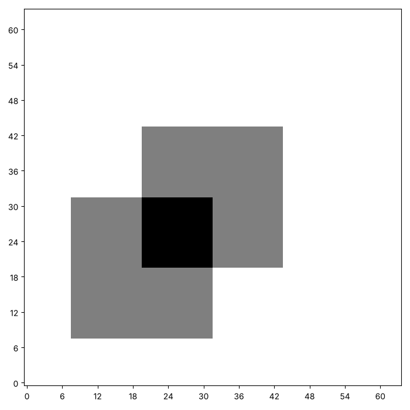
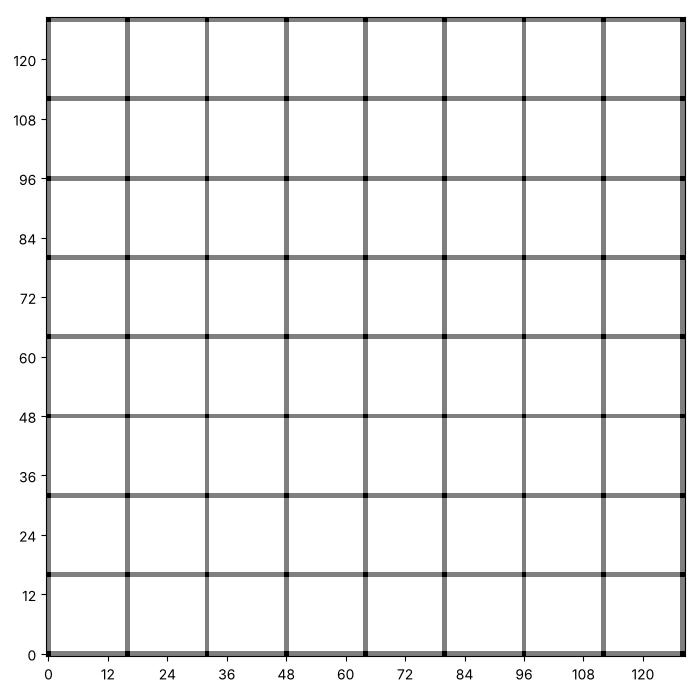

# Rectangles and grids: painting a whole region

On [the last page](tutorial:a-canvas-of-numbers) we painted points and
lines. A line is a run of squares in one row. What would a stack of
those runs make? Run the cell and find out. This canvas is bigger than
the ones on the last page, so the numbers along its edges now count in
tens.

```python exec
id: a-stack-of-lines-1
canvas = make_canvas(40, 60)
for row in range(10, 30):
    paint_horizontal(canvas, row, 15, 44)
show_picture(canvas)
```

Twenty horizontal lines, one above another, make a block. A block with
straight sides is a *rectangle*. This page turns that loop into a
function, and then paints with it.

## A rectangle

How would you fill a rectangle? You wrote the loop above, so the
function is that loop with names.

```python exec
id: a-rectangle-1
toolkit: yes
expect: (lambda c: (paint_rectangle(c, 1, 1, 2, 3), c == [[0, 0, 0, 0, 0], [0, 1, 1, 1, 0], [0, 1, 1, 1, 0], [0, 0, 0, 0, 0]])[1])(make_canvas(4, 5))
def paint_rectangle(canvas, first_row, first_column, last_row, last_column):
    """Paint every square inside a box with these four edges."""
    # A rectangle is made of rows. Which earlier function paints a row?
    # How many rows are there, and how do you count through them?
    ...
```

```python toolkit-reference
for: a-rectangle-1
def paint_rectangle(canvas, first_row, first_column, last_row, last_column):
    """Paint every square inside a box with these four edges."""
    for row in range(first_row, last_row + 1):
        paint_horizontal(canvas, row, first_column, last_column)
```

```hint
after: 3 errors
Which function from the last page paints one row of squares? How many
rows does a rectangle have, and how does your loop count through them?
```

```solution
def paint_rectangle(canvas, first_row, first_column, last_row, last_column):
    """Paint every square inside a box with these four edges."""
    for row in range(first_row, last_row + 1):
        paint_horizontal(canvas, row, first_column, last_column)
---
Here is one answer. Yours may be different and work too. Every row of a
rectangle is a horizontal line, and the function that paints one
already exists. A different answer could use two loops and `paint_point`.
```

What is a square, if you already have a rectangle?

```python exec
id: a-rectangle-2
toolkit: yes
expect: (lambda c: (paint_square(c, 1, 1, 3), sum(map(sum, c)) == 9 and c[3][3] == 1 and c[4][4] == 0)[1])(make_canvas(6, 6))
def paint_square(canvas, row, column, size):
    """Paint a square. The corner with the smallest row and column is at row and column. size is the length of each side."""
    # Which earlier function paints a box? What do you give it for last_row and last_column?
    # A square of size 3 that starts at row 2 ends at which row?
    ...
```

```python toolkit-reference
for: a-rectangle-2
def paint_square(canvas, row, column, size):
    """Paint a square. The corner with the smallest row and column is at row and column. size is the length of each side."""
    paint_rectangle(canvas, row, column, row + size - 1, column + size - 1)
```

```solution
def paint_square(canvas, row, column, size):
    """Paint a square. The corner with the smallest row and column is at row and column. size is the length of each side."""
    paint_rectangle(canvas, row, column, row + size - 1, column + size - 1)
---
Here is one answer. Yours may be different and work too. The last row
is `row + size - 1`, because the first row is also part of the square.
Without the `- 1`, the square is one row and one column too big.
```

## Two squares that overlap

Where two shapes cover the same squares, the ink adds up. Here are two
squares on a canvas of 64 by 64. The cell prints how many squares hold
2 ink, and then draws the canvas with `darkest=2`.

```python exec
id: two-squares-that-overlap-1
canvas = make_canvas(64, 64)
paint_square(canvas, 8, 8, 24)
paint_square(canvas, 20, 20, 24)
print(sum(row.count(2) for row in canvas))
show_picture(canvas, darkest=2)
```

```predict
type: number

Each square is 24 by 24, and the corner of the second is 12 squares
up and across from the first. How many squares hold 2 ink?
```

Can you make the same picture with the default `darkest`? What do you
see, and what does it hide?



## A grid

How would you draw lines at regular distances across a whole canvas?
Let's start with the counting. A `range` can take a third number, the
*step*. What do these two print?

```python exec
id: a-grid-1
print(list(range(0, 17, 4)))
print(list(range(0, 17, 3)))
```

```python exec
id: a-grid-2
toolkit: yes
expect: (lambda c: (paint_grid(c, 2), c[0] == [2, 1, 2, 1, 2] and c[1] == [1, 0, 1, 0, 1])[1])(make_canvas(3, 5))
def paint_grid(canvas, spacing):
    """Paint a line along row 0 and every spacing-th row after it, and along column 0 and every spacing-th column after it."""
    # Each line reaches across the whole canvas.
    # How can you find the number of rows and columns of a canvas you are given?
    # How can a loop move in steps bigger than 1?
    ...
```

```python toolkit-reference
for: a-grid-2
def paint_grid(canvas, spacing):
    """Paint a line along row 0 and every spacing-th row after it, and along column 0 and every spacing-th column after it."""
    rows = len(canvas)
    columns = len(canvas[0])
    for row in range(0, rows, spacing):
        paint_horizontal(canvas, row, 0, columns - 1)
    for column in range(0, columns, spacing):
        paint_vertical(canvas, column, 0, rows - 1)
```

```hint
after: 3 errors
Which `range` counts along the rows in steps of `spacing`? Which
function paints a whole row once you know the row number?
```

```solution
def paint_grid(canvas, spacing):
    """Paint a line along row 0 and every spacing-th row after it, and along column 0 and every spacing-th column after it."""
    rows = len(canvas)
    columns = len(canvas[0])
    for row in range(0, rows, spacing):
        paint_horizontal(canvas, row, 0, columns - 1)
    for column in range(0, columns, spacing):
        paint_vertical(canvas, column, 0, rows - 1)
---
Here is one answer. Yours may be different and work too. The last column
is `columns - 1`, not `columns`, because the first column is number 0.
```

Can you make this picture? It uses a canvas of 129 by 129.



```python exec
id: a-grid-3
# Your grid
```

```hint
Which spacing do the lines in the picture have? Count the squares between
two lines, using the numbers along the edge. The crossings are painted
twice, so which `darkest` makes them black?
```

```solution
{{include: setup/painting/toolkit.py}}

canvas = make_canvas(129, 129)
paint_grid(canvas, 16)
show_picture(canvas, darkest=2)
---
Here is one answer. Yours may be different and work too. A canvas of 129
has columns 0 to 128, and 128 is a multiple of 16, so the last line
falls exactly on the edge.
```

Now try your own. Paint a grid with a spacing that does not divide the
canvas evenly, such as 7 on a canvas of 100 by 100. What happens at the
right-hand and bottom edges? Which spacings put the last line exactly on
the edge?

## Your turn: a building

Can you paint a building with a grid of windows? Choose the size of your
canvas, and decide how you will place the windows inside the wall.

```python exec
id: your-turn-1
# Your building
```

```hint
Windows are small squares. A loop inside a loop, with a row and a column
that grow in steps, can place a whole grid of windows.
```

```solution
{{include: setup/painting/toolkit.py}}

canvas = make_canvas(80, 60)
paint_rectangle(canvas, 5, 5, 74, 54)
for row in range(12, 70, 14):
    for column in range(12, 50, 12):
        paint_square(canvas, row, column, 6)
show_picture(canvas, darkest=2)
---
Here is one answer. Yours may be different and work too. A window sits on
the wall, so it holds 2 ink, and `darkest=2` shows each one as a black
square in a grey wall.
```

## Looking back

The two squares and the grid both used `darkest=2` to show where ink
overlaps. What would you change in `show_picture` if you wanted
overlapping ink to show in a colour instead?

A challenge: paint a chessboard of 8 by 8 blocks, each block 10 squares
wide, where every other block is painted.

```python challenge
# A chessboard of 8 by 8 blocks, each block 10 squares wide.
canvas = make_canvas(80, 80)
```

The next page, [Fading ink and gradients](tutorial:fading-ink-and-gradients),
paints with amounts of ink other than 1.

## Where to read more

Wikipedia. *Rectangle.* <https://en.wikipedia.org/wiki/Rectangle>. The
shape on this page, and the maths of its sides and corners.

Downey, A. B. (2015). *Think Python: How to Think Like a Computer
Scientist* (2nd ed.). Green Tea Press.
<https://greenteapress.com/wp/think-python-2e/>. Chapter 4 draws shapes
with loops, in a different way from the one used here.
