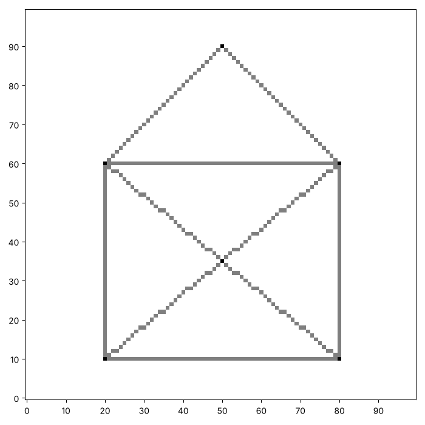
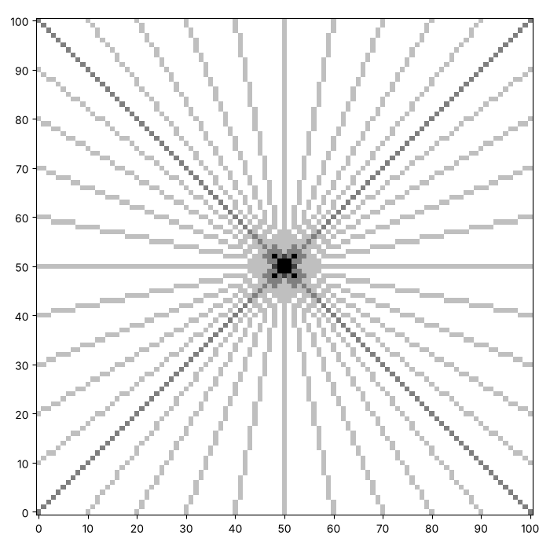
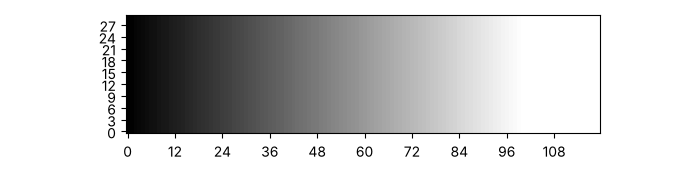
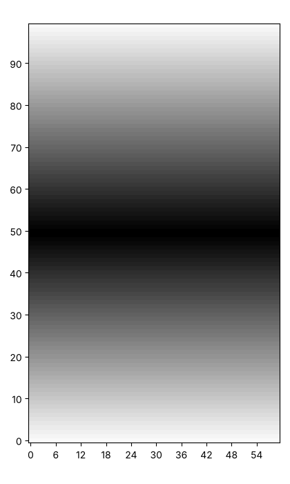
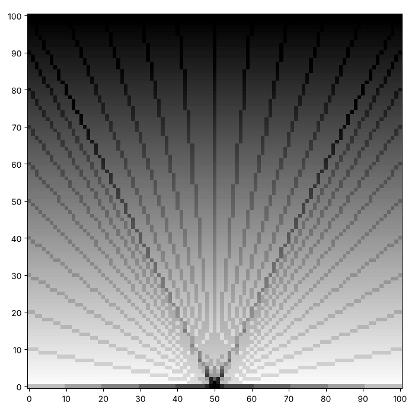

# Segments and starbursts: painting between two points

On the last page `paint_line` needed the numbers $a$ and $b$. Often we
know something else instead: the two points where a line starts and
ends. Here are two pictures we can make once we can paint between any two
points. Yours will look different, and that is the point.





This page adds two functions to your toolkit, a segment and a starburst,
and then leaves you to play with the fades from earlier in the series.

## A segment between two points

How would you paint the straight line that joins two points? You already
have a function that paints a line from $a$ and $b$. Which numbers
describe the line through $(x_1, y_1)$ and $(x_2, y_2)$?

The slope is how far $y$ rises for each step of $x$, and $b$ is what is
left when we take $a x_1$ away from $y_1$. What happens when the two
points have the same $x$?

```python exec
id: a-segment-1
toolkit: yes
expect: (lambda c: (paint_segment(c, 0, 0, 3, 3), paint_segment(c, 5, 1, 5, 4), sum(map(sum, c)) == 8 and c[2][2] == 1)[2])(make_canvas(6, 6)) and (lambda c: (paint_segment(c, 3, 3, 0, 0), sum(map(sum, c)) == 4)[1])(make_canvas(6, 6))
def paint_segment(canvas, x1, y1, x2, y2):
    """Paint the straight line that joins the points (x1, y1) and (x2, y2), both ends included."""
    # Which numbers does paint_line need? How do you find them from two points?
    # paint_line needs its start and its end in order. What if x1 is bigger than x2?
    # What is the slope when x1 and x2 are the same? What can you do instead?
    ...
```

```python toolkit-reference
for: a-segment-1
def paint_segment(canvas, x1, y1, x2, y2):
    """Paint the straight line that joins the points (x1, y1) and (x2, y2), both ends included."""
    if x1 == x2:
        # A vertical line has no slope, so walk up it one square at a time.
        for y in range(min(y1, y2), max(y1, y2) + 1):
            paint_xy(canvas, x1, y)
    else:
        a = (y2 - y1) / (x2 - x1)
        b = y1 - a * x1
        paint_line(canvas, a, b, min(x1, x2), max(x1, x2))
```

```hint
after: 3 errors
Try one segment on a small canvas, such as from (0, 0) to (3, 3), and
print the canvas. Which squares did it paint, and which should it have?
```

```hint
after: 6 errors
title: some steps
1. Find the slope: `a = (y2 - y1) / (x2 - x1)`.
2. Find where the line crosses the $y$ axis: `b = y1 - a * x1`.
3. Call `paint_line` with `min(x1, x2)` and `max(x1, x2)` so the start is
   never past the end.
4. A vertical segment has `x1 == x2`, so step 1 divides by zero. Give it
   its own branch, and walk up with `paint_xy`.
```

```solution
def paint_segment(canvas, x1, y1, x2, y2):
    """Paint the straight line that joins the points (x1, y1) and (x2, y2), both ends included."""
    if x1 == x2:
        # A vertical line has no slope, so walk up it one square at a time.
        for y in range(min(y1, y2), max(y1, y2) + 1):
            paint_xy(canvas, x1, y)
    else:
        a = (y2 - y1) / (x2 - x1)
        b = y1 - a * x1
        paint_line(canvas, a, b, min(x1, x2), max(x1, x2))
---
Here is one answer. Yours may be different and work too. A vertical
segment divides by zero in the slope, so it has its own branch, and
walking up with `paint_xy` keeps the function independent of the origin
you chose. `min` and `max` put the two ends in order, so the segment
from (3, 3) to (0, 0) is the same as the one from (0, 0) to (3, 3).
```

Can you draw a house like this one, with a pointed roof and two braces
that cross? Four segments make the walls, two make the roof, and two make
the braces. The numbers along the edges give the points.


```python exec
id: a-segment-2
# Your house
```

```solution
# From earlier on this page, repeated so that this answer runs on its own
def paint_segment(canvas, x1, y1, x2, y2):
    if x1 == x2:
        # A vertical line has no slope, so walk up it one square at a time.
        for y in range(min(y1, y2), max(y1, y2) + 1):
            paint_xy(canvas, x1, y)
    else:
        a = (y2 - y1) / (x2 - x1)
        b = y1 - a * x1
        paint_line(canvas, a, b, min(x1, x2), max(x1, x2))

canvas = make_canvas(100, 100)
paint_segment(canvas, 20, 10, 80, 10)     # the floor
paint_segment(canvas, 80, 10, 80, 60)     # the right wall
paint_segment(canvas, 80, 60, 20, 60)     # the ceiling
paint_segment(canvas, 20, 60, 20, 10)     # the left wall
paint_segment(canvas, 20, 60, 50, 90)     # the roof
paint_segment(canvas, 50, 90, 80, 60)
paint_segment(canvas, 20, 10, 80, 60)     # two braces
paint_segment(canvas, 20, 60, 80, 10)
show_picture(canvas, darkest=2)
---
Here is one answer. Yours may be different and work too. The braces cross
in the middle, where two lines share a square, so `darkest=2` shows that
square as black.
```

Does a segment change if you swap its two ends? What about a vertical
segment, a horizontal one, or a segment whose two ends are the same
point? Try each on a canvas of your own.

## A starburst

How would you draw rays from one point to evenly spaced points all the
way round the edge of a canvas? Where the rays overlap, the ink adds up.

Think about the edge as four runs: the bottom row, the top row, the left
column and the right column. Which ends of the rays are on each run?
`range(0, columns, spacing)` counts along a run in steps.

```python exec
id: a-starburst-1
toolkit: yes
expect: (lambda c: (paint_starburst(c, 2, 2, 2), c[2][2] == 12 and c[0][0] >= 1 and c[4][4] >= 1)[1])(make_canvas(5, 5))
def paint_starburst(canvas, x, y, spacing):
    """Paint a ray from the point (x, y) to every spacing-th square along each of the four edges of the canvas."""
    # Which function paints a ray between two points?
    # Along the bottom row the end of each ray is (column, 0). What is it along the top row?
    # Along the left column and the right column?
    # What is the last index of a row, and of a column?
    ...
```

```python toolkit-reference
for: a-starburst-1
def paint_starburst(canvas, x, y, spacing):
    """Paint a ray from the point (x, y) to every spacing-th square along each of the four edges of the canvas."""
    rows = len(canvas)
    columns = len(canvas[0])
    for column in range(0, columns, spacing):
        paint_segment(canvas, x, y, column, 0)
        paint_segment(canvas, x, y, column, rows - 1)
    for row in range(0, rows, spacing):
        paint_segment(canvas, x, y, 0, row)
        paint_segment(canvas, x, y, columns - 1, row)
```

```hint
after: 3 errors
The last column has the index `len(canvas[0]) - 1`, not
`len(canvas[0])`. Which rays does your function paint on a canvas of 5 by
5 with a spacing of 2? Print the canvas and look for a ray that is
missing.
```

```solution
def paint_starburst(canvas, x, y, spacing):
    """Paint a ray from the point (x, y) to every spacing-th square along each of the four edges of the canvas."""
    rows = len(canvas)
    columns = len(canvas[0])
    for column in range(0, columns, spacing):
        paint_segment(canvas, x, y, column, 0)
        paint_segment(canvas, x, y, column, rows - 1)
    for row in range(0, rows, spacing):
        paint_segment(canvas, x, y, 0, row)
        paint_segment(canvas, x, y, columns - 1, row)
---
Here is one answer. Yours may be different and work too. There are four
loops, one for each edge. Every ray passes through the point `(x, y)`, so
the ink adds up there and the rays crowd the centre.
```

Can you make a starburst like this one, with rays running from the centre
to the edge all the way round? Show your canvas with a `darkest` bigger
than 1, so that single rays and crowded places look different.


```python exec
id: a-starburst-2
# Your starburst
```

```solution
# From earlier on this page, repeated so that this answer runs on its own
def paint_segment(canvas, x1, y1, x2, y2):
    if x1 == x2:
        # A vertical line has no slope, so walk up it one square at a time.
        for y in range(min(y1, y2), max(y1, y2) + 1):
            paint_xy(canvas, x1, y)
    else:
        a = (y2 - y1) / (x2 - x1)
        b = y1 - a * x1
        paint_line(canvas, a, b, min(x1, x2), max(x1, x2))

def paint_starburst(canvas, x, y, spacing):
    rows = len(canvas)
    columns = len(canvas[0])
    for column in range(0, columns, spacing):
        paint_segment(canvas, x, y, column, 0)
        paint_segment(canvas, x, y, column, rows - 1)
    for row in range(0, rows, spacing):
        paint_segment(canvas, x, y, 0, row)
        paint_segment(canvas, x, y, columns - 1, row)

canvas = make_canvas(101, 101)
paint_starburst(canvas, 50, 50, 10)
show_picture(canvas, darkest=4)
---
Here is one answer. Yours may be different and work too. The ink is
darkest at the centre, where every ray passes, and `darkest=4` is enough
for the rays near the middle to look black.
```

What if the centre sits somewhere other than the middle of a canvas that
is wider than it is tall? What happens as the spacing grows, and which
spacing leaves the last ray out?

## Play with fades and rays

You now have fades, gradients, segments and rays, and you can combine
them. This part has no new function. Here are three things to try. Choose
any, or invent your own.

A block that fades from left to right, instead of from the bottom to the
top. Which function from the page on fading ink could you call once for
each row?



```python exec
id: play-with-fades-1
# A block that fades from left to right
```

```solution
# A block that fades from left to right: each row is a fade.
canvas = make_canvas(30, 120)
for row in range(30):
    paint_fade(canvas, row, 0, 100)
show_picture(canvas, darkest=100)
---
Here is one answer. Yours may be different and work too. A fade is one
row, so a block is a fade for every row.
```

A ridge, where the ink is darkest in the middle row and pale at both
ends. How could two blocks make it?



```python exec
id: play-with-fades-2
# A ridge
```

```solution
# A ridge: the ink rises to the middle row and falls away again.
canvas = make_canvas(100, 60)
paint_gradient(canvas, 0, 0, 49, 59)             # rows 0 to 49 get 1 to 50 ink
for row in range(50, 100):                       # a second block that fades the other way
    for column in range(60):
        canvas[row][column] = canvas[row][column] + (100 - row)
show_picture(canvas, darkest=50)
---
Here is one answer. Yours may be different and work too. The first block
rises, and the second adds ink that falls, one row at a time. You could
also write a loop of your own for the second half.
```

A sunrise, with a sky that is dark at the top and rays from a sun on the
horizon. Which do you paint first? Does it matter? What does `darkest`
need to be?



```python exec
id: play-with-fades-3
# A sunrise
```

```solution
# From earlier on this page, repeated so that this answer runs on its own
def paint_segment(canvas, x1, y1, x2, y2):
    if x1 == x2:
        # A vertical line has no slope, so walk up it one square at a time.
        for y in range(min(y1, y2), max(y1, y2) + 1):
            paint_xy(canvas, x1, y)
    else:
        a = (y2 - y1) / (x2 - x1)
        b = y1 - a * x1
        paint_line(canvas, a, b, min(x1, x2), max(x1, x2))

def paint_starburst(canvas, x, y, spacing):
    rows = len(canvas)
    columns = len(canvas[0])
    for column in range(0, columns, spacing):
        paint_segment(canvas, x, y, column, 0)
        paint_segment(canvas, x, y, column, rows - 1)
    for row in range(0, rows, spacing):
        paint_segment(canvas, x, y, 0, row)
        paint_segment(canvas, x, y, columns - 1, row)

# A sunrise: a sky that is dark at the top, with rays from a sun on the horizon.
canvas = make_canvas(101, 101)
paint_gradient(canvas, 0, 0, 100, 100)
for layer in range(12):
    paint_starburst(canvas, 50, 0, 10)
show_picture(canvas, darkest=100)
---
Here is one answer. Yours may be different and work too. The ink only
ever adds, so the order does not change the total. The rays need several
layers, though, to show against a sky that is already dark.
```

What happens when `darkest` is smaller than the darkest square? What
happens when it is much bigger?

## Looking back

A segment and a starburst are both built from `paint_line`, and
`paint_line` is built from `paint_xy`. Which function would you have to
change if you wanted every picture in this series to count rows from the
top? Why only that one?

A challenge: paint a picture of your own that uses at least three
functions from your toolkit, such as a starburst behind a house, with a
sky that fades behind both.

```python challenge
# A picture of your own. Your toolkit has make_canvas, paint_point,
# paint_horizontal, paint_vertical, paint_rectangle, paint_square,
# paint_grid, paint_fade, paint_gradient, paint_xy, paint_line,
# paint_segment, paint_starburst and show_picture.
canvas = make_canvas(100, 100)
```

## Where to read more

Wikipedia. *Line drawing algorithm.*
<https://en.wikipedia.org/wiki/Line_drawing_algorithm>. How computers
draw a line between two points, and why the vertical line is the case
that needs special care.
