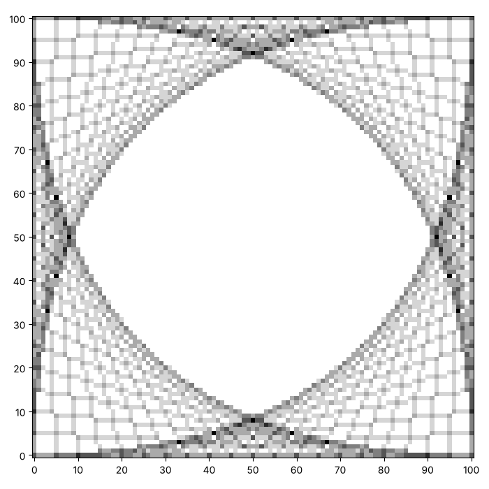
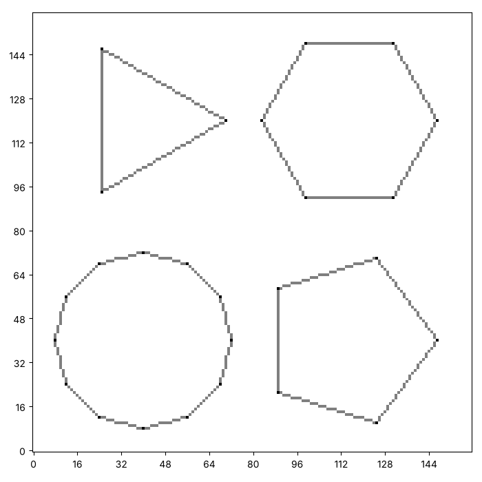
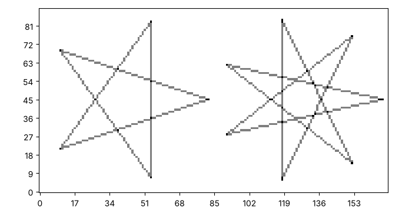
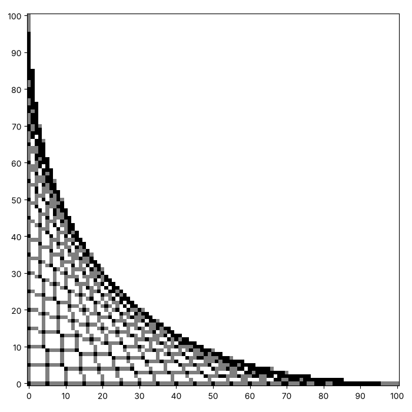

# Strings and polygons: curves from straight lines

In the last series every picture was made of straight lines, and some of
them looked curved. Here is how that happens. Take two straight arms
that meet at a corner, and join points along one arm to points along the
other. Every thread is straight, and together the threads trace a curve.
Here are three pictures from this page. Yours will look different, and
that is the point.







This page adds four functions to your toolkit: a fan of threads, the
corners of a polygon, a polygon and a star. They all use `paint_segment`
from the last page. We also meet `math`, the module that comes with
Python and knows about circles.

## String art

Put points at equal distances along each of two arms that meet at a
corner. Join the first point on one arm to the last point on the other,
then the second to the second-last, and so on. How would you paint this?

A point is a pair of numbers, so we pass each one as a pair: `(x, y)` is
a *tuple*. The line `corner_x, corner_y = corner` takes a pair apart
into two names. At each step a point that is a *fraction* of the way
from $P$ to $Q$ sits at $P + (Q - P) \times$ fraction. What is the
fraction at the first step, and what is it at the last?

```python exec
id: a-fan-1
toolkit: yes
expect: (lambda c: (paint_fan(c, (0, 0), (0, 10), (10, 0), 5), c[0][0] > 0 and c[10][0] > 0 and c[0][10] > 0 and c[10][10] == 0)[1])(make_canvas(11, 11))
def paint_fan(canvas, corner, first_end, second_end, steps):
    """Paint steps + 1 threads. Each one joins a point that slides from first_end to the corner with a point that slides from the corner to second_end."""
    # Inputs: corner, first_end and second_end are each a point. What type holds the two numbers of a point?
    # As a fraction of the way along, what is each end at step 0, and at the last step?
    # How do you find the point that is a given fraction of the way from one point to another?
    ...
```

```python toolkit-reference
for: a-fan-1
def paint_fan(canvas, corner, first_end, second_end, steps):
    corner_x, corner_y = corner
    first_x, first_y = first_end
    second_x, second_y = second_end
    for step in range(steps + 1):
        fraction = step / steps
        # One end of the string slides in from first_end to the corner,
        # and the other end slides out from the corner to second_end.
        x1 = round(first_x + (corner_x - first_x) * fraction)
        y1 = round(first_y + (corner_y - first_y) * fraction)
        x2 = round(corner_x + (second_x - corner_x) * fraction)
        y2 = round(corner_y + (second_y - corner_y) * fraction)
        paint_segment(canvas, x1, y1, x2, y2)
```

```hint
after: 3 errors
Try a fan on a small canvas, such as 11 by 11 with the corner at (0, 0)
and arms that reach (0, 10) and (10, 0). Print the canvas. The first
thread should run down the left edge and the last along the bottom edge.
Which of the two is missing, or wrong?
```

```hint
after: 6 errors
title: some steps
1. Take each point apart: `corner_x, corner_y = corner`, and the same
for the two ends.
2. Go round a loop for `steps + 1` threads, and let `fraction = step /
steps`.
3. One end of the thread is `first_x + (corner_x - first_x) * fraction`,
and the same for y. The other end slides from the corner to `second_end`
in the same way.
4. Round both ends, then call `paint_segment`.
```

```solution
def paint_fan(canvas, corner, first_end, second_end, steps):
    corner_x, corner_y = corner
    first_x, first_y = first_end
    second_x, second_y = second_end
    for step in range(steps + 1):
        fraction = step / steps
        # One end of the string slides in from first_end to the corner,
        # and the other end slides out from the corner to second_end.
        x1 = round(first_x + (corner_x - first_x) * fraction)
        y1 = round(first_y + (corner_y - first_y) * fraction)
        x2 = round(corner_x + (second_x - corner_x) * fraction)
        y2 = round(corner_y + (second_y - corner_y) * fraction)
        paint_segment(canvas, x1, y1, x2, y2)
---
Here is one answer. Yours may be different and work too. `fraction` goes
from 0 to 1. At 0 the first end is at `first_end` and the second end is
at the corner. At 1 the first end has reached the corner and the second
end has reached `second_end`. The threads together make a parabola.
```

Can you make a curve out of straight threads, like this one? A canvas of about 101 by 101 and 20 threads will do. Yours does not need to match.



```python exec
id: a-fan-2
# Your fan
```

```solution
# From earlier on this page, repeated so that this answer runs on its own
def paint_fan(canvas, corner, first_end, second_end, steps):
    corner_x, corner_y = corner
    first_x, first_y = first_end
    second_x, second_y = second_end
    for step in range(steps + 1):
        fraction = step / steps
        # One end of the string slides in from first_end to the corner,
        # and the other end slides out from the corner to second_end.
        x1 = round(first_x + (corner_x - first_x) * fraction)
        y1 = round(first_y + (corner_y - first_y) * fraction)
        x2 = round(corner_x + (second_x - corner_x) * fraction)
        y2 = round(corner_y + (second_y - corner_y) * fraction)
        paint_segment(canvas, x1, y1, x2, y2)

canvas = make_canvas(101, 101)
paint_fan(canvas, (0, 0), (0, 100), (100, 0), 20)
show_picture(canvas, darkest=2)
---
Here is one answer. Yours may be different and work too. The corner is
(0, 0), the arms reach (0, 100) and (100, 0), and 20 steps give 21
threads.
```

Can you make four curves, one in each corner? Which numbers change from
one corner to the next?


```python exec
id: a-fan-3
# Four fans
```

```solution
# From earlier on this page, repeated so that this answer runs on its own
def paint_fan(canvas, corner, first_end, second_end, steps):
    corner_x, corner_y = corner
    first_x, first_y = first_end
    second_x, second_y = second_end
    for step in range(steps + 1):
        fraction = step / steps
        # One end of the string slides in from first_end to the corner,
        # and the other end slides out from the corner to second_end.
        x1 = round(first_x + (corner_x - first_x) * fraction)
        y1 = round(first_y + (corner_y - first_y) * fraction)
        x2 = round(corner_x + (second_x - corner_x) * fraction)
        y2 = round(corner_y + (second_y - corner_y) * fraction)
        paint_segment(canvas, x1, y1, x2, y2)

canvas = make_canvas(101, 101)
paint_fan(canvas, (0, 0), (0, 100), (100, 0), 20)
paint_fan(canvas, (100, 0), (0, 0), (100, 100), 20)
paint_fan(canvas, (100, 100), (100, 0), (0, 100), 20)
paint_fan(canvas, (0, 100), (100, 100), (0, 0), 20)
show_picture(canvas, darkest=6)
---
Here is one answer. Yours may be different and work too. Each fan has
its corner on a different corner of the canvas, and its arms reach the
two neighbours. The threads cross in the middle, so `darkest=6` shows
the crowded places.
```

What if the corner of a fan sits in the middle of a canvas? What happens
with arms of different lengths, or with more and fewer steps? When does
the curve stop looking like a curve?

## Polygons

A polygon is a ring of segments. To find its corners, place points
evenly on a circle. A full turn is $2\pi$ radians, and `math.cos` and
`math.sin` turn an angle into the $x$ and $y$ of a point on a circle of
radius 1. How would you paint a triangle, a hexagon or a twelve-sided
polygon from one function?

```python exec
id: polygon-points-1
toolkit: yes
expect: polygon_points(10, 10, 5, 4) == [(15, 10), (10, 15), (5, 10), (10, 5)]
import math
def polygon_points(center_x, center_y, radius, sides):
    """A list of the corners of a polygon, as (x, y) points, spread evenly round a circle."""
    # Returns: a list of points. What type is each point? How many are there?
    # Corner number k sits at the angle 2 * math.pi * k / sides.
    # math.cos(angle) and math.sin(angle) give the x and y of that angle on a circle of radius 1.
    # A square needs a whole number. What turns a decimal into a whole number?
    ...
```

```python toolkit-reference
for: polygon-points-1
import math
def polygon_points(center_x, center_y, radius, sides):
    points = []
    for corner in range(sides):
        angle = 2 * math.pi * corner / sides
        x = round(center_x + radius * math.cos(angle))
        y = round(center_y + radius * math.sin(angle))
        points.append((x, y))
    return points
```

```hint
after: 3 errors
Print `polygon_points(10, 10, 5, 4)`. The corners of a square should be
at the right, the top, the left and the bottom of the circle. Which one
is wrong, and what angle does it have?
```

```solution
import math
def polygon_points(center_x, center_y, radius, sides):
    points = []
    for corner in range(sides):
        angle = 2 * math.pi * corner / sides
        x = round(center_x + radius * math.cos(angle))
        y = round(center_y + radius * math.sin(angle))
        points.append((x, y))
    return points
---
Here is one answer. Yours may be different and work too. `2 * math.pi *
corner / sides` spreads the corners evenly. Multiplying by the radius
and adding the centre moves the point from a circle of radius 1 at the
origin to the circle you want. `round` turns each number into a whole
number of squares.
```

```python exec
id: polygon-1
toolkit: yes
expect: (lambda c: (paint_polygon(c, [(0, 0), (4, 0), (4, 4)]), c[0][2] > 0 and c[2][4] > 0 and c[2][2] > 0)[1])(make_canvas(5, 5))
def paint_polygon(canvas, points):
    """Paint a segment from each point to the next, and from the last point back to the first."""
    # In words: join each point to the next, and the last point back to the first.
    # What does the % operator give when an index runs past the end of the list?
    ...
```

```python toolkit-reference
for: polygon-1
def paint_polygon(canvas, points):
    for index in range(len(points)):
        x1, y1 = points[index]
        x2, y2 = points[(index + 1) % len(points)]   # the % joins the last point back to the first
        paint_segment(canvas, x1, y1, x2, y2)
```

```hint
after: 3 errors
Which segment joins the last point back to the first? When `index` is
the last position, what is `index + 1`, and what is `(index + 1) %
len(points)`?
```

```solution
def paint_polygon(canvas, points):
    for index in range(len(points)):
        x1, y1 = points[index]
        x2, y2 = points[(index + 1) % len(points)]   # the % joins the last point back to the first
        paint_segment(canvas, x1, y1, x2, y2)
---
Here is one answer. Yours may be different and work too. The `%` gives
the remainder, so `(index + 1) % len(points)` is the next position, and
it comes back to 0 after the last point.
```

Can you draw a triangle, a hexagon, a twelve-sided polygon and a pentagon on one canvas, like these? Each has a radius of about 30.


```python exec
id: polygon-2
# Your polygons
```

```solution
import math

# From earlier on this page, repeated so that this answer runs on its own
def polygon_points(center_x, center_y, radius, sides):
    points = []
    for corner in range(sides):
        angle = 2 * math.pi * corner / sides
        x = round(center_x + radius * math.cos(angle))
        y = round(center_y + radius * math.sin(angle))
        points.append((x, y))
    return points

def paint_polygon(canvas, points):
    for index in range(len(points)):
        x1, y1 = points[index]
        x2, y2 = points[(index + 1) % len(points)]   # the % joins the last point back to the first
        paint_segment(canvas, x1, y1, x2, y2)

canvas = make_canvas(160, 160)
paint_polygon(canvas, polygon_points(40, 120, 30, 3))
paint_polygon(canvas, polygon_points(115, 120, 32, 6))
paint_polygon(canvas, polygon_points(40, 40, 32, 12))
paint_polygon(canvas, polygon_points(115, 40, 32, 5))
show_picture(canvas, darkest=2)
---
Here is one answer. Yours may be different and work too. One function
draws every shape. Only `sides` changes.
```

## Stars

What if every point joined the point two places on, instead of the next
one? With five points, that makes a five-pointed star. How would you
paint it? What is `paint_polygon` in terms of your new function?

```python exec
id: star-1
toolkit: yes
expect: (lambda c: (paint_star(c, [(0, 0), (4, 0), (4, 4), (0, 4)], 2), c[2][2] >= 2 and c[0][2] == 0)[1])(make_canvas(5, 5))
def paint_star(canvas, points, step):
    """Paint a segment from each point to the point `step` places on, going round the ring."""
    # How is this like paint_polygon? What is paint_polygon in terms of paint_star?
    ...
```

```python toolkit-reference
for: star-1
def paint_star(canvas, points, step):
    for index in range(len(points)):
        x1, y1 = points[index]
        x2, y2 = points[(index + step) % len(points)]
        paint_segment(canvas, x1, y1, x2, y2)
```

```hint
after: 3 errors
A step of 1 should give the same picture as `paint_polygon`. Does it?
What is the position of the point two places on from the last point?
```

```solution
def paint_star(canvas, points, step):
    for index in range(len(points)):
        x1, y1 = points[index]
        x2, y2 = points[(index + step) % len(points)]
        paint_segment(canvas, x1, y1, x2, y2)
---
Here is one answer. Yours may be different and work too. A step of 1 is
exactly `paint_polygon`. The `%` brings the position back round the
ring.
```

Can you draw two stars side by side, like these? One has five points and one has seven. Which step makes each one?


```python exec
id: star-2
# Your stars
```

```solution
import math

# From earlier on this page, repeated so that this answer runs on its own
def polygon_points(center_x, center_y, radius, sides):
    points = []
    for corner in range(sides):
        angle = 2 * math.pi * corner / sides
        x = round(center_x + radius * math.cos(angle))
        y = round(center_y + radius * math.sin(angle))
        points.append((x, y))
    return points

def paint_star(canvas, points, step):
    for index in range(len(points)):
        x1, y1 = points[index]
        x2, y2 = points[(index + step) % len(points)]
        paint_segment(canvas, x1, y1, x2, y2)

canvas = make_canvas(90, 170)
paint_star(canvas, polygon_points(42, 45, 40, 5), 2)
paint_star(canvas, polygon_points(127, 45, 40, 7), 3)
show_picture(canvas, darkest=2)
---
Here is one answer. Yours may be different and work too. Five points
with a step of 2 make the five-pointed star, and seven points with a
step of 3 make the seven-pointed one.
```

Could you draw an eight-sided polygon, and then an eight-pointed star
that skips 3 points? Which skips give one closed path, and which give
several shapes? What does a skip of 4 do?

## Looking back

`paint_polygon` is `paint_star` with a step of 1. A star with 8 points
and a step of 2 falls apart into two squares. What do the numbers 8 and
2 have in common that makes this happen? What about 7 and 2?

A challenge: draw a flower, with a ring of polygons that overlap round a
centre.

```python challenge
# A flower of polygons. Your toolkit has polygon_points and paint_polygon.
canvas = make_canvas(120, 120)
```

## Where to read more

Wikipedia. *String art.* <https://en.wikipedia.org/wiki/String_art>. How
threads between nails make curves, and why the envelope of straight
lines is a parabola.
