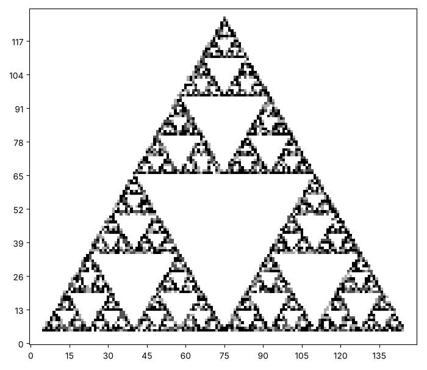
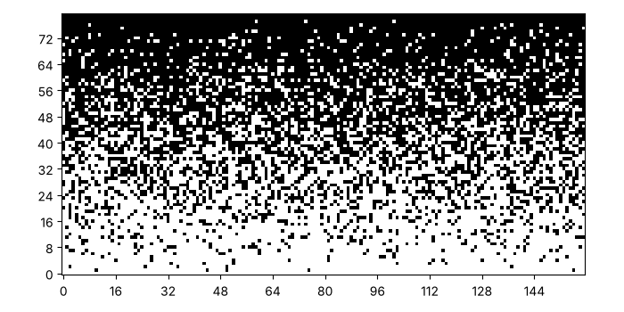
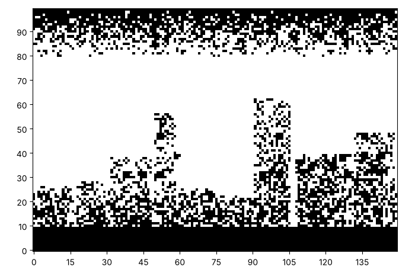

# The chaos game and dots: order from chance

Two pictures finish our time with chance. In the first, random moves
paint a shape that looks nothing like chance. In the second, a smooth
picture turns into dots of black and white. Here are both. Yours will
look different, and that is the point.





## The chaos game

Pick three corners of a triangle. Start at one of them. Then repeat many
times: pick a corner at random, move halfway towards it, and paint where
you land. Nothing in these rules mentions a triangle made of triangles.
Predict what you will see.

`random.choice(corners)` picks one item from a list, and the corners are
pairs, so it gives you a pair.

```python exec
id: chaos-game-1
toolkit: yes
expect: (lambda c: (chaos_game(c, [(2, 2), (30, 2), (16, 28)], 500, 1), sum(map(sum, c)) == 500)[1])(make_canvas(32, 32))
import random
def chaos_game(canvas, corners, steps, seed):
    """Start at the first corner. For each step, choose a corner at random, move halfway towards it, and paint where you land."""
    # Inputs: corners is a list of points. What type is each point?
    # In words: start at the first corner. For each step, choose a corner at random, move halfway
    # towards it, and paint where you land.
    # The halfway point of x and corner_x is (x + corner_x) / 2. A square needs a whole number. What gives one?
    ...
```

```python toolkit-reference
for: chaos-game-1
import random
def chaos_game(canvas, corners, steps, seed):
    random.seed(seed)
    x, y = corners[0]
    for step in range(steps):
        corner_x, corner_y = random.choice(corners)
        x = (x + corner_x) / 2                  # move halfway towards a corner
        y = (y + corner_y) / 2
        paint_xy(canvas, round(x), round(y))
```

```hint
after: 3 errors
Each step paints one square, so 500 steps on an empty canvas leave 500
ink in total. Does yours? Where does the pair from `random.choice` get
taken apart?
```

```solution
import random
def chaos_game(canvas, corners, steps, seed):
    random.seed(seed)
    x, y = corners[0]
    for step in range(steps):
        corner_x, corner_y = random.choice(corners)
        x = (x + corner_x) / 2                  # move halfway towards a corner
        y = (y + corner_y) / 2
        paint_xy(canvas, round(x), round(y))
---
Here is one answer. Yours may be different and work too. The halfway
rule shrinks the distance to a corner by a half, and that gives a
self-similar triangle, the Sierpinski triangle, whatever the starting
point. The shape comes from the rule, not from the chance, which only
visits it.
```

Can you play the chaos game with three corners and see what appears? Before you run it, sketch what you expect.


```python exec
id: chaos-game-2
# Your chaos game
```

```solution
{{include: setup/painting/toolkit.py}}

canvas = make_canvas(130, 150)
chaos_game(canvas, [(5, 5), (145, 5), (75, 126)], 8000, 2)
show_picture(canvas, darkest=3)
---
Here is one answer. Yours may be different and work too. The canvas is
130 by 150, the corners are (5, 5), (145, 5) and (75, 126), and there
are 8000 steps.
```

What do you see with four corners, the corners of a square, moving
halfway? What about moving two thirds of the way? Which numbers did you
change, and why?

```python exec
id: chaos-game-3
canvas = make_canvas(150, 150)
chaos_game(canvas, [(5, 5), (145, 5), (145, 145), (5, 145)], 8000, 2)    # four corners: no pattern appears
show_picture(canvas, darkest=3)
```

```predict
type: choice

What will four corners and halfway moves paint?

- A square made of squares
  - The same trick for the triangle does not carry over to four corners.
- An even spread over the whole square
- A cross in the middle
```

## Dots from greys

A newspaper photograph is made of black dots on white paper, and your
eye blends them into greys. This is called **dithering**. Where a
picture is dark, put a lot of dots. Where it is light, put few.

Take a canvas whose largest number is `darkest`. Make a new canvas of 0
and 1. A square with a number `ink` becomes a 1 with probability `ink /
darkest`. How would you write this? Why does the picture, seen from a
distance, look like the original?

```python exec
id: dither-1
toolkit: yes
expect: dither([[4, 0]], 4, 1) == [[1, 0]] and len(dither(make_canvas(5, 7), 1, 1)) == 5
import random
def dither(canvas, darkest, seed):
    """A new canvas of 0 and 1. Each square becomes 1 with the chance (its ink) / darkest."""
    # Returns: a new canvas of 0 and 1. Which of your functions makes a blank canvas?
    # In words: each square becomes 1 with the chance (its ink) / darkest.
    # Which function compares a random decimal with a chance?
    ...
```

```python toolkit-reference
for: dither-1
import random
def dither(canvas, darkest, seed):
    random.seed(seed)
    result = make_canvas(len(canvas), len(canvas[0]))
    for row in range(len(canvas)):
        for column in range(len(canvas[0])):
            chance = canvas[row][column] / darkest
            if random.random() < chance:
                result[row][column] = 1
    return result
```

```hint
after: 3 errors
A square with the most ink should always become 1, and an empty square
never. What is the chance for each, and what does `random.random() <
chance` give?
```

```solution
import random
def dither(canvas, darkest, seed):
    random.seed(seed)
    result = make_canvas(len(canvas), len(canvas[0]))
    for row in range(len(canvas)):
        for column in range(len(canvas[0])):
            chance = canvas[row][column] / darkest
            if random.random() < chance:
                result[row][column] = 1
    return result
---
Here is one answer. Yours may be different and work too. A square with
`ink` out of `darkest` becomes black with that probability. Averaged
over a neighbourhood, the dots reproduce the grey of the original.
```

Can you turn a smooth gradient into black dots, and then the city? Here are both.




```python exec
id: dither-2
# Your dithered gradient, and your dithered city
```

```solution
{{include: setup/painting/toolkit.py}}

canvas = make_canvas(80, 160)
paint_gradient(canvas, 0, 0, 79, 159)
show_picture(dither(canvas, 80, 2))

canvas = make_canvas(100, 150)
paint_city(canvas, 7)
show_picture(dither(canvas, 20, 1))
---
Here is one answer. Yours may be different and work too. The gradient
goes from 0 to 79, so `darkest` is 80. The city has a `darkest` of 20.
```

What happens if you dither the gradient with a `darkest` that is too
big, or one that is too small?

```python exec
id: dither-3
canvas = make_canvas(80, 160)
paint_gradient(canvas, 0, 0, 79, 159)
show_picture(dither(canvas, 160, 2))             # a darkest that is too large: the picture comes out pale
show_picture(dither(canvas, 40, 2))              # too small: the top half is solid black
```

## Looking back

Is anything on this page truly random? What did the seed change, and
what did it leave alone? Where did a small rule produce a surprising
shape, and where did chance only fill in the details? A machine learning
model is trained from random starting numbers, and it is usually trained
twice with different seeds. Why would anyone do that?

A challenge: play the chaos game with five corners and a move of three
fifths of the way, and see what you get.

```python challenge
# The chaos game with more corners. Your toolkit has chaos_game and polygon_points.
canvas = make_canvas(150, 150)
```

## Where to read more

Wikipedia. *Chaos game.* <https://en.wikipedia.org/wiki/Chaos_game>. The
Sierpinski triangle and other fractals from random moves, and why the
starting point does not matter.
