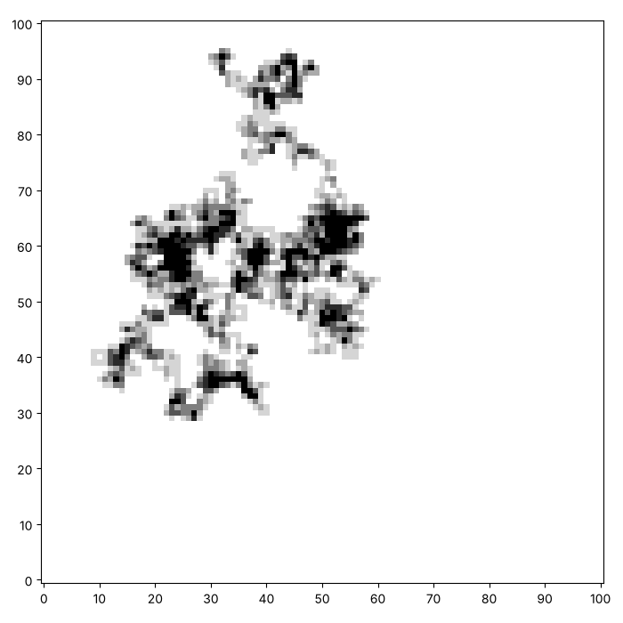
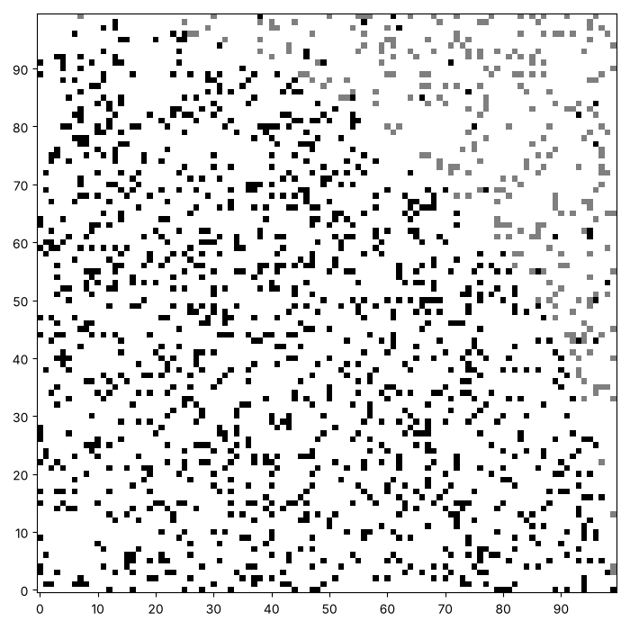

# Walks and darts: what chance can compute

Chance is useful for more than pictures. A walker that chooses its
direction at random wanders somewhere surprising, and a hail of random
darts can estimate a number we normally find by geometry. Here is a
walk. Yours will look different, and that is the point.



This page adds two functions, a random walk and an estimate of $\pi$.

## A random walk

Start in the middle of a canvas. At every step, choose one of four
directions at random: up, down, left or right. Step that way, and paint
where you land. Where do you end up after a thousand steps? How would
you stop the walker from leaving the canvas? Think of `min` and `max`.

```python exec
id: random-walk-1
toolkit: yes
expect: (lambda c: (random_walk(c, 50, 1), sum(map(sum, c)) == 50 and c[5][5] >= 1)[1])(make_canvas(11, 11))
import random
def random_walk(canvas, steps, seed):
    """Start in the middle of the canvas. For each step, paint where you are, then move one square up, down, left or right at random. Stay on the canvas."""
    # In words: start in the middle. For each step, paint where you are, choose one of four directions
    # at random, and move one square that way.
    # How do you keep the row and the column on the canvas? (Think of min and max.)
    ...
```

```python toolkit-reference
for: random-walk-1
import random
def random_walk(canvas, steps, seed):
    random.seed(seed)
    row = len(canvas) // 2
    column = len(canvas[0]) // 2
    for step in range(steps):
        paint_point(canvas, row, column)
        direction = random.randint(0, 3)
        if direction == 0:
            row = row + 1
        elif direction == 1:
            row = row - 1
        elif direction == 2:
            column = column + 1
        else:
            column = column - 1
        row = min(max(row, 0), len(canvas) - 1)             # stay on the canvas
        column = min(max(column, 0), len(canvas[0]) - 1)
```

```hint
after: 3 errors
After 50 steps the ink on the canvas should add up to 50, because every
step paints one square. Does yours? What happens to the row when the
walker is on the top row and moves up?
```

```solution
import random
def random_walk(canvas, steps, seed):
    random.seed(seed)
    row = len(canvas) // 2
    column = len(canvas[0]) // 2
    for step in range(steps):
        paint_point(canvas, row, column)
        direction = random.randint(0, 3)
        if direction == 0:
            row = row + 1
        elif direction == 1:
            row = row - 1
        elif direction == 2:
            column = column + 1
        else:
            column = column - 1
        row = min(max(row, 0), len(canvas) - 1)             # stay on the canvas
        column = min(max(column, 0), len(canvas[0]) - 1)
---
Here is one answer. Yours may be different and work too.
`random.randint(0, 3)` chooses a direction. `min(max(row, 0),
len(canvas) - 1)` pushes a row that left the canvas back to the nearest
edge.
```

Can you make a wandering path like this one? Try a few thousand steps.


```python exec
id: random-walk-2
# Your walk
```

```solution
import random

# From earlier on this page, repeated so that this answer runs on its own
def random_walk(canvas, steps, seed):
    random.seed(seed)
    row = len(canvas) // 2
    column = len(canvas[0]) // 2
    for step in range(steps):
        paint_point(canvas, row, column)
        direction = random.randint(0, 3)
        if direction == 0:
            row = row + 1
        elif direction == 1:
            row = row - 1
        elif direction == 2:
            column = column + 1
        else:
            column = column - 1
        row = min(max(row, 0), len(canvas) - 1)             # stay on the canvas
        column = min(max(column, 0), len(canvas[0]) - 1)

canvas = make_canvas(101, 101)
random_walk(canvas, 4000, 11)
show_picture(canvas, darkest=6)
---
Here is one answer. Yours may be different and work too. The canvas is
101 by 101, the walk has 4000 steps and `darkest` is 6.
```

How many different squares does a walk visit after 100, 1000 and 10 000
steps on a large canvas? Does ten times the steps give ten times the
squares?

```python exec
id: random-walk-3
for steps in [100, 1000, 10000]:
    canvas = make_canvas(301, 301)
    random_walk(canvas, steps, 1)
    visited = sum(1 for row in canvas for ink in row if ink > 0)
    print(steps, "steps visited", visited, "different squares")
```

```predict
type: choice

Will 10 000 steps visit about ten times as many squares as 1000 steps?

- Yes, about ten times as many
  - The walker often returns to squares it has already visited.
- Fewer than ten times as many
- About the same number
```

## Darts at a square

Draw a square of side 1 and a quarter of a circle of radius 1 inside it.
The square has an area of 1, and the quarter circle has an area of $\pi
/ 4$. Throw darts at random at the square. The fraction that land inside
the quarter circle should be about $\pi / 4$.

A dart at $(x, y)$ is inside when $x^2 + y^2 \le 1$. How would you write
a function that throws a number of darts and returns its estimate of
$\pi$?

```python exec
id: estimate-pi-1
toolkit: yes
expect: 3.0 < estimate_pi(10000, 1) < 3.3 and estimate_pi(100, 5) == estimate_pi(100, 5)
import random
def estimate_pi(darts, seed):
    """Throw darts at the unit square and return four times the fraction that land inside the quarter circle of radius 1."""
    # Returns: one number. What type is it?
    # In words: throw darts at the unit square, count those with x * x + y * y <= 1,
    # and return four times the fraction that landed inside.
    # Which random function gives a decimal from 0 to 1?
    ...
```

```python toolkit-reference
for: estimate-pi-1
import random
def estimate_pi(darts, seed):
    random.seed(seed)
    inside = 0
    for dart in range(darts):
        x = random.random()
        y = random.random()
        if x * x + y * y <= 1:                 # inside the quarter circle of radius 1
            inside = inside + 1
    return 4 * inside / darts                   # the quarter circle covers pi / 4 of the square
```

```hint
after: 3 errors
With 10 000 darts the answer should be near 3.14. If it is near 0.78,
what did you forget to multiply by?
```

```solution
import random
def estimate_pi(darts, seed):
    random.seed(seed)
    inside = 0
    for dart in range(darts):
        x = random.random()
        y = random.random()
        if x * x + y * y <= 1:                 # inside the quarter circle of radius 1
            inside = inside + 1
    return 4 * inside / darts                   # the quarter circle covers pi / 4 of the square
---
Here is one answer. Yours may be different and work too. The quarter
circle covers $\pi / 4$ of the square, so four times the fraction inside
is an estimate of $\pi$. A different seed gives a different estimate,
and none is exact.
```

Predict first: will 100 darts give a better answer than 10 000? Will the
answer ever be exactly $\pi$? Run the cell.

```python exec
id: estimate-pi-2
for darts in [100, 1000, 10000, 100000]:
    print(darts, estimate_pi(darts, 1))
```

```predict
type: number
tolerance: 0.05

What is the last number the cell prints, for 100 000 darts?
```

We can also see the darts. Can you throw darts at a square canvas and
let the ones inside the quarter circle come out darker, like this? The
picture should show the quarter circle.



```python exec
id: estimate-pi-3
# Your darts
```

```solution
import random

canvas = make_canvas(100, 100)
random.seed(3)
inside = 0
for dart in range(1500):
    x = random.randint(0, 99)
    y = random.randint(0, 99)
    paint_xy(canvas, x, y)
    if x * x + y * y <= 99 * 99:
        paint_xy(canvas, x, y)                  # a dart inside the circle gets a second layer
        inside = inside + 1
print(4 * inside / 1500)
show_picture(canvas, darkest=2)
---
Here is one answer. Yours may be different and work too. Every dart
paints its square, and a dart inside the circle of radius 99 paints it a
second time, so `darkest=2` shows the inside as black.
```

How different are the answers if you run `estimate_pi` with 1000 darts
and five different seeds? How many darts would you need to be sure of
the second decimal place?

```python exec
id: estimate-pi-4
for seed in range(5):
    print(seed, estimate_pi(1000, seed))        # the same number of darts, five different seeds
```

## Looking back

The error of a Monte Carlo estimate shrinks like $1 / \sqrt{n}$, so a
hundred times the darts gives only ten times the accuracy. What does
that cost, if you want ten times the accuracy?

A challenge: use darts to estimate the area of a shape that is hard to
measure, such as a disc with a square hole in it.

```python challenge
# A hard shape, and darts. Your toolkit has random, paint_xy and estimate_pi.
import random
```

## Where to read more

Wikipedia. *Monte Carlo method.*
<https://en.wikipedia.org/wiki/Monte_Carlo_method>. Where the idea of
answering a question by random sampling came from, and how widely it is
used.
